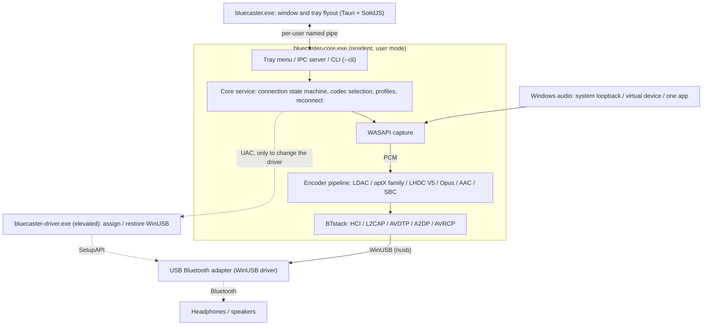
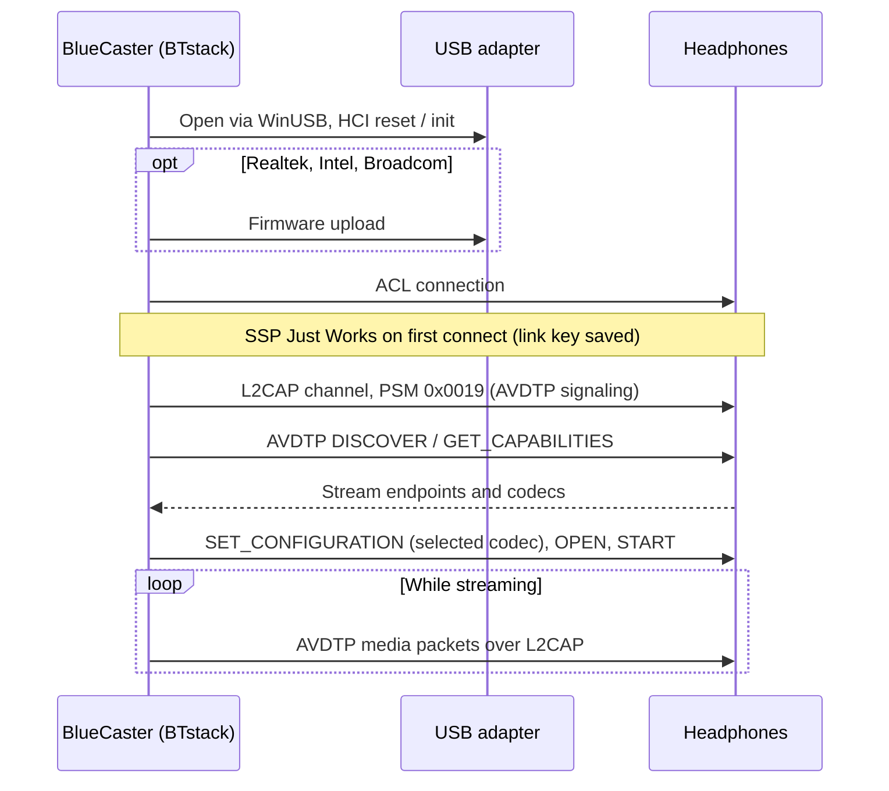
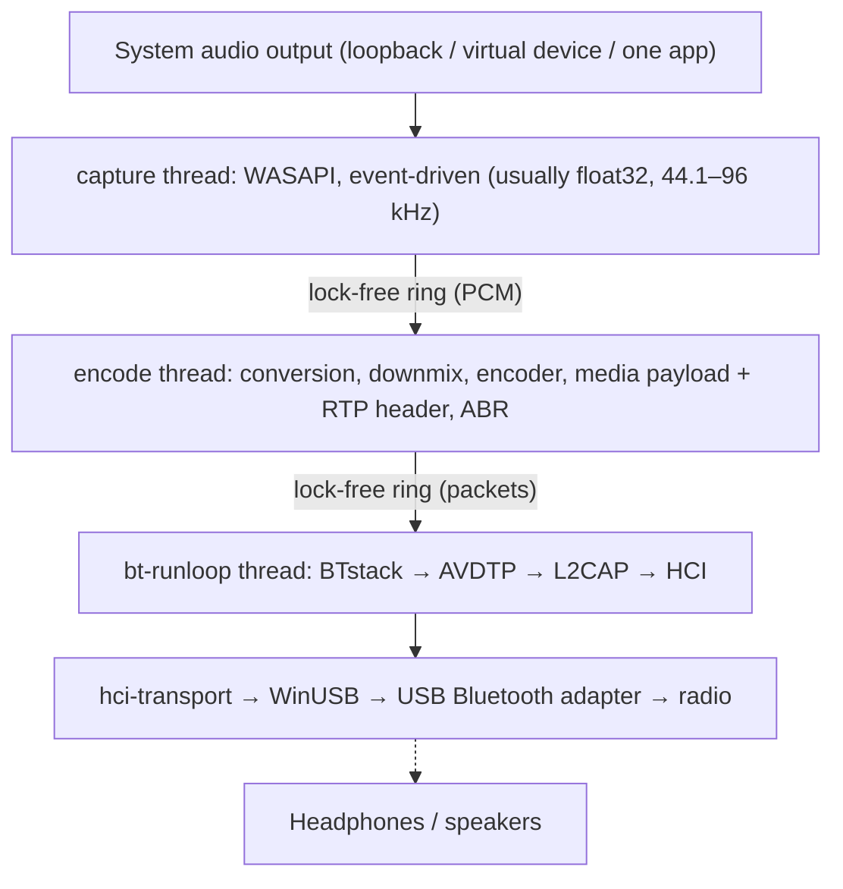
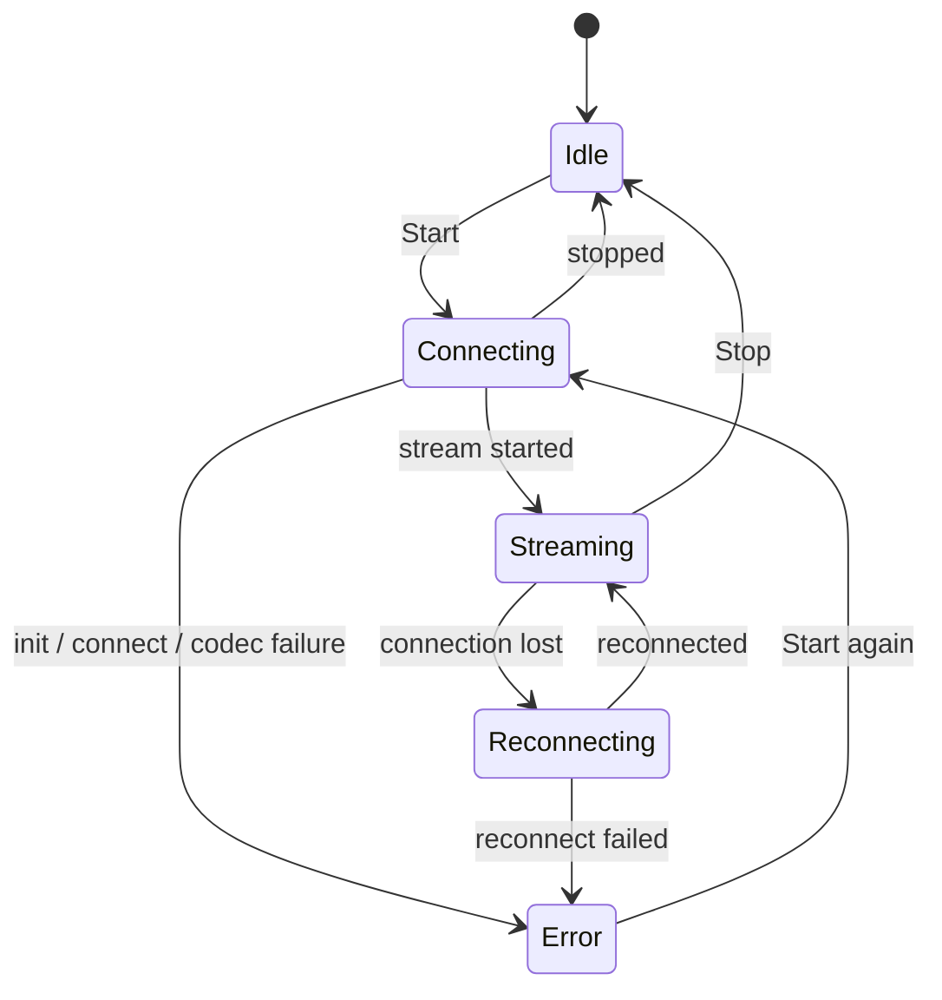

# Architecture
{: .no_toc }

## Table of contents
{: .no_toc .text-delta }

1. TOC
{:toc}

---

## Overview

BlueCaster enables LHDC V5, LDAC, aptX Adaptive, aptX HD,
aptX Low Latency, aptX, Opus, AAC, SBC XQ and SBC Bluetooth audio on Windows
(and LC3 over LE Audio, experimental). Windows' own Bluetooth stack supports
only SBC, classic aptX and (Windows 11 only) AAC for A2DP — this tool adds the
others without requiring a kernel driver.

Uses **BTstack + WinUSB** — entirely user-mode, no driver signing needed.

BlueCaster 2.0 is written in Rust. The C libraries that cannot be replaced
(BTstack and the codec encoders) are compiled from source and called through
small FFI crates; everything else, the SBC encoder included, is Rust.

## Processes

BlueCaster runs as up to three programs:

| Program | Runs | Does |
|:--------|:-----|:-----|
| `bluecaster-core.exe` | While BlueCaster is running (started by the window, the Start menu or **Start with Windows**) | Bluetooth, audio capture and encoding, profiles and settings, the tray icon and its menu, the IPC server. `--cli` runs the same core from a console instead |
| `bluecaster.exe` | Only while a window is open (exits 3 minutes after the last one was closed) | The main window and the tray flyout (Tauri 2, SolidJS + TypeScript). Holds no state of its own |
| `bluecaster-driver.exe` | For one driver change, with administrator rights (UAC) | Assigns WinUSB to an adapter or restores its previous driver, then exits |

- **The core is not a Windows service.** It is an ordinary process of the
  signed-in user, because WASAPI loopback captures that user's session audio.
  A per-session mutex keeps it to one instance; starting it again opens the
  window.
- **The tray belongs to the core.** Its right-click menu (open, the first 10
  devices, disconnect, exit) opens at once, without starting the window. A
  left click starts the window's flyout (or the main window, as Settings
  say).
- **The window only displays.** It receives a snapshot of the core's state
  and then the changes; closing it, or the window crashing, does not stop
  the audio. Closing a window only hides it, so reopening it from the tray
  is instant.
- **The command line uses the same core.** `bluecaster-core.exe --cli` runs the
  core service without tray and IPC; the emulator test runs this way.

## Transport: BTstack + WinUSB

Bypasses the Windows Bluetooth stack entirely by communicating directly with a
USB Bluetooth adapter via WinUSB (Microsoft-signed generic USB driver). BTstack,
a source-available Bluetooth stack (non-commercial license), implements HCI, L2CAP, AVDTP, and A2DP in
user-mode.

**Advantages**:
- No driver signing cost
- No test signing mode required
- No Secure Boot disabling
- All code runs in user-mode (easier debugging)

**Trade-offs**:
- Requires a dedicated USB Bluetooth adapter (separate from Windows's built-in
  Bluetooth)
- While claimed by WinUSB, the adapter is unavailable for normal Windows
  Bluetooth
- Device address is entered manually or found by a scan (GAP inquiry) with
  the USB adapter

**How it works**:
1. WinUSB is assigned to a USB Bluetooth adapter, in the app (**Adapter >
   Replace with WinUSB driver**, see [Driver Assignment](#driver-assignment)) or with Zadig
2. The `hci-transport` crate opens the adapter through WinUSB with `nusb`
   and connects it to BTstack as its HCI transport
3. BTstack sends HCI commands to initialize the Bluetooth controller
4. (Realtek, Intel and Broadcom adapters) Firmware is uploaded if needed
5. BTstack establishes an ACL connection and opens L2CAP channels (PSM 0x0019)
6. AVDTP signaling discovers remote SEPs and negotiates codecs
7. Encoded audio is sent as AVDTP media packets over L2CAP

The USB transport keeps the recovery steps that real adapters needed in
v1: the event and ACL pipes are reset when the adapter is opened, a failed
event read is retried, HCI commands time out, and closing the adapter sends
HCI Reset, so the next session finds an idle controller.

## Crate Structure

One Cargo workspace (`Cargo.toml` at the repository root) in five layers;
each layer depends only on the layers below it. Libraries are in
`app/src/crates/`, the programs in `app/src/core`, `app/src/ui` and
`app/src/driver`. Only the `*-sys` crates and `win-sys` may contain `unsafe`
code; all other crates have `#![forbid(unsafe_code)]`.

| Layer | Crate | Does |
|:------|:------|:-----|
| 1. FFI | `btstack-sys` | Builds BTstack with `cc` (MSVC), hand-written FFI declarations and safe wrappers, `btstack_config.h`. BTstack may only be called on its run loop thread: the `!Send` `Stack` token enforces it |
| 1. FFI | `ldac-sys`, `openaptx-sys`, `fdkaac-sys`, `lhdcv5-sys`, `opus-sys`, `lc3-sys` | Build the C encoders and expose them; one crate per library, so each license stays separate |
| 1. FFI | `win-sys` | Win32 APIs without a Rust library: MMCSS, the default audio device (IPolicyConfig), the WLAN API (AFH), power notifications, the Run key, media keys, the pipe's DACL, elevation, and the WinUSB driver assignment (SetupAPI) |
| 2. Parts | `hci-transport` | HCI over USB ("H2") with `nusb`, and H4 over TCP to a virtual controller (`tools/emu`) |
| 2. Parts | `aptx-adaptive` | The aptX Adaptive encoder in Rust (vendored from AKS-Logic/aptx-adaptive-linux, MIT) |
| 2. Parts | `codec` | The `Encoder` trait, the SBC encoder (Rust port of Bluedroid's), safe wrappers of the C encoders, Codec Information parsing and the codec choice |
| 2. Parts | `audio-capture` | WASAPI capture (`wasapi` crate): system loopback, virtual device, one application (process loopback); device and app lists, test tone |
| 3. Engine | `bt-host` | Runs BTstack on its own thread, driven by commands and typed events: GAP, A2DP Source, AVRCP, SDP, RFCOMM channels for the passthrough (`rfcomm.*`), link keys, AFH, firmware loading, HCI capture (`.pklg`), LE Audio (`le/`) |
| 2. Parts | `le-audio` | LE Audio (experimental): the logic without BTstack or Windows (assigned numbers, LTV, PACS / ASCS PDUs, presets, the CSIP / VCP / MCP / CCP models) |
| 3. Engine | `pipeline` | PCM rings, format conversion, downmix, encoding, media payloads, pacing, ABR |
| 4. Core | `bluecaster-core` (directory `core`) | The state machine, reconnects, sleep / resume, profiles, settings and the v1 migration, volume sync, update check, the receiver test client, statistics |
| 4. Core | `ipc` | The protocol types shared by core and window (serde; TypeScript types generated with `ts-rs`) and the pipe framing |
| 5. Programs | `bluecaster-core-exe` (`app/src/core`) | `bluecaster-core.exe`: core, tray (`tray-icon` on a `tao` event loop), IPC server, `--cli` |
| 5. Programs | `bluecaster-ui` (`app/src/ui`) | `bluecaster.exe`: Tauri 2; the Rust side is an IPC client, the page is SolidJS + TypeScript + Vite |
| 5. Programs | `bluecaster-driver` (`app/src/driver`) | `bluecaster-driver.exe`: the elevated helper |

## Audio Path and Threads

| Thread | Priority | Work |
|:-------|:---------|:-----|
| capture | MMCSS "Audio" | Reads WASAPI; fills silent stretches with silence |
| encode | MMCSS "Pro Audio" | Converts to what the encoder takes, encodes whole encoder blocks (the rest waits for the next round), packs frames into media payloads, in rounds of about 10 ms so packets go out evenly |
| bt-runloop | -- | BTstack's run loop; sends a queued packet whenever L2CAP can send |
| USB | -- | WinUSB transfers: three reads in flight on each IN pipe (events, ACL data), a writer for commands and ACL data |
| core | Normal | State machine, IPC (tokio; the RFCOMM passthrough's queues per connection), settings, statistics (4 Hz), update check |

Once a stream runs, the audio path allocates no memory and takes no lock.
Statistics are atomic counters that the core reads four times a second.
BTstack is not thread-safe: other threads send it commands, which run on
the bt-runloop thread.

## Core and IPC

The window talks to the core over the user's named pipe
`\\.\pipe\bluecaster-<user SID>`, whose DACL admits only that user. Messages are
length-prefixed JSON frames:

1. The window sends `hello { protocol, client }`. A core with another
   protocol version answers `reject`, and the window says that the two
   programs are from different versions. Otherwise the core answers
   `welcome { protocol, server, features }`; `features` names additions to
   the protocol (`rfcomm`).
2. The core sends a `snapshot`: its whole state (adapter, devices,
   stream, profiles, settings, update) and a revision number.
3. From then on the core sends `event`s with the changes. A missed revision
   makes the window fetch a new snapshot.
4. Actions are `request { id, method, params }` with a `response { id,
   result | error }`. The method groups are `state.*`, `stream.*`,
   `device.*`, `profile.*`, `settings.*`, `adapter.*`, `audio.*`, `diag.*`,
   `receiver.*`, `rfcomm.*` and `app.*`.

Other programs use the same pipe; what they need is on
[Integration (IPC)](integration). Versions before 3.0.0 named the pipe
`\\.\pipe\a2dpwb-<user SID>`; the core serves that name too, for at least 6
months after 3.0.0.

Errors are codes with parameters (for example `adapter.driver_missing`), not
texts; the window translates them and offers the fix next to the message.
High-rate data (link quality, the log) is only sent while a screen
subscribes to it.

The connection state machine:

A failed connection is tried up to 3 times, a lost one is reconnected up to
10 times. When the PC goes to sleep, the core stops BTstack without counting
the lost link as a failure and reconnects after the PC resumes.

## Driver Assignment {#driver-assignment}

Windows 8 and later include the Microsoft-signed WinUSB driver
(`winusb.inf`). `bluecaster-driver.exe` does what Device Manager's "Update
driver > Let me pick > WinUsb Device" does, through SetupAPI:

1. Open the adapter by its device instance ID.
2. Write a `DeviceInterfaceGUIDs` value to its `Device Parameters`, so that
   WinUSB registers a device interface for it.
3. Select the "WinUsb Device" model of `%SystemRoot%\INF\winusb.inf` and
   install it with `DiInstallDevice`. The inbox driver is signed, so no
   certificate is installed (unlike Zadig / libwdi, which sign a generated
   INF with a self-made certificate).
4. **Restore**: remove the device (`DiUninstallDevice`) and re-enumerate it;
   Windows then picks its best-ranked driver again (normally `BthUSB` or the
   vendor's driver). The driver the adapter had before is recorded in the
   settings folder (`driver\`) and compared after the restore.
   `restore --records <folder>` restores every recorded adapter in one
   elevated run; the uninstaller uses it after asking.

The core never runs as administrator: for an assignment or a restore it starts
the helper with a UAC prompt (`ShellExecuteEx` "runas") and reads its JSON
result. Listing adapters and their driver needs no elevation.

## Key Modules

### Codec choice (`codec::caps`)

- Parses the remote's capabilities: the standard SBC and AAC elements and the
  vendor codecs, including aptX LL under both vendor IDs and aptX Adaptive
  (R1 and R2 sinks; usable only with 48 kHz stereo)
- Picks the codec: Auto takes the codec with the highest sound quality the
  remote offers; a requested codec the remote does not offer is replaced by
  the same codec Auto would take (always for a profile, since issue #86; the
  command line only with `--fallback`), and is an error otherwise
- Leaves the experimental codecs (aptX HD, aptX LL, Opus, Opus 05,
  FastStream) out of Auto and the fallback with the command line's
  `--no-experimental`; the app always uses them (the `experimental_codecs`
  setting, from 2.0.2-beta.7's Codecs page, is read as on since issue #86)
- Streams every A2DP profile as Auto, with Auto's default settings, while
  the `auto_codec` setting is on (Codecs > Auto-select the codec with the
  highest quality, one setting for every device since schema 5); the codec
  chosen for the device stays in its profile for when it is off
- Follows the device's codec order as the user dragged its cards with
  Auto-select off (the profile's `codec_order`; `codec::AutoOrder`, empty
  for highest sound quality first), for Auto's pick and for the fallback of
  a chosen codec; under Auto-select, the default order. FastStream and Opus
  05 are never Auto's pick nor a fallback. (2.0.2's betas had one order for
  every device, settings.json's `auto_order`, now ignored.)
- Picks the aptX-family sample rate (44.1 / 48 kHz from the rates the remote
  advertises; WASAPI resamples the capture); aptX Adaptive uses 48 kHz, or
  96 kHz when 96 kHz is chosen, the quality is High and the sink is R2 and
  lists 96 kHz. A rate on Auto (Auto-select too) asks for 48 kHz, each
  codec's picker taking the best the sink lists without it (issue #86: not
  the highest rate it lists nor the Windows mix rate)
- Maps the profile's quality to the ones the codec offers
  (`Quality::for_codec`, issue #86): LDAC and LHDC V5 High / Medium
  (`sq`) / Low (`mq`), LHDC V5 also Medium-High (`mhq`), aptX Adaptive
  High / Low Latency, every other codec High (its highest bit rate the device
  takes); a quality the codec no longer has (aptX Adaptive's Standard /
  Mobile, AAC's lower levels) runs as High
- Records what each codec the device offered lists (`KnownCodecs.caps`:
  sample rates, bit depths, maximum bit rate; `RemoteCaps::listed_*`), so the
  codec settings offer only those; SBC's bitpool range was already recorded

### Bluetooth host (`bt-host`)

**Responsibilities**:
- Run BTstack with the USB (or TCP) HCI transport on its own thread
- Register stream endpoints: vendor codecs (LDAC, aptX HD, aptX, aptX LL,
  LHDC V5, FastStream, Opus, Opus 05, aptX Adaptive) plus SBC (also used by
  SBC XQ) and AAC: 11 in all (BTstack's `MAX_NR_AVDTP_STREAM_ENDPOINTS`)
- Register SDP records (A2DP Source, AVRCP Controller, AVRCP Target)
- Manage SSP pairing (Just Works, General Bonding; link keys persisted)
- Tear down a half-open connection after a connect timeout so retries work
- Retry a failed connection (up to 3 attempts) and tell the causes apart (no
  answer, silent link, remote ended the link, authentication); drop a link key
  the device no longer knows and pair again
- GAP inquiry for the device scan
- AVRCP absolute volume and the headphones' buttons
- AFH host channel classification and RSSI / AFH readings for the link quality
  view
- Firmware loading for Realtek, Intel and Broadcom chipsets
- HCI capture (`.pklg`), including the connection setup when it starts mid-connection

**Key BTstack APIs used**:
- `a2dp_source_create_stream_endpoint()` — Register codec endpoints
- `a2dp_source_establish_stream()` — Connect to A2DP sink
- `a2dp_source_set_config_other()` — Configure vendor-specific codec
- `a2dp_source_stream_send_media_payload_rtp()` — Send encoded audio with an
  RTP header (LDAC, aptX HD, AAC, SBC, SBC XQ, LHDC V5, Opus)
- `a2dp_source_stream_send_media_packet()` — Send raw media packets without
  an RTP header (aptX, aptX LL, FastStream), or with BlueCaster's own RTP header
  (aptX Adaptive)

### Audio capture (`audio-capture`)

Captures audio in real time using the Windows Audio Session API.
- System loopback of the default output device, loopback of a chosen
  (virtual) device, or process loopback of one application and its child
  processes (Windows 10 build 19041 or later)
- Delivers the device's shared-mode mix format (usually float32; the
  pipeline converts it for the encoder)
- In Application mode, waits for the application and picks it up again when
  it is restarted

### Audio Encoders

| Encoder | Library | Bitrate | Features |
|---------|---------|---------|----------|
| LHDC V5 | lhdcv5-enc (C port of the AOSP encoder) | 400/500/900/1000 kbps (Low/Medium/Medium-High/High), at most the sink's listed maximum, ABR 160–400 kbps | 16/24-bit, 5 ms frames, 2-byte media payload header, RTP header |
| LDAC | libldac (AOSP) | 330/660/990 kbps | High/Medium/Low (HQ/SQ/MQ) modes, ABR |
| aptX Adaptive | aptx-adaptive (pure-Rust encoder of AKS-Logic/aptx-adaptive-linux, MIT) | 427 kbps High, 265 kbps Low Latency (R2 sinks: 270); ABR steps down to 364/318 (R2: 270/204) | 48 kHz stereo (96 kHz in High when chosen, to an R2 sink that lists it: 646/340/255 kbps), 24-bit; one codec packet per media packet behind BlueCaster's own RTP header; ABR in High; Auto takes it after LHDC V5 and LDAC |
| Opus | libopus 1.5.2 | 256 kbps (stereo; mono half) | Experimental; Android's A2DP Opus: 48 kHz, 20 ms frames (10 ms if the sink has only that), constrained VBR capped to the media payload, one frame per packet, 1-byte media payload header, RTP header |
| aptX HD | libopenaptx | 576 kbps | 24-bit input, fixed rate, RTP header |
| aptX | libopenaptx | 352/384 kbps (44.1/48 kHz) | 16-bit stereo, no RTP header |
| aptX LL | libopenaptx | 352 kbps | ~32 ms latency, no RTP header, packets ≤ ~7.5 ms |
| AAC | fdk-aac | up to 256 kbps (at most the sink's listed bit rate) | AAC-LC, LATM transport |
| SBC XQ | the same SBC encoder | ~385/505/552 kbps | Dual channel, bitpool 47 / 43 at 44.1 / 48 kHz (High); only when the sink's SBC allows dual channel and a bitpool of at least 29 (the bitpool is then capped at the sink's maximum, as PipeWire); shares SBC's stream endpoint, media payload header and RTP header |
| SBC | Rust port of the Bluedroid encoder | up to ~345 kbps | Mandatory A2DP baseline; bit-exact with the C encoder (tested over all configurations) |
| FastStream | the same SBC encoder | 198/216 kbps (44.1/48 kHz) | CSR vendor codec, music direction only (no voice backchannel): SBC joint stereo bitpool 29, frames padded to 72 bytes, 3 per packet, no media payload header and no RTP header (as PipeWire); never chosen by Auto |

All encoders implement the `codec::Encoder` trait: they state the PCM
format and the number of frames one call consumes, and return codec frames.

libopenaptx expects groups of 4 stereo samples as packed 24-bit little-endian
PCM; the aptX wrappers convert the 16-bit or 32-bit samples into that format,
and mono input is duplicated to both channels.

## Vendor Codec Information Elements

Non-standard codecs are registered as Vendor Specific in AVDTP:

| Codec | Vendor ID | Codec ID |
|-------|-----------|----------|
| LHDC V5 | Savitech (0x0000053A) | 0x4C35 |
| LDAC | Sony (0x0000012D) | 0x00AA |
| aptX Adaptive | Qualcomm (0x000000D7) | 0x00AD |
| Opus | Google (0x000000E0) | 0x0001 |
| aptX HD | Qualcomm (0x000000D7) | 0x0024 |
| aptX | APT (0x0000004F) | 0x0001 |
| aptX Low Latency | CSR (0x0000000A) or Qualcomm (0x000000D7) | 0x0002 |
| FastStream | CSR (0x0000000A) | 0x0001 |
| Opus 05 | The Linux Foundation (0x000005F1, PipeWire) | 0x1005 |

AAC and SBC use standard A2DP codec IDs defined in the A2DP specification.

Codec information element sizes (including the 6-byte vendor/codec ID):

- **aptX**: 7 bytes (byte 6 = sample rate / channel mode)
- **aptX HD**: 11 bytes (byte 6 as aptX, plus 4 reserved bytes); stereo is
  required
- **aptX LL**: 8 bytes, or 17 bytes when the sink sets the extended
  ("new caps") flag. BlueCaster registers one aptX LL endpoint and configures the
  stream with the vendor ID the sink used
- **LHDC V5**: 11 bytes (Android `a2dp_vendor_lhdcv5_constants.h`): byte 6
  sample rates (0x20 44.1k, 0x10 48k, 0x04 96k, 0x01 192k), byte 7 bit depth
  (0x04 16-bit, 0x02 24-bit) and the sink's min/max bit rate limits, byte 8
  codec sub-version (0x01 = V5 ver.1) and 0x10 = 5 ms frames, bytes 9-10
  optional features (low latency, lossless, JAS, AR, META), none of which
  BlueCaster offers. Stereo only. The sink's bit rate limits are echoed back in the
  configuration and applied to the encoder, as Android does. Media packets
  carry a 2-byte payload header: frame count << 2 (latency bits 0) and a
  sequence number
- **FastStream**: 8 bytes (PipeWire `a2dp_faststream_t`): byte 6 direction
  (0x01 sink = music, 0x02 source = voice), byte 7 low nibble the sink rates
  (0x2 44.1k, 0x1 48k), high nibble the source rate (0x2 16k). BlueCaster offers
  and configures the music direction only
- **Opus**: 7 bytes (Android `a2dp_vendor_opus_constants.h`): byte 6 bits
  2..0 channel mode (0x01 mono, 0x02 stereo, 0x04 dual mono), bits 4..3
  frame duration (0x08 10 ms, 0x10 20 ms), bit 7 48 kHz. BlueCaster offers mono
  and stereo, 10 and 20 ms, and configures 20 ms stereo (mono only for mono
  input to a sink that has it). Media packets carry one Opus packet behind
  a 1-byte payload header (frame count 1 in the low 4 bits)
- **aptX Adaptive**: 40 bytes. BTstack's capability event cuts the sink's
  codec information to 30 bytes, which still hold everything BlueCaster uses.
  SET_CONFIGURATION: 48 kHz with source type 2 (host encoder: the sink times
  playback itself), stereo; an R1 sink gets its own target-latency bytes
  back with LL0 raised to at least 80 ms and a zero HQ latency replaced by
  200 ms; an R2 sink gets the source's own R2 block

**RTP vs no RTP**: LDAC, aptX HD, AAC, SBC, SBC XQ, LHDC V5 and Opus media packets carry the
12-byte RTP header. aptX, aptX LL and FastStream are sent **without** an RTP header (as Android and
PipeWire do), so the whole L2CAP MTU is available for aptX frames.

**aptX Adaptive** sends one codec packet per media packet
behind BlueCaster's own 12-byte RTP header (BTstack adds none): payload type 96,
sequence number +1 per packet, timestamp = the samples per channel in the
packet (not a clock), SSRC = the sink's latency mode (0x000000A3 HQ,
0x000000A1 LL). The payload is byte-swapped in 16-bit words. HQ packets are
656 bytes (12 ms), LL packets 348 bytes (10 ms). Auto selects it over
classic aptX, Opus and AAC (issue #86's order), below LHDC V5 and LDAC.

## Settings and Files

Everything is kept in the settings folder, `%APPDATA%\BlueCaster` (or the
folder named by the `BLUECASTER_CONFIG_DIR` environment variable), in the same
formats as v1 and 2.0.x (which used `%APPDATA%\A2DPWB`; 3.0.0 renames that
folder at its first start and sorts the files into the folders below):

| Path | Contents |
|:-----|:---------|
| `settings.json` | App settings, with a `schema_version`; unknown keys are kept |
| `profiles.json` | Profiles |
| `devices\devices.txt` | Known devices |
| `devices\le_audio_devices.txt` | LE Audio (experimental): the LE Audio entries of the device list |
| `devices\device_codecs.json` | The codecs each device reported |
| `pairing\link_keys.txt` | Link keys: headphones paired with v1 or 2.0.x reconnect without pairing again |
| `pairing\le_audio_bonds.tlv`, `pairing\le_audio_csip.txt` | LE Audio (experimental): LE bonds (with the GATT server's persistent CCC values) and coordinated sets |
| `adapters\adapter_caps.json` | What each adapter reported |
| `adapters\driver\<instance id>.json` | The previous driver of each adapter WinUSB was assigned to |
| `firmware\` | Firmware files (`*.bin`, `*.hcd`, `ibt-*`) |
| `logs\<YYYY-MM-DD>\core.log`, `ui.log`, `driver.log` | The logs of the core, the window and the driver helper, one folder per day (UTC); not masked |
| `logs\hci\*.pklg` | HCI captures: the flight recorder's, written when a stream fails or a connection is lost (the newest 10), and the ones you start yourself (`hci_<date>_<time>.pklg`) |
| `logs\crash\` | Crash reports: a minidump (`*.dmp`) and a text file per crash (the newest 5 per program) |
| `logs\bundles\*.zip` | Diagnostic bundles (the newest 3) |
| `backup\v1\` | A copy of the v1 settings, made once at the first v2 start |
| `backup\v2\` | A copy of the 2.0.x settings and pairings, made once at the first 3.0.0 start |
| `backup\profiles-before-codecs.json` | `profiles.json` as it was before the Codecs screen folded several profiles of a device into one (written once) |

The program folder is `%LOCALAPPDATA%\BlueCaster\`: the three programs, the
uninstaller and `licenses\` (`licenses\README.txt`, `licenses\bluecaster\LICENSE...`,
`licenses\third-party\...`). The firmware download cache is `%TEMP%\bluecaster-cache`.

## Build System

- **Cargo** builds the programs; they need no CMake. Each `-sys` crate
  compiles its C library from the git submodule in `extern/` with MSVC in
  `build.rs`. Only the developer tool `tools/a2dp_decode` is built with CMake
- The window's page is built with **Vite** (`pnpm build` in `app/src/ui`) and
  embedded into `bluecaster.exe` by Tauri
- The TypeScript types of the IPC protocol are generated from the Rust types
  (`cargo test -p ipc export_bindings`)
- Language files (`app/lang/*.json`) are used by the window and by the core's
  tray menu
- `installer/build-release.ps1` makes the installer (Inno Setup, `installer/BlueCaster.iss`),
  the portable zip and the updater manifest. See [Building](building)

## Important Considerations

- **Adapter compatibility**: Realtek (best tested) and CSR USB adapters; Intel and
  Broadcom are experimental. Realtek adapters require firmware upload at startup,
  Intel adapters in bootloader mode too
- **Pairing**: Uses SSP Just Works with General Bonding. Link keys are persisted
  to a local file
- **Second adapter recommended**: Keep built-in Bluetooth for Windows, use
  dedicated USB adapter for BlueCaster
- Some Bluetooth adapters' firmware limits achievable bitrate
- USB Bluetooth 5.0+ adapters generally work well for LDAC
- Auto codec selection priority (by sound quality, issue #86): LHDC V5 > LDAC > aptX Adaptive > Opus > aptX HD > aptX > aptX LL > AAC > SBC XQ > SBC (FastStream and Opus 05 only when chosen); a chosen codec the device does not offer falls back to the first one in the device's order it offers
