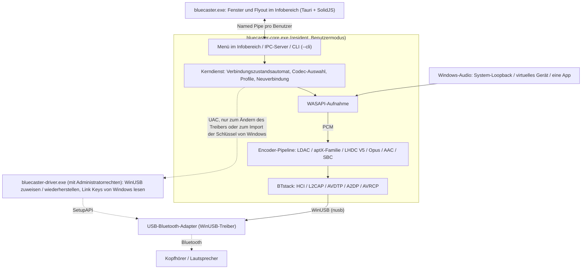
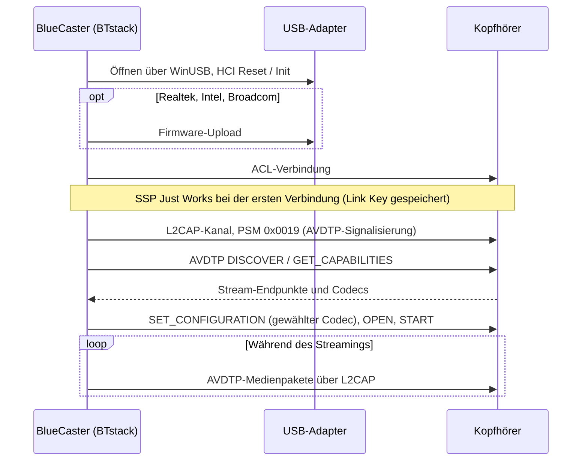
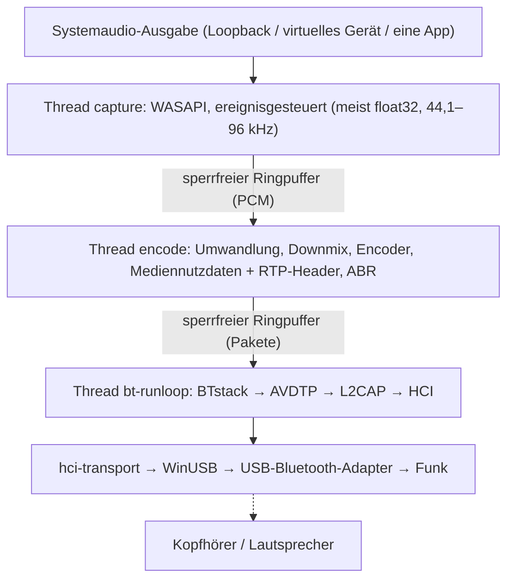
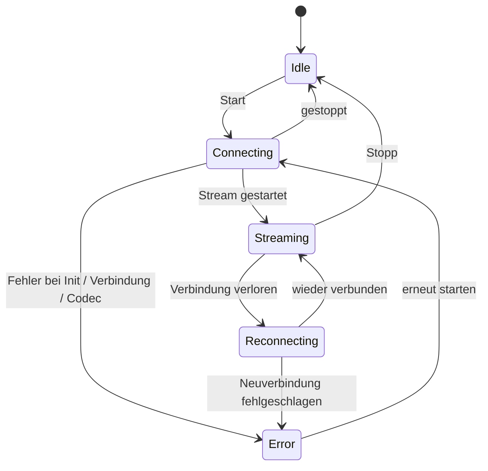

# Architektur
{: .no_toc }

## Inhalt
{: .no_toc .text-delta }

1. TOC
{:toc}

---

## Überblick

BlueCaster ermöglicht Bluetooth-Audio mit LHDC V5, LDAC, aptX Adaptive, aptX HD,
aptX Low Latency, aptX, Opus, AAC, SBC XQ und SBC unter Windows
(und LC3 über LE Audio, experimentell). Der eigene Bluetooth-Stack von Windows unterstützt für A2DP
nur SBC, klassisches aptX und (nur unter Windows 11) AAC — dieses Werkzeug ergänzt die
übrigen, ohne einen Kerneltreiber zu benötigen.

Verwendet **BTstack + WinUSB** — vollständig im Benutzermodus, keine Treibersignatur nötig.

BlueCaster 2.0 ist in Rust geschrieben. Die C-Bibliotheken, die sich nicht ersetzen lassen
(BTstack und die Codec-Encoder), werden aus dem Quellcode kompiliert und über
kleine FFI-Crates aufgerufen; alles andere, einschließlich des SBC-Encoders, ist Rust.

## Prozesse

BlueCaster läuft als bis zu drei Programme:

| Programm | Läuft | Aufgabe |
|:---------|:------|:--------|
| `bluecaster-core.exe` | Solange BlueCaster läuft (gestartet vom Fenster, vom Startmenü oder über **Mit Windows starten**) | Bluetooth, Audioaufnahme und Kodierung, Profile und Einstellungen, das Symbol im Infobereich und sein Menü, der IPC-Server. `--cli` führt denselben Kern stattdessen in einer Konsole aus |
| `bluecaster.exe` | Nur solange ein Fenster offen ist (beendet sich 3 Minuten, nachdem das letzte geschlossen wurde) | Das Hauptfenster und das Flyout im Infobereich (Tauri 2, SolidJS + TypeScript). Hält keinen eigenen Zustand |
| `bluecaster-driver.exe` | Für eine einzelne Treiberänderung oder einen Schlüsselimport, mit Administratorrechten (UAC) | Weist einem Adapter WinUSB zu oder stellt seinen vorherigen Treiber wieder her, oder liest die Link Keys, die das Bluetooth von Windows für einen Adapter aufbewahrt (`windows-keys`), und beendet sich dann |

- **Der Kern ist kein Windows-Dienst.** Er ist ein gewöhnlicher Prozess des
  angemeldeten Benutzers, weil der WASAPI-Loopback das Audio der Sitzung dieses Benutzers aufnimmt.
  Ein Mutex pro Sitzung beschränkt ihn auf eine Instanz; ein erneuter Start öffnet das
  Fenster.
- **Der Infobereich gehört zum Kern.** Sein Rechtsklickmenü (Öffnen, die ersten 10
  Geräte, Trennen, Beenden) öffnet sich sofort, ohne das Fenster zu starten. Ein
  Linksklick startet das Flyout des Fensters (oder das Hauptfenster, je nach
  Einstellungen).
- **Das Fenster zeigt nur an.** Es erhält eine Momentaufnahme des Kernzustands
  und danach die Änderungen; das Schließen oder ein Absturz des Fensters stoppt
  das Audio nicht. Das Schließen eines Fensters blendet es nur aus, daher öffnet es sich
  über den Infobereich sofort wieder.
- **Die Kommandozeile verwendet denselben Kern.** `bluecaster-core.exe --cli` führt den
  Kerndienst ohne Infobereich und IPC aus; der Emulatortest läuft auf diese Weise.

## Transport: BTstack + WinUSB

Umgeht den Bluetooth-Stack von Windows vollständig, indem direkt über WinUSB (der von Microsoft
signierte generische USB-Treiber) mit einem USB-Bluetooth-Adapter kommuniziert wird. BTstack,
ein Bluetooth-Stack mit verfügbarem Quellcode (nicht kommerzielle Lizenz), implementiert HCI, L2CAP, AVDTP und A2DP im
Benutzermodus.

**Vorteile**:
- Keine Kosten für eine Treibersignatur
- Kein Testsignaturmodus erforderlich
- Secure Boot muss nicht deaktiviert werden
- Der gesamte Code läuft im Benutzermodus (einfacheres Debugging)

**Nachteile**:
- Erfordert einen eigenen USB-Bluetooth-Adapter (getrennt vom integrierten
  Bluetooth von Windows)
- Solange WinUSB den Adapter belegt, steht er für das normale Windows-Bluetooth
  nicht zur Verfügung
- Die Geräteadresse wird manuell eingegeben oder per Suche (GAP Inquiry) mit
  dem USB-Adapter gefunden

**Funktionsweise**:
1. Einem USB-Bluetooth-Adapter wird WinUSB zugewiesen, in der App (**Adapter >
   Durch WinUSB-Treiber ersetzen**, siehe [Treiberzuweisung](#driver-assignment)) oder mit Zadig
2. Das Crate `hci-transport` öffnet den Adapter über WinUSB mit `nusb`
   und verbindet ihn als HCI-Transport mit BTstack
3. BTstack sendet HCI-Befehle, um den Bluetooth-Controller zu initialisieren
4. (Realtek-, Intel- und Broadcom-Adapter) Bei Bedarf wird Firmware hochgeladen
5. BTstack baut eine ACL-Verbindung auf und öffnet L2CAP-Kanäle (PSM 0x0019)
6. Die AVDTP-Signalisierung ermittelt die SEPs der Gegenseite und handelt die Codecs aus
7. Das kodierte Audio wird als AVDTP-Medienpakete über L2CAP gesendet

Der USB-Transport behält die Wiederherstellungsschritte bei, die echte Adapter in
v1 benötigten: Die Event- und ACL-Pipes werden beim Öffnen des Adapters zurückgesetzt, ein fehlgeschlagener
Event-Lesevorgang wird wiederholt, HCI-Befehle haben eine Zeitüberschreitung, und beim Schließen des Adapters wird
HCI Reset gesendet (nicht an einen Controller, der noch in seinem Bootloader ist), sodass die nächste
Sitzung einen untätigen Controller vorfindet.

## Crate-Struktur

Ein Cargo-Workspace (`Cargo.toml` im Wurzelverzeichnis des Repositorys) in fünf Schichten;
jede Schicht hängt nur von den Schichten unter ihr ab. Die Bibliotheken liegen in
`app/src/crates/`, die Programme in `app/src/core`, `app/src/ui` und
`app/src/driver`; das übernommene `aptx-adaptive` ist eine Pfadabhängigkeit von
`codec` und gehört nicht zum Workspace. Nur die `*-sys`-Crates und `win-sys` dürfen `unsafe`-Code
enthalten; alle anderen Crates haben `#![forbid(unsafe_code)]`.

| Schicht | Crate | Aufgabe |
|:--------|:------|:--------|
| 1. FFI | `btstack-sys` | Baut BTstack mit `cc` (MSVC), handgeschriebene FFI-Deklarationen und sichere Wrapper, `btstack_config.h`. BTstack darf nur auf dem Thread seiner Run Loop aufgerufen werden: Das `!Send`-Token `Stack` erzwingt dies |
| 1. FFI | `ldac-sys`, `openaptx-sys`, `fdkaac-sys`, `lhdcv5-sys`, `opus-sys`, `lc3-sys` | Bauen die C-Encoder und stellen sie bereit; ein Crate pro Bibliothek, damit jede Lizenz getrennt bleibt |
| 1. FFI | `win-sys` | Win32-APIs ohne Rust-Bibliothek: MMCSS, das Standard-Audiogerät (IPolicyConfig), die WLAN-API (AFH), Energiebenachrichtigungen, der Run-Schlüssel, Medientasten, die DACL der Pipe, Rechteerhöhung, die WinUSB-Treiberzuweisung (SetupAPI) und das eigene Bluetooth von Windows (seine Funkmodule, gekoppelten Geräte und Link Keys) |
| 2. Bausteine | `hci-transport` | HCI über USB („H2“) mit `nusb` und H4 über TCP zu einem virtuellen Controller (`tools/emu`) |
| 2. Bausteine | `aptx-adaptive` | Der aptX-Adaptive-Encoder in Rust (übernommen aus AKS-Logic/aptx-adaptive-linux, MIT) |
| 2. Bausteine | `codec` | Der Trait `Encoder`, der SBC-Encoder (Rust-Portierung des Encoders aus Bluedroid), sichere Wrapper der C-Encoder, Auswertung der Codec Information und die Codec-Wahl |
| 2. Bausteine | `audio-capture` | WASAPI-Aufnahme (Crate `wasapi`): System-Loopback, virtuelles Gerät, eine Anwendung (Prozess-Loopback); Geräte- und App-Listen, Testton, Lautstärke pro App (Lautstärkemixer) |
| 3. Engine | `bt-host` | Führt BTstack auf einem eigenen Thread aus, gesteuert durch Befehle und typisierte Ereignisse: GAP, A2DP Source, AVRCP, SDP, RFCOMM-Kanäle für das Passthrough (`rfcomm.*`), Link Keys, die SDP-Dienste eines Geräts, AFH, Laden der Firmware und Chip-Loader (`bringup`), die Chip-Abfrage und Chip-Skripte, HCI-Aufzeichnung (`.pklg`), LE Audio (`le/`) |
| 2. Bausteine | `le-audio` | LE Audio (experimentell): die Logik ohne BTstack oder Windows (Assigned Numbers, LTV, PDUs von PACS / ASCS, Presets, die Modelle für CSIP / VCP / MCP / CCP) |
| 3. Engine | `pipeline` | PCM-Ringpuffer, Formatumwandlung, Downmix, Kodierung, Mediennutzdaten, Taktung, ABR |
| 4. Kern | `bluecaster-core` (Verzeichnis `core`) | Der Zustandsautomat, Neuverbindungen, Energiesparmodus / Fortsetzen, Profile, Einstellungen und die Migration von v1, Lautstärke-Sync, die Stummschaltung der Ausgabe, Updateprüfung, Download der Realtek-Firmware, der Client für den Empfängertest, Statistik, Herstellerprotokolle (`vendor/`) |
| 4. Kern | `ipc` | Die Protokolltypen, die Kern und Fenster gemeinsam nutzen (serde; TypeScript-Typen mit `ts-rs` generiert), und die Rahmung auf der Pipe |
| 5. Programme | `bluecaster-core-exe` (`app/src/core`) | `bluecaster-core.exe`: Kern, Infobereich (`tray-icon` auf einer `tao`-Ereignisschleife), IPC-Server, `--cli` |
| 5. Programme | `bluecaster-ui` (`app/src/ui`) | `bluecaster.exe`: Tauri 2; die Rust-Seite ist ein IPC-Client, die Seite ist SolidJS + TypeScript + Vite |
| 5. Programme | `bluecaster-driver` (`app/src/driver`) | `bluecaster-driver.exe`: das Hilfsprogramm mit Administratorrechten |

## Audiopfad und Threads

| Thread | Priorität | Aufgabe |
|:-------|:----------|:--------|
| capture | MMCSS "Audio" | Liest WASAPI; füllt stille Abschnitte mit Stille auf |
| encode | MMCSS "Pro Audio" | Wandelt in das Format des Encoders um, kodiert ganze Encoder-Blöcke (der Rest wartet auf die nächste Runde), packt Frames in Mediennutzdaten, in Runden von etwa 10 ms, damit die Pakete gleichmäßig hinausgehen |
| bt-runloop | -- | Die Run Loop von BTstack; sendet ein wartendes Paket, sobald L2CAP senden kann. Die Sendewarteschlange (64 Pakete) verwirft bei jedem neu eingereihten Paket ein Paket, das 350 ms gewartet hat, das älteste zuerst |
| USB | -- | WinUSB-Übertragungen: drei laufende Lesevorgänge auf jeder IN-Pipe (Events, ACL-Daten), ein Schreiber für Befehle und einer für ACL-Daten (bis zu 8 laufende Übertragungen) |
| core | Normal | Zustandsautomat, IPC (tokio; die Warteschlangen des RFCOMM-Passthrough pro Verbindung), Einstellungen, Statistik (4 Hz), Updateprüfung |

Sobald ein Stream läuft, reserviert der Audiopfad keinen Speicher und nimmt keine Sperre.
Die Statistik besteht aus atomaren Zählern, die der Kern viermal pro Sekunde liest.
BTstack ist nicht threadsicher: Andere Threads schicken ihm Befehle, die auf
dem Thread bt-runloop ausgeführt werden.

## Kern und IPC

Das Fenster kommuniziert mit dem Kern über die Named Pipe des Benutzers
`\\.\pipe\bluecaster-<user SID>`, deren DACL nur diesen Benutzer zulässt. Nachrichten sind
JSON-Frames mit vorangestellter Länge:

1. Das Fenster sendet `hello { protocol, client }`. Ein Kern mit einer anderen
   Protokollversion antwortet mit `reject`, und das Fenster meldet, dass die beiden
   Programme aus verschiedenen Versionen stammen. Andernfalls antwortet der Kern mit
   `welcome { protocol, server, features }`; `features` nennt Ergänzungen des
   Protokolls (`rfcomm`).
2. Der Kern sendet einen `snapshot`: seinen gesamten Zustand (Adapter, Geräte,
   Stream, Profile, Einstellungen, Update) und eine Revisionsnummer.
3. Danach sendet der Kern `event`s mit den Änderungen. Fehlt eine Revision,
   holt das Fenster eine neue Momentaufnahme.
4. Aktionen sind `request { id, method, params }` mit einer `response { id,
   result | error }`. Die Methodengruppen sind `state.*`, `stream.*`,
   `device.*`, `profile.*`, `settings.*`, `adapter.*`, `audio.*`, `diag.*`,
   `receiver.*`, `rfcomm.*` und `app.*`.

Andere Programme verwenden dieselbe Pipe; was sie brauchen, steht unter
[Integration (IPC)](integration). Versionen vor 3.0.0 nannten die Pipe
`\\.\pipe\a2dpwb-<user SID>`; der Kern bedient auch diesen Namen, noch mindestens 6
Monate nach 3.0.0.

Fehler sind Codes mit Parametern (zum Beispiel `adapter.driver_missing`), keine
Texte; das Fenster übersetzt sie und bietet die Behebung neben der Meldung an.
Daten mit hoher Rate (Verbindungsqualität, das Protokoll) werden nur gesendet, solange eine Seite
sie abonniert.

Der Zustandsautomat der Verbindung:

Eine fehlgeschlagene Verbindung wird bis zu 3-mal versucht. Eine verlorene Verbindung wird bis zu
3-mal wiederhergestellt, oder bis zu 10-mal, nachdem der Stack neu gestartet wurde (Energiesparmodus, ein Adapter,
der nicht mehr funktionierte). Wechselt der PC in den Energiesparmodus, stoppt der Kern BTstack, ohne
die verlorene Verbindung als Fehler zu zählen, und verbindet nach dem Aufwachen erneut.

## Treiberzuweisung {#driver-assignment}

Windows 8 und neuer enthalten den von Microsoft signierten WinUSB-Treiber
(`winusb.inf`). `bluecaster-driver.exe` tut über SetupAPI dasselbe wie im Geräte-Manager
„Treiber aktualisieren > Aus einer Liste auswählen > WinUsb Device“:

1. Den Adapter über seine Geräteinstanz-ID öffnen.
2. Einen Wert `DeviceInterfaceGUIDs` in seine `Device Parameters` schreiben, damit
   WinUSB eine Geräteschnittstelle für ihn registriert.
3. Das Modell „WinUsb Device“ aus `%SystemRoot%\INF\winusb.inf` auswählen und
   mit `DiInstallDevice` installieren. Der mitgelieferte Treiber ist signiert, daher wird kein
   Zertifikat installiert (anders als bei Zadig / libwdi, die eine generierte
   INF mit einem selbst erstellten Zertifikat signieren).
4. **Wiederherstellen**: das Gerät entfernen (`DiUninstallDevice`) und neu auflisten lassen;
   Windows wählt dann wieder seinen am besten bewerteten Treiber (normalerweise `BthUSB` oder den
   Treiber des Herstellers). Der Treiber, den der Adapter vorher hatte, wird im
   Einstellungsordner (`driver\`) festgehalten und nach der Wiederherstellung verglichen.
   `restore --records <folder>` stellt jeden festgehaltenen Adapter in einem einzigen
   Lauf mit Administratorrechten wieder her; das Deinstallationsprogramm verwendet es nach einer Rückfrage.

Der Kern läuft nie als Administrator: Für eine Zuweisung oder Wiederherstellung startet er
das Hilfsprogramm mit einer UAC-Abfrage (`ShellExecuteEx` "runas") und liest dessen
JSON-Ergebnis. Das Auflisten der Adapter und ihrer Treiber benötigt keine Administratorrechte.

## Wichtige Module

### Codec-Wahl (`codec::caps`)

- Wertet die Fähigkeiten der Gegenseite aus: die standardisierten Elemente für SBC und AAC sowie die
  Hersteller-Codecs, einschließlich aptX LL unter beiden Vendor IDs und aptX Adaptive
  (R1- und R2-Senken; nur mit 48 kHz Stereo nutzbar)
- Wählt den Codec: Automatisch nimmt den Codec mit der höchsten Klangqualität, den die
  Gegenseite anbietet; ein angeforderter Codec, den die Gegenseite nicht anbietet, wird durch
  denselben Codec ersetzt, den Automatisch nehmen würde (bei einem Profil immer, seit Issue #86; die
  Kommandozeile nur mit `--fallback`), und ist andernfalls ein Fehler
- Lässt die experimentellen Codecs (aptX HD, aptX LL, Opus, Opus 05,
  FastStream) mit `--no-experimental` der Kommandozeile aus der Automatik und dem Ausweichen
  heraus; die App verwendet sie immer (die Einstellung `experimental_codecs`
  von der Codecs-Seite aus 2.0.2-beta.7 wird seit Issue #86 als eingeschaltet gelesen)
- Streamt jedes A2DP-Profil wie Automatisch, mit den Standardeinstellungen der Automatik, solange
  die Einstellung `auto_codec` eingeschaltet ist (Codecs > Automatisch den unterstützten Codec mit der
  höchsten Qualität wählen, seit Schema 5 eine Einstellung für alle Geräte); der für das Gerät
  gewählte Codec bleibt in seinem Profil für den Fall erhalten, dass sie aus ist
- Folgt der Codec-Reihenfolge des Geräts, wie der Benutzer seine Karten bei ausgeschalteter
  automatischer Auswahl gezogen hat (`codec_order` des Profils; `codec::AutoOrder`, leer
  für höchste Klangqualität zuerst), für die Wahl der Automatik und für das Ausweichen
  eines gewählten Codecs; bei automatischer Auswahl die Standardreihenfolge. FastStream und Opus
  05 sind nie die Wahl der Automatik und nie ein Ausweichcodec. (Die Betas von 2.0.2 hatten eine
  Reihenfolge für alle Geräte, `auto_order` in settings.json, die jetzt ignoriert wird.)
- Wählt die Abtastrate für die aptX-Familie (44,1 / 48 kHz aus den Raten, die die Gegenseite
  meldet; WASAPI rechnet die Aufnahme um); aptX Adaptive verwendet 48 kHz, oder
  96 kHz, wenn 96 kHz gewählt ist, die Qualität Hoch ist und die Senke R2 ist und
  96 kHz aufführt. Eine Rate auf Automatisch (auch bei automatischer Auswahl) verlangt 48 kHz,
  wobei die Auswahl jedes Codecs ohne 48 kHz das Beste nimmt, was die Senke aufführt (Issue #86: nicht
  die höchste aufgeführte Rate und nicht die Mischrate von Windows)
- Ordnet die Qualität des Profils den Qualitäten zu, die der Codec anbietet
  (`Quality::for_codec`, Issue #86): LDAC und LHDC V5 Hoch / Mittel
  (`sq`) / Niedrig (`mq`), LHDC V5 außerdem Mittel-hoch (`mhq`), aptX Adaptive
  Hoch / Niedrige Latenz, jeder andere Codec Hoch (seine höchste Bitrate, die das Gerät
  annimmt); eine Qualität, die der Codec nicht mehr hat (Standard / Mobil bei aptX Adaptive,
  die niedrigeren Stufen von AAC), läuft als Hoch
- Hält fest, was jeder vom Gerät angebotene Codec aufführt (`KnownCodecs.caps`:
  Abtastraten, Bittiefen, maximale Bitrate; `RemoteCaps::listed_*`), sodass die
  Codec-Einstellungen nur diese anbieten; der Bitpool-Bereich von SBC wurde schon vorher festgehalten

### Bluetooth-Host (`bt-host`)

**Aufgaben**:
- BTstack mit dem USB- (oder TCP-)HCI-Transport auf einem eigenen Thread ausführen
- Stream-Endpunkte registrieren: Hersteller-Codecs (LDAC, aptX HD, aptX, aptX LL,
  LHDC V5, FastStream, Opus, Opus 05, aptX Adaptive) sowie SBC (auch von SBC XQ
  verwendet) und AAC: insgesamt 11 (BTstacks `MAX_NR_AVDTP_STREAM_ENDPOINTS`)
- SDP-Einträge registrieren (A2DP Source, AVRCP Controller, AVRCP Target; HFP
  Audio Gateway, nur für den Akkustand, solange diese experimentelle Einstellung
  eingeschaltet ist)
- SSP-Kopplung verwalten (Just Works, General Bonding; Link Keys werden gespeichert)
- Eine halboffene Verbindung nach einer Zeitüberschreitung beim Verbinden abbauen, damit erneute Versuche funktionieren
- Eine fehlgeschlagene Verbindung erneut versuchen (bis zu 3 Versuche) und die Ursachen unterscheiden (keine
  Antwort, stumme Verbindung, Gegenseite hat die Verbindung beendet, Authentifizierung); einen Link Key
  verwerfen, den das Gerät nicht mehr kennt, und erneut koppeln
- GAP Inquiry für die Gerätesuche
- AVRCP Absolute Volume und die Tasten der Kopfhörer
- AFH-Host-Kanalklassifizierung sowie RSSI- / AFH-Werte für die Anzeige der
  Verbindungsqualität
- Laden der Firmware: Realtek und Broadcom über die Chipsatztreiber von BTstack,
  Intel (Legacy- und TLV-Bootloader) in Rust über die gemeinsame Chip-Loader-Schnittstelle
  (`bringup`), deren Fortschritt die Adapter-Seite zeigt, während der
  Adapter startet
- Entwicklermodus: die Chip-Abfrage (was ein Adapter auf standardisierte Lesebefehle
  antwortet, ein JSON-Bericht in `logs\probe\`), Chip-Skripte (als Text geschriebene Anfragen,
  ausgeführt auf einem Adapter mit WinUSB) und die SDP-Dienste, die ein verbundenes
  Gerät aufführt
- HCI-Aufzeichnung (`.pklg`), einschließlich des Verbindungsaufbaus, wenn sie während einer Verbindung beginnt

**Wichtige verwendete BTstack-APIs**:
- `a2dp_source_create_stream_endpoint()` — Codec-Endpunkte registrieren
- `a2dp_source_establish_stream()` — Mit der A2DP-Senke verbinden
- `a2dp_source_set_config_other()` — Herstellerspezifischen Codec konfigurieren
- `a2dp_source_stream_send_media_payload_rtp()` — Kodiertes Audio mit einem
  RTP-Header senden (LDAC, aptX HD, AAC, SBC, SBC XQ, LHDC V5, Opus)
- `a2dp_source_stream_send_media_packet()` — Rohe Medienpakete ohne
  RTP-Header senden (aptX, aptX LL, FastStream) oder mit dem eigenen RTP-Header
  von BlueCaster (aptX Adaptive)

### Audioaufnahme (`audio-capture`)

Nimmt Audio in Echtzeit über die Windows Audio Session API auf.
- System-Loopback des Standardausgabegeräts, Loopback eines gewählten
  (virtuellen) Geräts oder Prozess-Loopback einer Anwendung und ihrer untergeordneten
  Prozesse (Windows 10 Build 19041 oder neuer)
- Liefert das Mixformat des Geräts im gemeinsamen Modus (meist float32; die
  Pipeline wandelt es für den Encoder um)
- Wartet im Modus Anwendung auf die Anwendung und übernimmt sie wieder, wenn
  sie neu gestartet wird
- Setzt Lautstärke und Stummschaltung einer App auf der Standardausgabe, wie es der
  Lautstärkemixer von Windows tut (`mixer`): Die Lautstärke einer Sitzung wirkt sich auf die
  Loopback-Aufnahme aus, auch solange der Kern diese Ausgabe während eines Streams mit System-Loopback
  stummschaltet (`bluecaster-core::mute_output`)

### Herstellerprotokolle (`bluecaster-core::vendor`)

Manche Ohrhörer bieten einen Codec oder eine Bitrate erst an, nachdem ihre eigene App über
ihren eigenen RFCOMM-Dienst einen Modus umgeschaltet hat. Ein Modul pro Hersteller erledigt das über die
Verbindung, die BlueCaster hat, für Ohrhörer, die an ihrem angegebenen Namen erkannt werden:

- **Huawei / Honor**: Ein Profil, das von Ohrhörern, die LDAC nicht aufführen, LDAC verlangt,
  stellt ihren Modus „Klangqualität zuerst“ ein und verbindet sich dann neu;
  Ohrhörer, bei denen der Modus aus war, bekommen ihn zurück, wenn daraus kein LDAC wurde. Nie
  bei Automatisch
- **OPPO**: Wenn LHDC V5 streamt (gewählt oder von der Automatik), werden die Ohrhörer einmal
  nach Hi-Res gefragt, mit einer neuen Verbindung, um zu lesen, was sie danach aufführen; der
  Vermerk darüber wird bei den Codecs des Geräts (`device_codecs.json`) aufbewahrt, bis
  `device.forget_codecs` ihn löscht

Die Registerkarte Hersteller des Entwicklermodus legt fest, wann jedes Modul verwendet wird (Automatisch nach Name,
Immer, Nie), und bietet die eigenen Optionen des Herstellers an.

### Kopplungen (`link_keys`, `win-sys::bt_keys`)

Link Keys werden in `link_keys.txt` aufbewahrt. Dort, wo Geräte hinzugefügt werden, kann der Kern
die Schlüssel übernehmen, die das Bluetooth von Windows für den Adapter aufbewahrt hat, den BlueCaster jetzt verwendet:
`bluecaster-driver.exe windows-keys` liest sie (eine UAC-Abfrage), ein Schlüssel, den BlueCaster
schon hat, bleibt erhalten, und die Audiogeräte darunter werden mit den Namen von
Windows gespeichert. Der Entwicklermodus zeigt den Link Key eines Geräts und die SDP-Dienste,
die es aufführt.

### Audio-Encoder

| Encoder | Bibliothek | Bitrate | Merkmale |
|---------|------------|---------|----------|
| LHDC V5 | lhdcv5-enc (C-Portierung des AOSP-Encoders) | 400/500/900/1000 kbps (Niedrig/Mittel/Mittel-hoch/Hoch), höchstens das von der Senke aufgeführte Maximum, ABR 160–400 kbps | 16/24 Bit, 5-ms-Frames, 2 Byte Header der Mediennutzdaten, RTP-Header |
| LDAC | libldac (AOSP) | 330/660/990 kbps | Modi Hoch/Mittel/Niedrig (HQ/SQ/MQ), ABR |
| aptX Adaptive | aptx-adaptive (reiner Rust-Encoder von AKS-Logic/aptx-adaptive-linux, MIT) | 427 kbps Hoch, 265 kbps Niedrige Latenz (R2-Senken: 270); ABR stuft auf 364/318 herunter (R2: 270/204) | 48 kHz Stereo (96 kHz in Hoch, wenn gewählt, an eine R2-Senke, die es aufführt: 646/340/255 kbps), 24 Bit; ein Codec-Paket pro Medienpaket hinter dem eigenen RTP-Header von BlueCaster; ABR in Hoch; Automatisch nimmt es nach LHDC V5 und LDAC |
| Opus | libopus 1.5.2 | 256 kbps (Stereo; Mono die Hälfte) | Experimentell; A2DP Opus von Android: 48 kHz, 20-ms-Frames (10 ms, falls die Senke nur diese hat), Constrained VBR, begrenzt auf die Mediennutzdaten, ein Frame pro Paket, 1 Byte Header der Mediennutzdaten, RTP-Header |
| aptX HD | libopenaptx | 576 kbps | 24-Bit-Eingang, feste Rate, RTP-Header |
| aptX | libopenaptx | 352/384 kbps (44,1/48 kHz) | 16 Bit Stereo, kein RTP-Header |
| aptX LL | libopenaptx | 352 kbps | ca. 32 ms Latenz, kein RTP-Header, Pakete ≤ ca. 7,5 ms |
| AAC | fdk-aac | bis 256 kbps (höchstens die von der Senke aufgeführte Bitrate) | AAC-LC, LATM-Transport |
| SBC XQ | derselbe SBC-Encoder | ca. 385/505/552 kbps | Dual Channel, Bitpool 47 / 43 bei 44,1 / 48 kHz (Hoch); nur wenn das SBC der Senke Dual Channel und einen Bitpool von mindestens 29 erlaubt (der Bitpool wird dann wie bei PipeWire auf das Maximum der Senke begrenzt); teilt sich mit SBC den Stream-Endpunkt, den Header der Mediennutzdaten und den RTP-Header |
| SBC | Rust-Portierung des Bluedroid-Encoders | bis ca. 345 kbps | Verpflichtende A2DP-Grundlage; bitgenau zum C-Encoder (über alle Konfigurationen getestet) |
| FastStream | derselbe SBC-Encoder | 198/216 kbps (44,1/48 kHz) | CSR-Hersteller-Codec, nur Musikrichtung (kein Sprachrückkanal): SBC Joint Stereo Bitpool 29, Frames auf 72 Byte aufgefüllt, 3 pro Paket, kein Header der Mediennutzdaten und kein RTP-Header (wie bei PipeWire); wird von Automatisch nie gewählt |

Alle Encoder implementieren den Trait `codec::Encoder`: Sie geben das PCM-Format
und die Anzahl der Frames an, die ein Aufruf verbraucht, und liefern Codec-Frames zurück.

libopenaptx erwartet Gruppen von 4 Stereo-Samples als gepacktes 24-Bit-Little-Endian-PCM;
die aptX-Wrapper wandeln die 16-Bit- oder 32-Bit-Samples in dieses Format um,
und ein Mono-Eingang wird auf beide Kanäle dupliziert.

## Codec Information Elements der Hersteller-Codecs

Nicht standardisierte Codecs werden in AVDTP als Vendor Specific registriert:

| Codec | Vendor ID | Codec ID |
|-------|-----------|----------|
| LHDC V5 | Savitech (0x0000053A) | 0x4C35 |
| LDAC | Sony (0x0000012D) | 0x00AA |
| aptX Adaptive | Qualcomm (0x000000D7) | 0x00AD |
| Opus | Google (0x000000E0) | 0x0001 |
| aptX HD | Qualcomm (0x000000D7) | 0x0024 |
| aptX | APT (0x0000004F) | 0x0001 |
| aptX Low Latency | CSR (0x0000000A) oder Qualcomm (0x000000D7) | 0x0002 |
| FastStream | CSR (0x0000000A) | 0x0001 |
| Opus 05 | The Linux Foundation (0x000005F1, PipeWire) | 0x1005 |

AAC und SBC verwenden die in der A2DP-Spezifikation definierten Standard-Codec-IDs.

Größen der Codec Information Elements (einschließlich der 6 Byte für Vendor ID / Codec ID):

- **aptX**: 7 Byte (Byte 6 = Abtastrate / Kanalmodus)
- **aptX HD**: 11 Byte (Byte 6 wie bei aptX, dazu 4 reservierte Byte); Stereo ist
  erforderlich
- **aptX LL**: 8 Byte, oder 17 Byte, wenn die Senke das erweiterte Flag
  („new caps“) setzt. BlueCaster registriert einen aptX-LL-Endpunkt und konfiguriert den
  Stream mit der Vendor ID, die die Senke verwendet hat
- **LHDC V5**: 11 Byte (Android `a2dp_vendor_lhdcv5_constants.h`): Byte 6
  Abtastraten (0x20 44,1k, 0x10 48k, 0x04 96k, 0x01 192k), Byte 7 Bittiefe
  (0x04 16 Bit, 0x02 24 Bit) und die minimale/maximale Bitrate der Senke, Byte 8
  Codec-Unterversion (0x01 = V5 ver.1) und 0x10 = 5-ms-Frames, Byte 9-10
  optionale Funktionen (Low Latency, Lossless, JAS, AR, META), von denen
  BlueCaster keine anbietet. Nur Stereo. Die Bitratengrenzen der Senke werden in der
  Konfiguration zurückgegeben und auf den Encoder angewendet, wie bei Android. Medienpakete
  tragen einen 2 Byte langen Nutzdaten-Header: Frame-Anzahl << 2 (Latenz-Bits 0) und eine
  Sequenznummer
- **FastStream**: 8 Byte (PipeWire `a2dp_faststream_t`): Byte 6 Richtung
  (0x01 Sink = Musik, 0x02 Source = Sprache), Byte 7 im unteren Nibble die Raten der Senke
  (0x2 44,1k, 0x1 48k), im oberen Nibble die Rate der Quelle (0x2 16k). BlueCaster bietet
  und konfiguriert nur die Musikrichtung
- **Opus**: 7 Byte (Android `a2dp_vendor_opus_constants.h`): Byte 6 Bits
  2..0 Kanalmodus (0x01 Mono, 0x02 Stereo, 0x04 Dual Mono), Bits 4..3
  Frame-Dauer (0x08 10 ms, 0x10 20 ms), Bit 7 48 kHz. BlueCaster bietet Mono
  und Stereo, 10 und 20 ms an und konfiguriert 20 ms Stereo (Mono nur bei einem
  Mono-Eingang an eine Senke, die Mono unterstützt). Medienpakete tragen ein Opus-Paket hinter
  einem 1 Byte langen Nutzdaten-Header (Frame-Anzahl 1 in den unteren 4 Bits)
- **aptX Adaptive**: 40 Byte. Das Capability-Ereignis von BTstack kürzt die
  Codec Information der Senke auf 30 Byte, die dennoch alles enthalten, was BlueCaster verwendet.
  SET_CONFIGURATION: 48 kHz mit Source-Typ 2 (Host-Encoder: die Senke steuert das Timing
  der Wiedergabe selbst), Stereo; eine R1-Senke erhält ihre eigenen Bytes für die
  Ziellatenz zurück, wobei LL0 auf mindestens 80 ms angehoben und eine HQ-Latenz von 0
  durch 200 ms ersetzt wird; eine R2-Senke erhält den eigenen R2-Block der Quelle

**RTP oder kein RTP**: Die Medienpakete von LDAC, aptX HD, AAC, SBC, SBC XQ, LHDC V5 und Opus tragen den
12 Byte langen RTP-Header. aptX, aptX LL und FastStream werden **ohne** RTP-Header gesendet (wie bei Android und
PipeWire), sodass die gesamte L2CAP-MTU für aptX-Frames zur Verfügung steht.

**aptX Adaptive** sendet ein Codec-Paket pro Medienpaket hinter dem
eigenen 12 Byte langen RTP-Header von BlueCaster (BTstack fügt keinen hinzu): Payload-Typ 96,
Sequenznummer +1 pro Paket, Zeitstempel = Samples pro Kanal im Paket (keine Uhr),
SSRC = Latenzmodus der Senke (0x000000A3 HQ, 0x000000A1 LL). Die Nutzdaten werden in
16-Bit-Wörtern byteweise vertauscht. HQ-Pakete sind 656 Byte (12 ms), LL-Pakete 348 Byte
(10 ms) groß. Automatisch wählt es vor klassischem aptX, Opus und AAC (die Reihenfolge aus Issue #86),
nach LHDC V5 und LDAC.

## Einstellungen und Dateien

Alles wird im Einstellungsordner aufbewahrt, `%APPDATA%\BlueCaster` (oder dem
Ordner, den die Umgebungsvariable `BLUECASTER_CONFIG_DIR` angibt); die Dateien, die
v1 und 2.0.x hatten, behalten ihre Formate (2.0.x verwendete `%APPDATA%\A2DPWB`; 3.0.0
benennt diesen Ordner beim ersten Start um und sortiert die Dateien in die
unten genannten Ordner):

| Pfad | Inhalt |
|:-----|:-------|
| `settings.json` | App-Einstellungen, mit einer `schema_version`; unbekannte Schlüssel bleiben erhalten |
| `profiles.json` | Profile |
| `devices\devices.txt` | Bekannte Geräte |
| `devices\le_audio_devices.txt` | LE Audio (experimentell): die LE-Audio-Einträge der Geräteliste |
| `devices\device_codecs.json` | Was jedes klassische Gerät bei seiner letzten Verbindung angeboten hat (und ob OPPO-Ohrhörer nach Hi-Res gefragt wurden) |
| `pairing\link_keys.txt` | Link Keys: Mit v1 oder 2.0.x gekoppelte Kopfhörer verbinden sich ohne erneute Kopplung wieder |
| `pairing\le_audio_bonds.tlv`, `pairing\le_audio_csip.txt` | LE Audio (experimentell): LE-Bonds (mit den dauerhaften CCC-Werten des GATT-Servers) und koordinierte Sets |
| `adapters\adapter_caps.json` | Was ein Stack über jeden Adapter erfahren hat (Unterstützung für LE Audio, Adresse, HCI-Version, sein Name in Windows) |
| `adapters\driver\<instance id>.json` | Der vorherige Treiber jedes Adapters, dem WinUSB zugewiesen wurde |
| `firmware\` | Firmware-Dateien (`*.bin`, `*.hcd`, `ibt-*`; die von Intel auch in `firmware\intel\`, wie linux-firmware sie anordnet); Dateien, die frühere Versionen lose im Einstellungsordner abgelegt haben, werden dorthin verschoben |
| `logs\<YYYY-MM-DD>\core.log`, `ui.log`, `driver.log` | Die Protokolle des Kerns, des Fensters und des Treiberhelfers, ein Ordner pro Tag (UTC); nicht maskiert |
| `logs\hci\*.pklg` | HCI-Aufzeichnungen: die des Flugschreibers, geschrieben, wenn ein Stream fehlschlägt oder eine Verbindung verloren geht (die neuesten 10), und die, die Sie selbst starten (`hci_<date>_<time>.pklg`) |
| `logs\probe\` | Berichte der Chip-Abfrage und der Chip-Skripte (die neuesten 10) |
| `logs\crash\` | Absturzberichte: ein Minidump (`*.dmp`) und eine Textdatei pro Absturz (die neuesten 5 pro Programm) |
| `logs\bundles\*.zip` | Diagnosepakete (die neuesten 3) |
| `backup\v1\` | Eine Kopie der Einstellungen von v1, einmalig beim ersten Start von v2 angelegt |
| `backup\v2\` | Eine Kopie der Einstellungen und Kopplungen von 2.0.x, einmalig beim ersten Start von 3.0.0 angelegt |
| `backup\profiles-before-codecs.json` | `profiles.json` in dem Zustand, bevor die Codecs-Seite mehrere Profile eines Geräts zu einem zusammengeführt hat (einmalig geschrieben) |

Der Programmordner ist `%LOCALAPPDATA%\BlueCaster\`: die drei Programme, das
Deinstallationsprogramm und `licenses\` (`licenses\README.txt`, `licenses\bluecaster\LICENSE...`,
`licenses\third-party\...`). Der Cache für Firmware-Downloads ist `%TEMP%\bluecaster-cache`.

## Build-System

- **Cargo** baut die Programme; sie brauchen kein CMake. Jedes `-sys`-Crate
  kompiliert seine C-Bibliothek aus dem Git-Submodul in `extern/` mit MSVC in
  `build.rs`. Nur das Entwicklerwerkzeug `tools/a2dp_decode` wird mit CMake gebaut
- Die Seite des Fensters wird mit **Vite** gebaut (`pnpm build` in `app/src/ui`) und
  von Tauri in `bluecaster.exe` eingebettet
- Die TypeScript-Typen des IPC-Protokolls werden aus den Rust-Typen generiert
  (`cargo test -p ipc export_bindings`)
- Die Sprachdateien (`app/lang/*.json`) werden vom Fenster und vom Menü
  des Kerns im Infobereich verwendet
- `installer/build-release.ps1` erstellt das Installationsprogramm (Inno Setup, `installer/BlueCaster.iss`),
  das portable ZIP und das Updater-Manifest. Siehe [Bauen](building)

## Wichtige Hinweise

- **Adapter-Kompatibilität**: USB-Adapter von Realtek (am besten getestet) und CSR; Intel und
  Broadcom sind experimentell. Realtek-Adapter benötigen beim Start einen Firmware-Upload,
  Intel-Adapter im Bootloader-Modus ebenfalls
- **Kopplung**: Verwendet SSP Just Works mit General Bonding. Link Keys werden
  in einer lokalen Datei gespeichert oder für den Adapter aus dem Bluetooth von Windows übernommen
- **Zweiter Adapter empfohlen**: Behalten Sie das integrierte Bluetooth für Windows und verwenden Sie
  einen eigenen USB-Adapter für BlueCaster
- Die Firmware mancher Bluetooth-Adapter begrenzt die erreichbare Bitrate
- USB-Adapter mit Bluetooth 5.0+ funktionieren mit LDAC im Allgemeinen gut
- Priorität der automatischen Codec-Auswahl (nach Klangqualität, Issue #86): LHDC V5 > LDAC > aptX Adaptive > Opus > aptX HD > aptX > aptX LL > AAC > SBC XQ > SBC (FastStream und Opus 05 nur, wenn gewählt); ein gewählter Codec, den das Gerät nicht anbietet, weicht auf den ersten Codec in der Reihenfolge des Geräts aus, den es anbietet
