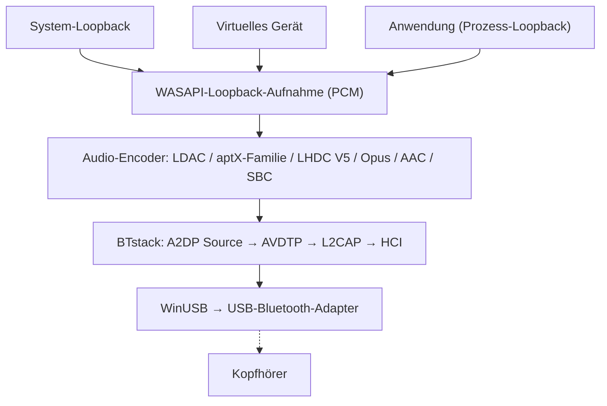

# A2DP Windows Bridge (A2DPWB)

Bluetooth-A2DP-Audiostreaming für Windows mit voller Codec-Unterstützung.
{: .fs-6 .fw-300 }

Streamt das Systemaudio über **LHDC V5, LDAC, aptX Adaptive, aptX HD, aptX, aptX Low Latency, AAC, SBC** und (experimentell) **Opus** sowie PipeWires **Opus 05** mit einem USB-Bluetooth-Adapter im WinUSB-Modus -- ohne Kerneltreiber und ohne Testsignatur.

[Erste Schritte](setup){: .btn .btn-primary .fs-5 .mb-4 .mb-md-0 .mr-2 }
[GitHub](https://github.com/SeiyaFunaokaJP/A2DP-Windows-Bridge){: .btn .fs-5 .mb-4 .mb-md-0 }

---

## Unterstützte Codecs

| Codec | Bitrate | Abtastrate | Bittiefe | Latenz |
|:------|:--------|:-----------|:---------|:-------|
| LHDC V5 | 400/500/900/1000 kbps, ABR 160--400 kbps | 44,1/48/96/192 kHz | 16/24 Bit | -- |
| LDAC | 330/660/990 kbps | 44,1--96 kHz | 16/24/32 Bit | ~200 ms |
| aptX Adaptive | 265--427 kbps (96 kHz: 255--646) | 48/96 kHz | 24 Bit | -- |
| Opus 🧪 | 128/192/256 kbps | 48 kHz | 16 Bit | -- |
| aptX HD 🧪 | 576 kbps | 44,1/48 kHz | 24 Bit | ~150 ms |
| aptX | 352/384 kbps | 44,1/48 kHz | 16 Bit | -- |
| aptX Low Latency 🧪 | 352 kbps | 44,1/48 kHz | 16 Bit | ~32 ms |
| AAC | 128/192/256 kbps | 44,1/48 kHz | 16 Bit | ~150 ms |
| SBC XQ | ca. 385/505/552 kbps | 44,1/48 kHz | 16 Bit | ~150 ms |
| SBC | bis ca. 345 kbps | 44,1/48 kHz | 16 Bit | ~150 ms |
| FastStream 🧪 | 198/216 kbps | 44,1/48 kHz | 16 Bit | -- |
| Opus 05 🧪 | 128/192/256 kbps | 48 kHz | 16 Bit | -- |
| LC3 (LE Audio) 🧪 | 32--124 kbps pro Kanal | 16/24/32/48 kHz | 16 Bit | ~140 ms |
| LC3 Low Latency (LE Audio GMAP) 🧪 | 64--96 kbps pro Kanal | 32/48 kHz | 16 Bit | ~30 ms |

### Codec-Unterstützung nach Plattform (Senden an Kopfhörer)

| Codec | Windows 10 integriert | Windows 11 integriert | Ubuntu integriert (PipeWire) | **A2DPWB** (Windows 10 / 11) |
|:------|:---------------------:|:---------------------:|:----------------------------:|:----------------------------:|
| LHDC V5 | ❌ | ❌ | ❌ | ✅ |
| LDAC | ❌ | ❌ | ✅ | ✅ |
| aptX Adaptive | ❌ | ❌ | ❌ | ✅ |
| Opus (A2DP Opus von Android) | ❌ | ❌ | ✅ PipeWire 1.2+ (`opus_g`); nicht in Ubuntu 24.04 (PipeWire 1.0.5) | 🧪 experimentell |
| aptX HD | ❌ | ❌ | ✅ | 🧪 experimentell |
| aptX | ✅ | ✅ | ✅ | ✅ |
| aptX Low Latency | ❌ | ❌ | ✅ | 🧪 experimentell |
| AAC | ❌ | ✅ | ❌ nicht in den Ubuntu-Paketen | ✅ |
| SBC XQ | ❌ | ❌ | ✅ | ✅ (Empfänger, deren SBC Dual Channel und Bitpool ≥ 29 erlaubt) |
| SBC | ✅ | ✅ | ✅ | ✅ |
| FastStream | ❌ | ❌ | ✅ | 🧪 experimentell (nur Musik, nur bei ausdrücklicher Wahl) |
| Opus 05 (PipeWires eigenes Opus) | ❌ | ❌ | ✅ PipeWire 0.3.57+ (`opus_05`, nur zu PipeWire-Geräten) | 🧪 experimentell (nur bei ausdrücklicher Wahl) |
| LC3 (LE Audio, BAP Unicast) | ❌ | ✅ auf PCs, deren Bluetooth-Hardware und -Treiber LE Audio unterstützen | ✅ PipeWire BAP `lc3` (LE Audio von BlueZ) | 🧪 experimentell (LE-Audio-Eintrag eines Geräts; GMAP mit niedriger Latenz bei Gaming-Headsets; Adapter mit Bluetooth 5.2 und ISO, [Verwendung](usage#le-audio)) |

✅ unterstützt · 🧪 experimentell · ❌ nicht unterstützt. Alle Spalten beziehen sich auf die Sendeseite (PC → Kopfhörer). „Integriert“ ist das Bluetooth-Audio des Betriebssystems selbst, ohne A2DPWB; die Ubuntu-Spalte ist der PipeWire-Codec-Umfang von Ubuntu 26.04 (`libspa-0.2-bluetooth`).

{: .warning }
**aptX HD und aptX Low Latency sind experimentell.** Sie folgen den Implementierungen von Android / PipeWire und bestehen Round-Trip-Tests (Kodieren/Dekodieren), wurden aber noch nicht mit echten Kopfhörern geprüft. Die Latenzwerte in dieser Tabelle sind typische Angaben, nicht mit A2DPWB gemessen.

{: .warning }
**Zu LHDC V5.** Verwendet wird eine C-Portierung des LHDC-V5-Encoders, den Google in Android 17 aufgenommen hat (AOSP, Apache-2.0); die Portierung wurde bitgenau gegen den Rust-Encoder aus AOSP geprüft, und die A2DP-Signalisierung folgt Androids `a2dp_vendor_lhdcv5`. Ein Nutzer hat LHDC V5 unter v1.1.1-beta.1 mit echten LHDC-V5-Kopfhörern bei 1000 kbps / 192 kHz bestätigt ([#50](https://github.com/SeiyaFunaokaJP/A2DP-Windows-Bridge/issues/50)); v2 verwendet denselben Encoder. Unterstützt wird nur verlustbehaftetes LHDC V5: Für LHDC V2/V3 (ältere Kopfhörer) und den verlustfreien Modus „LHDC-RAW“ gibt es keinen Open-Source-Encoder. Im Modus Automatisch steht LHDC V5 hinter LDAC und der aptX-Familie und vor AAC / SBC.

{: .warning }
**Opus ist experimentell.** Es handelt sich um den A2DP-Opus-Hersteller-Codec von Android (Android 13+, Vendor ID 0x000000E0 Google): 48 kHz, 20-ms-Frames, 256 kbps Stereo, wie Android es anfordert (Standard 192, Mobil 128 kbps), kodiert mit libopus 1.5.2. Opus besteht den End-to-End-Test gegen eine virtuelle Senke, wurde aber noch nicht mit echten Opus-Kopfhörern geprüft. Im Modus Automatisch steht Opus hinter LHDC V5 und vor AAC / SBC.

{: .warning }
**Opus 05 ist experimentell und nicht an echter Hardware geprüft.** Es ist der eigene A2DP-Opus-Hersteller-Codec von PipeWire (Vendor ID 0x000005F1, Codec 0x1005; PipeWire `opus_05`), den nur PipeWire implementiert; der Empfänger muss also ein PC sein, auf dem PipeWire als A2DP-Senke läuft. A2DPWB sendet nur die Stereo-Musikrichtung (kein 5.1 / 7.1, kein Rückkanal): 48 kHz, 10-ms-Frames (20 ms, wenn die Senke nur diese kann), derselbe libopus-Encoder und dieselben Bitraten wie bei Opus, begrenzt auf das Limit der Senke. Automatisch wählt es nie; wählen Sie es unter **Codecs** oder mit `-c opus05`. Es besteht den End-to-End-Test gegen eine virtuelle Senke, die die Fähigkeiten von PipeWire anbietet, wurde aber nicht mit einem echten PipeWire-Empfänger ausprobiert. PipeWire als A2DP-Senke dekodiert Opus 05 seit 0.3.57 und das Opus von Android (`opus_g`) seit 1.2.0: Ubuntu 24.04 LTS liefert PipeWire 1.0.5 (nur Opus 05), Ubuntu 25.10 (1.4.7) und 26.04 LTS (1.6.2) liefern beide; beides ist mit A2DPWB noch nicht geprüft.

{: .warning }
**SBC XQ** wurde mit einem Sony WH-1000XM4 überprüft (Dual Channel, Bitpool 43 bei 48 kHz, 552 kbps). Empfänger, die die Konfiguration ablehnen, werden mit normalem SBC neu verbunden. **FastStream ist experimentell:** Es besteht den End-to-End-Test gegen eine virtuelle Senke, wurde aber noch nicht mit echten FastStream-Kopfhörern ausprobiert. Nur die Musikrichtung; Automatisch wählt es nie.

{: .note }
**Nur klassisches aptX nötig?** Windows 10 unterstützt klassisches aptX bereits im integrierten Bluetooth-Stack (nicht aptX HD, aptX LL oder aptX Adaptive), dafür wird A2DPWB also nicht benötigt. A2DPWB ist vor allem für LDAC, aptX HD und aptX Low Latency nützlich.

{: .note }
**Zu aptX Adaptive.** Kodiert wird mit dem MIT-lizenzierten, rein in Rust geschriebenen Encoder von [AKS-Logic/aptx-adaptive-linux](https://github.com/AKS-Logic/aptx-adaptive-linux), dessen Tabellen seine Autoren aus ausgelieferten Qualcomm-Binärdateien und Funkmitschnitten rekonstruiert haben. 48 kHz Stereo (Anforderungen von 44,1 kHz werden mit 48 kHz aufgenommen), 24 Bit: Hoch 427 kbps, Standard 364, Mobil 318 und Niedrige Latenz 265 kbps bei R1-Senken (R2-Senken haben eine eigene Tabelle), ABR in Hoch. 96 kHz (Hoch 646 kbps, Standard 340, Mobil 255), wenn Sie in seinen Einstellungen 96 kHz wählen und die Kopfhörer eine R2-Senke sind, die 96 kHz meldet; nicht in Niedrige Latenz, sonst 48 kHz. Auch 96 kHz ist mit echten Kopfhörern bestätigt ([#86](https://github.com/SeiyaFunaokaJP/A2DP-Windows-Bridge/issues/86)); Automatisch streamt 48 kHz. Automatisch wählt es nach LHDC V5 und LDAC; oder wählen Sie es unter **Codecs** oder mit `-c aptxad`. Ein Nutzer hat es mit einem EarFun Air Pro 4+ bei 48 kHz unter 2.0.2-beta.6 bestätigt, so stabil wie klassisches aptX ([#86](https://github.com/SeiyaFunaokaJP/A2DP-Windows-Bridge/issues/86)); das Originalprojekt meldet, dass es unter Linux mit Bose QuietComfort Ultra (1. Generation) und B&W Px7 S2e funktioniert. Siehe [aptX-Familie und aptX Adaptive](usage#aptx-compatibility).

## Plattformunterstützung {#platform-support}

| Komponente | Windows 10 (x64 / ARM64) | Windows 11 (x64 / ARM64) | Linux (Ubuntu) |
|:-----------|:----------------:|:----------------:|:--------------:|
| **A2DPWB** (Fenster, Infobereich, CLI) | ✅ (noch nicht auf echter Hardware getestet) | ✅ | ❌ |
| [Aus dem Quellcode bauen](building) (Rust, Visual Studio 2022+, Node.js) | ✅ | ✅ | ❌ |
| `a2dpwb_decode` (Stream-Prüfung) | ✅ | ✅ | ❌ |
| End-to-End-Test `tools/emu/run_test.py` | ✅ | ✅ | ❌ |
| Virtueller Adapter `tools/emu/emu_vhci.py` | ❌ | ❌ | ✅ |
| [Messempfänger](usage#receiver) `tools/linux_sink` | ❌ | ❌ | ✅ |

A2DPWB selbst läuft nur unter Windows (Windows 10 22H2 oder Windows 11), als Build für x64 und ARM64. Die Linux-Werkzeuge benötigen Python 3.11 oder neuer (geprüft unter Ubuntu 26.04); `setup.sh` ist für Ubuntu / Debian gedacht, bei anderen Distributionen müssen die Pakete von Hand installiert werden.

## Geprüfte Hardware {#verified-hardware}

Getestet mit Sony WH-1000XM4 und WH-1000XM6, EarFun Air Pro 4+, Grado GW100x und weiteren, an TP-Link UB500, einem generischen RTL8761B, dem eingebauten RTL8852BE eines Notebooks, ASUS BT400 und CSR8510. Die vollständige Liste mit Codecs, Versionen und den zugrunde liegenden Berichten: **[Geprüfte Hardware](../hardware)** (Englisch).

## Aufnahmemodi

A2DPWB nimmt das Audio über WASAPI auf und bietet drei Modi:

| Modus | Beschreibung | Anwendungsfall |
|:------|:-------------|:---------------|
| **System-Loopback** | Nimmt per WASAPI-Loopback die gesamte Systemausgabe des Standardwiedergabegeräts auf | Einfache Einrichtung -- alle Klänge werden gestreamt |
| **Virtuelles Gerät** | Nimmt von einem ausgewählten virtuellen Audiogerät auf (z. B. VB-CABLE, VoiceMeeter) | Bestimmte Apps an Bluetooth leiten, während anderes Audio auf den Lautsprechern bleibt |
| **Anwendung** | Nimmt nur auf, was eine App wiedergibt, nach deren eigener Verarbeitung (Windows 11 / Windows 10 2004+) | Eine einzelne App senden oder die Ausgabe einer systemweiten Effekt-App (Equalizer, Klangverbesserer) |

Im Modus **Virtuelles Gerät** kann A2DPWB das Windows-Standardwiedergabegerät auf das ausgewählte virtuelle Gerät umstellen (**Standardgerät automatisch wechseln**) und nimmt dann dessen Loopback-Ausgabe auf. Apps, die auf dem virtuellen Gerät ausgeben, werden über Bluetooth gestreamt. Endet das Streaming, wird das vorherige Standardgerät wiederhergestellt.

System-Loopback nimmt dem Standardwiedergabegerät das Audio nicht weg: Es wird dort und zusätzlich über Bluetooth wiedergegeben. Siehe [Aufnahmemodi](usage#capture-modes).

## Funktionsweise

A2DPWB umgeht den Bluetooth-Stack von Windows vollständig. Es kommuniziert über WinUSB direkt mit einem USB-Bluetooth-Adapter und implementiert mit [BTstack](https://github.com/bluekitchen/btstack) den kompletten Bluetooth-Protokollstack im Benutzermodus. Ein kleines residentes Programm (`a2dpwb-core.exe`, mit dem Symbol im Infobereich) streamt das Audio; das Fenster zeigt nur dessen Zustand an, daher stoppt das Schließen des Fensters das Audio nicht (siehe [Architektur](architecture)).

## Funktionen

- **Mehrere Codecs**: LHDC V5, LDAC, aptX Adaptive, aptX HD, aptX, aptX Low Latency, AAC, SBC und (experimentell) Opus / Opus 05 mit automatischer Aushandlung
- **LE Audio (experimentell)**: LC3 an LE-Audio-Kopfhörer und -Ohrhörer (BAP Unicast, beide Ohrhörer eines Paars, Headset-Lautstärke, Medientasten, GMAP mit niedriger Latenz). Benötigt einen Adapter mit isochronen Bluetooth-5.2-Kanälen; nur mit dem Bluetooth-Emulator getestet, noch nicht mit echten LE-Audio-Kopfhörern ([Verwendung](usage#le-audio))
- **Drei Aufnahmemodi**: System-Loopback, Umleitung über ein virtuelles Audiogerät oder die Ausgabe einer einzelnen Anwendung
- **Fenster, Infobereich und CLI**: ein Fenster für Einrichtung und Diagnose, ein Flyout und ein Menü im Infobereich für das alltägliche Verbinden sowie eine Kommandozeile (siehe [Verwendung](usage))
- **WinUSB in der App**: weist dem Adapter den WinUSB-Treiber zu und stellt den ursprünglichen Treiber wieder her, Zadig ist nicht nötig (siehe [Einrichtung](setup#winusb))
- **Einrichtung beim ersten Start**: Adapter, Treiber und Firmware, Kopfhörer, erste Verbindung
- **ABR**: Adaptive Bitrate für instabile Verbindungen (LDAC, LHDC V5 und aptX Adaptive)
- **Automatische Neuverbindung**: Verbindet sich nach einem Abbruch erneut (bis zu 10 Versuche) sowie nachdem der PC aus dem Energiesparmodus zurückkehrt
- **Verbindungsqualität und AFH**: Zeigt, was gesendet wird, den RSSI und die genutzten Kanäle; teilt dem Adapter mit, welche Wi-Fi-Kanäle zu meiden sind (siehe [Verwendung](usage#link-quality))
- **Kopfhörersteuerung (AVRCP)**: Lautstärkeregler, synchron mit den Kopfhörern und der Windows-Lautstärke; deren Tasten für Wiedergabe/Pause, Weiter und Zurück steuern die Wiedergabe auf dem PC (siehe [Verwendung](usage#headphone-buttons))
- **Einstellungen pro Gerät**: ein Codec (mit eigenen Einstellungen) und eine Ausgabequelle für jedes Audiogerät, nebeneinander auf Start und über den Infobereich verbindbar
- **Updates**: Die installierte Version aktualisiert sich selbst, sobald das Audiogerät getrennt ist (siehe [Verwendung](usage#updates))
- **Lokalisierung**: Englisch, Japanisch, vereinfachtes / traditionelles Chinesisch, Koreanisch, Deutsch, Französisch und Spanisch
- **Realtek-Firmware**: Geführter Firmware-Download für Realtek-Adapter
- **Diagnose**: Verbindungsablauf, Protokoll, HCI-Aufzeichnung, Diagnoseinformationen für Fehlerberichte, Peer-Empfängertest gegen einen Linux-PC (siehe [Verwendung](usage#receiver))
