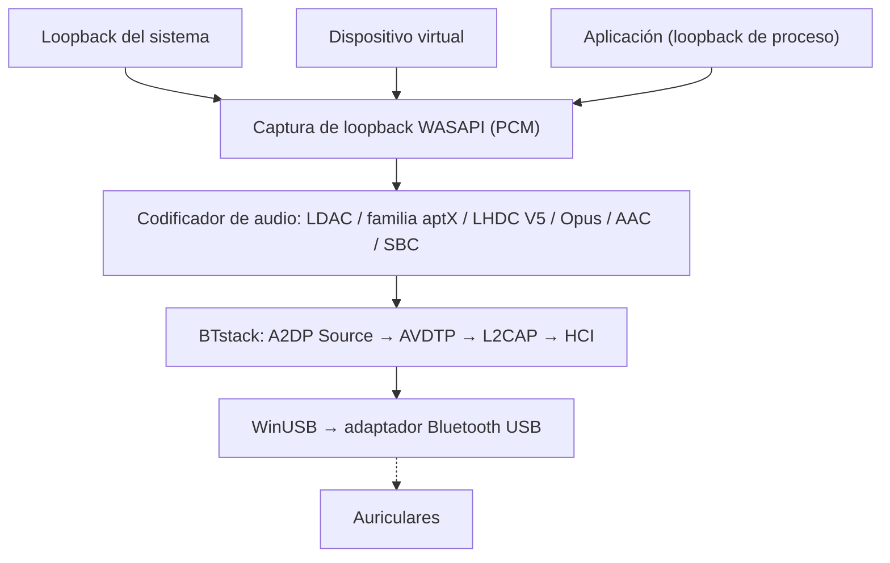

# A2DP Windows Bridge (A2DPWB)

Transmisión de audio Bluetooth A2DP para Windows con compatibilidad completa de códecs.
{: .fs-6 .fw-300 }

Transmite el audio del sistema mediante **LHDC V5, LDAC, aptX Adaptive, aptX HD, aptX, aptX Low Latency, AAC, SBC** y (de forma experimental) **Opus** y el **Opus 05** de PipeWire con un adaptador Bluetooth USB en modo WinUSB, sin controlador de kernel ni firma de prueba.

[Primeros pasos](setup){: .btn .btn-primary .fs-5 .mb-4 .mb-md-0 .mr-2 }
[GitHub](https://github.com/SeiyaFunaokaJP/A2DP-Windows-Bridge){: .btn .fs-5 .mb-4 .mb-md-0 }

---

## Códecs compatibles

| Códec | Tasa de bits | Frecuencia de muestreo | Profundidad de bits | Latencia |
|:------|:--------|:------------|:----------|:--------|
| LHDC V5 | 400/500/900/1000 kbps, ABR 160--400 kbps | 44.1/48/96/192 kHz | 16/24 bits | -- |
| LDAC | 330/660/990 kbps | 44.1--96 kHz | 16/24/32 bits | ~200 ms |
| aptX Adaptive | 265--427 kbps (96 kHz: 255--646) | 48/96 kHz | 24 bits | -- |
| Opus 🧪 | 128/192/256 kbps | 48 kHz | 16 bits | -- |
| aptX HD 🧪 | 576 kbps | 44.1/48 kHz | 24 bits | ~150 ms |
| aptX | 352/384 kbps | 44.1/48 kHz | 16 bits | -- |
| aptX Low Latency 🧪 | 352 kbps | 44.1/48 kHz | 16 bits | ~32 ms |
| AAC | 128/192/256 kbps | 44.1/48 kHz | 16 bits | ~150 ms |
| SBC XQ | ~385/505/552 kbps | 44.1/48 kHz | 16 bits | ~150 ms |
| SBC | hasta ~345 kbps | 44.1/48 kHz | 16 bits | ~150 ms |
| FastStream 🧪 | 198/216 kbps | 44.1/48 kHz | 16 bits | -- |
| Opus 05 🧪 | 128/192/256 kbps | 48 kHz | 16 bits | -- |
| LC3 (LE Audio) 🧪 | 32--124 kbps por canal | 16/24/32/48 kHz | 16 bits | ~140 ms |
| LC3 baja latencia (LE Audio GMAP) 🧪 | 64--96 kbps por canal | 32/48 kHz | 16 bits | ~30 ms |

### Compatibilidad de códecs por plataforma (envío a los auriculares)

| Códec | Windows 10 integrado | Windows 11 integrado | Ubuntu integrado (PipeWire) | **A2DPWB** (Windows 10 / 11) |
|:------|:-------------------:|:-------------------:|:--------------------------:|:----------------------------:|
| LHDC V5 | ❌ | ❌ | ❌ | ✅ |
| LDAC | ❌ | ❌ | ✅ | ✅ |
| aptX Adaptive | ❌ | ❌ | ❌ | ✅ |
| Opus (Opus A2DP de Android) | ❌ | ❌ | ✅ PipeWire 1.2+ (`opus_g`); no está en Ubuntu 24.04 (PipeWire 1.0.5) | 🧪 experimental |
| aptX HD | ❌ | ❌ | ✅ | 🧪 experimental |
| aptX | ✅ | ✅ | ✅ | ✅ |
| aptX Low Latency | ❌ | ❌ | ✅ | 🧪 experimental |
| AAC | ❌ | ✅ | ❌ no está en los paquetes de Ubuntu | ✅ |
| SBC XQ | ❌ | ❌ | ✅ | ✅ (receptores cuyo SBC admite canal dual y bitpool ≥ 29) |
| SBC | ✅ | ✅ | ✅ | ✅ |
| FastStream | ❌ | ❌ | ✅ | 🧪 experimental (solo música, si se elige expresamente) |
| Opus 05 (Opus propio de PipeWire) | ❌ | ❌ | ✅ PipeWire 0.3.57+ (`opus_05`, solo hacia dispositivos PipeWire) | 🧪 experimental (si se elige expresamente) |
| LC3 (LE Audio, BAP unicast) | ❌ | ✅ en PC cuyo hardware y controlador Bluetooth admiten LE Audio | ✅ PipeWire BAP `lc3` (LE Audio de BlueZ) | 🧪 experimental (la entrada LE Audio de un dispositivo; baja latencia GMAP con auriculares gaming; adaptador Bluetooth 5.2 con ISO, [Uso](usage#le-audio)) |

✅ compatible · 🧪 experimental · ❌ no compatible. Todas las columnas corresponden al lado emisor (PC → auriculares). «Integrado» es el audio Bluetooth propio del sistema operativo, sin A2DPWB; la columna de Ubuntu es el conjunto de códecs de PipeWire en Ubuntu 26.04 (`libspa-0.2-bluetooth`).

{: .warning }
**aptX HD y aptX Low Latency son experimentales.** Siguen las implementaciones de Android / PipeWire y superan las pruebas de ida y vuelta de codificación/decodificación, pero aún no se han verificado con auriculares reales. Los valores de latencia de esta tabla son cifras típicas, no medidas con A2DPWB.

{: .warning }
**Acerca de LHDC V5.** Usa un port en C del codificador LHDC V5 que Google añadió a Android 17 (AOSP, Apache-2.0); se verificó que el port produce exactamente los mismos bits que el codificador en Rust de AOSP, y la señalización A2DP sigue `a2dp_vendor_lhdcv5` de Android. Un usuario lo verificó con auriculares LHDC V5 reales a 1000 kbps / 192 kHz con la v1.1.1-beta.1 ([#50](https://github.com/SeiyaFunaokaJP/A2DP-Windows-Bridge/issues/50)); la v2 usa el mismo codificador. Solo se admite LHDC V5 con pérdida: LHDC V2/V3 (auriculares más antiguos) y el modo sin pérdida «LHDC-RAW» no tienen codificador de código abierto. En modo Automático, LHDC V5 tiene menos prioridad que LDAC y la familia aptX, y más que AAC / SBC.

{: .warning }
**Opus es experimental.** Es el códec de fabricante Opus A2DP de Android (Android 13+, ID de fabricante 0x000000E0 Google): 48 kHz, tramas de 20 ms, 256 kbps estéreo tal como lo solicita Android (Estándar 192, Móvil 128 kbps), codificado con libopus 1.5.2. Supera la prueba de extremo a extremo contra un receptor virtual, pero aún no se ha verificado con auriculares Opus reales. En modo Automático tiene menos prioridad que LHDC V5 y más que AAC / SBC.

{: .warning }
**Opus 05 es experimental y no está verificado en hardware real.** Es el códec de fabricante Opus A2DP propio de PipeWire (ID de fabricante 0x000005F1, códec 0x1005; `opus_05` de PipeWire), que solo implementa PipeWire, así que el receptor tiene que ser un PC con PipeWire como receptor A2DP. A2DPWB envía solo la dirección de música estéreo (sin 5.1 / 7.1 ni canal de retorno): 48 kHz, tramas de 10 ms (20 ms si el receptor solo admite esas), el mismo codificador libopus y las mismas tasas de bits que Opus, limitadas al máximo del receptor. El modo Automático nunca lo elige; elíjalo en **Códecs** o con `-c opus05`. Supera la prueba de extremo a extremo contra un receptor virtual que ofrece las capacidades de PipeWire, pero no se ha probado con un receptor PipeWire real. PipeWire como receptor A2DP decodifica Opus 05 desde la 0.3.57 y el Opus de Android (`opus_g`) desde la 1.2.0: Ubuntu 24.04 LTS incluye PipeWire 1.0.5 (solo Opus 05), Ubuntu 25.10 (1.4.7) y 26.04 LTS (1.6.2) incluyen ambos; ninguno está aún verificado con A2DPWB.

{: .warning }
**SBC XQ** se verificó con unos Sony WH-1000XM4 (canal dual, bitpool 43 a 48 kHz, 552 kbps). Los receptores que rechazan la configuración se reconectan con SBC normal. **FastStream es experimental:** supera la prueba de extremo a extremo contra un receptor virtual, pero no se ha probado con auriculares FastStream reales. Solo la dirección de música; Automático nunca lo elige.

{: .note }
**¿Solo necesita aptX clásico?** Windows 10 ya admite aptX clásico en su pila Bluetooth integrada (no aptX HD, aptX LL ni aptX Adaptive), así que A2DPWB no es necesario para ese códec. A2DPWB es útil sobre todo para LDAC, aptX HD y aptX Low Latency.

{: .note }
**Acerca de aptX Adaptive.** Se codifica con el codificador en Rust puro, con licencia MIT, de [AKS-Logic/aptx-adaptive-linux](https://github.com/AKS-Logic/aptx-adaptive-linux), cuyas tablas reconstruyeron sus autores a partir de binarios de Qualcomm distribuidos y de capturas por aire. 48 kHz estéreo (las solicitudes de 44.1 kHz se capturan a 48 kHz), 24 bits: Alta 427 kbps, Estándar 364, Móvil 318 y Baja latencia 265 kbps con receptores R1 (los receptores R2 tienen su propia tabla), ABR en Alta. 96 kHz (Alta 646 kbps, Estándar 340, Móvil 255) cuando elige 96 kHz en su configuración y los auriculares son un receptor R2 que anuncia 96 kHz; no en Baja latencia, y en otro caso 48 kHz. 96 kHz también está confirmado con auriculares reales ([#86](https://github.com/SeiyaFunaokaJP/A2DP-Windows-Bridge/issues/86)); Automático transmite a 48 kHz. El modo Automático lo elige después de LHDC V5 y LDAC; también puede elegirlo en **Códecs** o con `-c aptxad`. Un usuario lo confirmó con unos EarFun Air Pro 4+ a 48 kHz en 2.0.2-beta.6, tan estable como el aptX clásico ([#86](https://github.com/SeiyaFunaokaJP/A2DP-Windows-Bridge/issues/86)); el proyecto original informa de que funciona en Linux con Bose QuietComfort Ultra (1.ª generación) y B&W Px7 S2e. Consulte [Familia aptX y aptX Adaptive](usage#aptx-compatibility).

## Compatibilidad de plataformas {#platform-support}

| Componente | Windows 10 (x64 / ARM64) | Windows 11 (x64 / ARM64) | Linux (Ubuntu) |
|:----------|:----------------:|:----------------:|:--------------:|
| **A2DPWB** (ventana, bandeja, CLI) | ✅ (aún no probado en hardware real) | ✅ | ❌ |
| [Compilación desde el código fuente](building) (Rust, Visual Studio 2022+, Node.js) | ✅ | ✅ | ❌ |
| `a2dpwb_decode` (comprobador del flujo) | ✅ | ✅ | ❌ |
| Prueba de extremo a extremo `tools/emu/run_test.py` | ✅ | ✅ | ❌ |
| Adaptador virtual `tools/emu/emu_vhci.py` | ❌ | ❌ | ✅ |
| [Receptor de medición](usage#receiver) `tools/linux_sink` | ❌ | ❌ | ✅ |

A2DPWB solo funciona en Windows (Windows 10 22H2 o Windows 11), con compilaciones para x64 y ARM64. Las herramientas de Linux necesitan Python 3.11 o posterior (verificado en Ubuntu 26.04); `setup.sh` está pensado para Ubuntu / Debian; en otras distribuciones hay que instalar los paquetes a mano.

## Hardware verificado {#verified-hardware}

Probado con Sony WH-1000XM4 y WH-1000XM6, EarFun Air Pro 4+, Grado GW100x y otros, con los adaptadores TP-Link UB500, RTL8761B genérico, el RTL8852BE integrado de un portátil, ASUS BT400 y CSR8510. La lista completa con códecs, versiones y los informes en que se basa: **[Hardware verificado](../hardware)** (en inglés).

## Modos de captura de audio

A2DPWB captura el audio mediante WASAPI y ofrece tres modos:

| Modo | Descripción | Caso de uso |
|:-----|:------------|:---------|
| **Loopback del sistema** | Captura toda la salida de audio del sistema del dispositivo de reproducción predeterminado mediante loopback de WASAPI | Configuración sencilla: se transmiten todos los sonidos |
| **Dispositivo virtual** | Captura desde un dispositivo de audio virtual elegido por el usuario (p. ej., VB-CABLE, VoiceMeeter) | Enviar aplicaciones concretas a Bluetooth y mantener el resto del audio en los altavoces |
| **Aplicación** | Captura solo lo que reproduce una aplicación, después de su propio procesamiento (Windows 11 / Windows 10 2004+) | Enviar una aplicación, o la salida de una aplicación de efectos para todo el sistema (ecualizador, mejora de sonido) |

En el modo **Dispositivo virtual**, A2DPWB puede cambiar el dispositivo de reproducción predeterminado de Windows al dispositivo virtual seleccionado (**Cambiar dispositivo predeterminado**) y luego captura su salida de loopback. Las aplicaciones que reproducen en el dispositivo virtual se transmiten por Bluetooth. Al detener la transmisión, se restaura el dispositivo predeterminado anterior.

El Loopback del sistema no le quita el audio al dispositivo de reproducción predeterminado: se oye allí y también por Bluetooth. Consulte [Modos de captura](usage#capture-modes).

## Cómo funciona

A2DPWB omite por completo la pila Bluetooth de Windows. Se comunica directamente con un adaptador Bluetooth USB a través de WinUSB y usa [BTstack](https://github.com/bluekitchen/btstack) para implementar toda la pila de protocolos Bluetooth en modo de usuario. Un pequeño programa residente (`a2dpwb-core.exe`, con el icono de la bandeja) transmite el audio; la ventana solo muestra su estado, por lo que cerrarla no detiene el audio (consulte [Arquitectura](architecture)).

## Funciones

- **Varios códecs**: LHDC V5, LDAC, aptX Adaptive, aptX HD, aptX, aptX Low Latency, AAC, SBC y (de forma experimental) Opus / Opus 05 con negociación automática
- **LE Audio (experimental)**: LC3 hacia auriculares LE Audio (BAP unicast, los dos auriculares de un par, volumen del auricular, botones multimedia, baja latencia GMAP). Necesita un adaptador con canales isócronos de Bluetooth 5.2; solo probado con el emulador de Bluetooth, todavía no con auriculares LE Audio reales ([Uso](usage#le-audio))
- **Tres modos de captura**: loopback del sistema, enrutamiento a través de un dispositivo de audio virtual o la salida de una sola aplicación
- **Ventana, bandeja y CLI**: una ventana para la configuración y el diagnóstico, un panel desplegable y un menú en la bandeja para conectarse en el día a día, y una línea de comandos (consulte [Uso](usage))
- **WinUSB desde la aplicación**: asigna el controlador WinUSB al adaptador y restaura el controlador original, sin necesidad de Zadig (consulte [Configuración](setup#winusb))
- **Configuración inicial**: adaptador, controlador y firmware, auriculares, una primera conexión
- **ABR**: tasa de bits adaptativa para conexiones inestables (LDAC, LHDC V5 y aptX Adaptive)
- **Reconexión automática**: vuelve a conectar si se pierde la conexión (hasta 10 intentos) y cuando el PC sale de la suspensión
- **Calidad del enlace y AFH**: muestra lo que se envía, el RSSI y los canales en uso; indica al adaptador qué canales Wi-Fi debe evitar (consulte [Uso](usage#link-quality))
- **Controles de los auriculares (AVRCP)**: control deslizante de volumen sincronizado con los auriculares y con el volumen de Windows; sus botones de reproducir/pausar, siguiente y anterior controlan la reproducción en el PC (consulte [Uso](usage#headphone-buttons))
- **Ajustes por dispositivo**: un códec (con sus propios ajustes) y un origen de salida para cada dispositivo de audio, uno junto a otro en Inicio y que se pueden conectar desde la bandeja
- **Actualizaciones**: la versión instalada se actualiza sola cuando se desconecta el dispositivo de audio (consulte [Uso](usage#updates))
- **Localización**: inglés, japonés, chino simplificado / tradicional, coreano, alemán, francés y español
- **Firmware de Realtek**: descarga guiada del firmware para adaptadores Realtek
- **Diagnóstico**: flujo de conexión, registro, captura HCI, información de diagnóstico para informes de errores, prueba con receptor par frente a un PC con Linux (consulte [Uso](usage#receiver))
