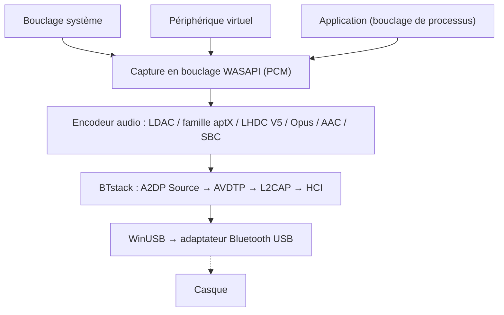

# BlueCaster

Diffusion audio Bluetooth A2DP pour Windows, avec tous les codecs.
{: .fs-6 .fw-300 }

Diffuse l'audio du système en **LHDC V5, LDAC, aptX Adaptive, aptX HD, aptX, aptX Low Latency, AAC, SBC** et (à titre expérimental) **Opus** et l'**Opus 05** de PipeWire grâce à un adaptateur Bluetooth USB en mode WinUSB -- sans pilote noyau ni signature de test.

[Commencer](setup){: .btn .btn-primary .fs-5 .mb-4 .mb-md-0 .mr-2 }
[GitHub](https://github.com/SeiyaFunaokaJP/BlueCaster){: .btn .fs-5 .mb-4 .mb-md-0 }

---

## Codecs pris en charge

| Codec | Débit | Fréquence d'échantillonnage | Profondeur de bits | Latence |
|:------|:--------|:------------|:----------|:--------|
| LHDC V5 | 400/500/900/1000 kbps, ABR 160--400 kbps | 44.1/48/96/192 kHz | 16/24 bit | -- |
| LDAC | 330/660/990 kbps | 44.1--96 kHz | 16/24/32 bit | ~200 ms |
| aptX Adaptive | 265--427 kbps (96 kHz : 255--646) | 48/96 kHz | 24 bit | -- |
| Opus 🧪 | 128/192/256 kbps | 48 kHz | 16 bit | -- |
| aptX HD 🧪 | 576 kbps | 44.1/48 kHz | 24 bit | ~150 ms |
| aptX | 352/384 kbps | 44.1/48 kHz | 16 bit | -- |
| aptX Low Latency 🧪 | 352 kbps | 44.1/48 kHz | 16 bit | ~32 ms |
| AAC | 128/192/256 kbps | 44.1/48 kHz | 16 bit | ~150 ms |
| SBC XQ | ~385/505/552 kbps | 44.1/48 kHz | 16 bit | ~150 ms |
| SBC | jusqu'à ~345 kbps | 44.1/48 kHz | 16 bit | ~150 ms |
| FastStream 🧪 | 198/216 kbps | 44.1/48 kHz | 16 bit | -- |
| Opus 05 🧪 | 128/192/256 kbps | 48 kHz | 16 bit | -- |
| LC3 (LE Audio) 🧪 | 32--124 kbps par canal | 16/24/32/48 kHz | 16 bit | ~140 ms |
| LC3 faible latence (LE Audio GMAP) 🧪 | 64--96 kbps par canal | 32/48 kHz | 16 bit | ~30 ms |

### Codecs pris en charge selon la plateforme (envoi vers le casque)

| Codec | Windows 10 natif | Windows 11 natif | Ubuntu natif (PipeWire) | **BlueCaster** (Windows 10 / 11) |
|:------|:-------------------:|:-------------------:|:--------------------------:|:----------------------------:|
| LHDC V5 | ❌ | ❌ | ❌ | ✅ |
| LDAC | ❌ | ❌ | ✅ | ✅ |
| aptX Adaptive | ❌ | ❌ | ❌ | ✅ |
| Opus (Opus A2DP d'Android) | ❌ | ❌ | ✅ PipeWire 1.2+ (`opus_g`) ; absent d'Ubuntu 24.04 (PipeWire 1.0.5) | 🧪 expérimental |
| aptX HD | ❌ | ❌ | ✅ | 🧪 expérimental |
| aptX | ✅ | ✅ | ✅ | ✅ |
| aptX Low Latency | ❌ | ❌ | ✅ | 🧪 expérimental |
| AAC | ❌ | ✅ | ❌ absent des paquets Ubuntu | ✅ |
| SBC XQ | ❌ | ❌ | ✅ | ✅ (récepteurs dont le SBC autorise le double canal et un bitpool ≥ 29) |
| SBC | ✅ | ✅ | ✅ | ✅ |
| FastStream | ❌ | ❌ | ✅ | 🧪 expérimental (musique uniquement, choisi explicitement) |
| Opus 05 (Opus propre à PipeWire) | ❌ | ❌ | ✅ PipeWire 0.3.57+ (`opus_05`, uniquement vers des appareils PipeWire) | 🧪 expérimental (choisi explicitement) |
| LC3 (LE Audio, BAP unicast) | ❌ | ✅ sur les PC dont le matériel et le pilote Bluetooth prennent en charge LE Audio | ✅ PipeWire BAP `lc3` (LE Audio de BlueZ) | 🧪 expérimental (l'entrée LE Audio d'un appareil ; faible latence GMAP avec les casques gaming ; adaptateur Bluetooth 5.2 avec ISO, [Utilisation](usage#le-audio)) |

✅ pris en charge · 🧪 expérimental · ❌ non pris en charge. Toutes les colonnes concernent le côté émetteur (PC → casque). « Natif » désigne l'audio Bluetooth propre au système, sans BlueCaster ; la colonne Ubuntu correspond aux codecs PipeWire d'Ubuntu 26.04 (`libspa-0.2-bluetooth`).

{: .warning }
**aptX HD et aptX Low Latency sont expérimentaux.** Ils suivent les implémentations d'Android / PipeWire et réussissent les tests d'aller-retour encodage/décodage, mais n'ont pas encore été vérifiés avec un vrai casque. Les latences de ce tableau sont des valeurs typiques, non mesurées avec BlueCaster.

{: .warning }
**À propos de LHDC V5.** Il utilise un portage en C de l'encodeur LHDC V5 que Google a ajouté à Android 17 (AOSP, Apache-2.0) ; ce portage a été vérifié bit à bit par rapport à l'encodeur Rust d'AOSP, et la signalisation A2DP suit `a2dp_vendor_lhdcv5` d'Android. Un utilisateur l'a vérifié avec un vrai casque LHDC V5 à 1000 kbps / 192 kHz sur la v1.1.1-beta.1 ([#50](https://github.com/SeiyaFunaokaJP/BlueCaster/issues/50)) ; la v2 utilise le même encodeur. Seul le LHDC V5 avec perte est pris en charge : LHDC V2/V3 (casques plus anciens) et le mode sans perte « LHDC-RAW » n'ont pas d'encodeur open source. En mode Auto, LHDC V5 passe après LDAC et la famille aptX, et avant AAC / SBC.

{: .warning }
**Opus est expérimental.** Il s'agit du codec propriétaire Opus A2DP d'Android (Android 13+, identifiant fabricant 0x000000E0 Google) : 48 kHz, trames de 20 ms, 256 kbps en stéréo comme le demande Android (Standard 192, Mobile 128 kbps), encodé avec libopus 1.5.2. Il réussit le test de bout en bout face à un récepteur virtuel, mais n'a pas encore été vérifié avec un vrai casque Opus. En mode Auto, il passe après LHDC V5 et avant AAC / SBC.

{: .warning }
**Opus 05 est expérimental et non vérifié sur du matériel réel.** C'est le codec propriétaire Opus A2DP propre à PipeWire (identifiant fabricant 0x000005F1, codec 0x1005 ; `opus_05` de PipeWire), que seul PipeWire implémente : le récepteur doit donc être un PC où PipeWire fait office de récepteur A2DP. BlueCaster n'envoie que le sens musique en stéréo (pas de 5.1 / 7.1, pas de voie de retour) : 48 kHz, trames de 10 ms (20 ms si le récepteur ne gère que celles-ci), le même encodeur libopus et les mêmes débits qu'Opus, plafonnés à la limite du récepteur. Auto ne le choisit jamais ; choisissez-le dans **Codecs** ou avec `-c opus05`. Il réussit le test de bout en bout face à un récepteur virtuel qui offre les capacités de PipeWire, mais n'a pas été essayé avec un vrai récepteur PipeWire. PipeWire en récepteur A2DP décode Opus 05 depuis la 0.3.57 et l'Opus d'Android (`opus_g`) depuis la 1.2.0 : Ubuntu 24.04 LTS fournit PipeWire 1.0.5 (Opus 05 seulement), Ubuntu 25.10 (1.4.7) et 26.04 LTS (1.6.2) fournissent les deux ; ni l'un ni l'autre n'est encore vérifié avec BlueCaster.

{: .warning }
**SBC XQ** a été vérifié avec un Sony WH-1000XM4 (double canal, bitpool 43 à 48 kHz, 552 kbps). Les récepteurs qui refusent la configuration sont reconnectés en SBC ordinaire. **FastStream est expérimental :** il réussit le test de bout en bout face à un récepteur virtuel, mais n'a pas été essayé avec de vrais casques FastStream. Sens musique uniquement ; Auto ne le choisit jamais.

{: .note }
**Seul l'aptX classique vous intéresse ?** Windows 10 prend déjà en charge l'aptX classique dans sa pile Bluetooth intégrée (pas aptX HD, aptX LL ni aptX Adaptive) : BlueCaster n'est donc pas nécessaire pour cela. BlueCaster sert surtout pour LDAC, aptX HD et aptX Low Latency.

{: .note }
**À propos de l'aptX Adaptive.** Il est encodé avec l'encodeur en Rust pur, sous licence MIT, d'[AKS-Logic/aptx-adaptive-linux](https://github.com/AKS-Logic/aptx-adaptive-linux), dont les auteurs ont reconstitué les tables à partir de binaires Qualcomm distribués et de captures radio. 48 kHz stéréo (une demande en 44,1 kHz est capturée en 48 kHz), 24 bits : Haute 427 kbps, Standard 364, Mobile 318 et Faible latence 265 kbps avec les récepteurs R1 (les récepteurs R2 ont leur propre table), ABR en Haute. 96 kHz (Haute 646 kbps, Standard 340, Mobile 255) si vous choisissez 96 kHz dans ses paramètres et que le casque est un récepteur R2 qui annonce 96 kHz ; pas en Faible latence, et 48 kHz sinon. Le 96 kHz est confirmé lui aussi avec un vrai casque ([#86](https://github.com/SeiyaFunaokaJP/BlueCaster/issues/86)) ; Auto diffuse en 48 kHz. Auto le choisit après LHDC V5 et LDAC ; vous pouvez aussi le choisir dans **Codecs** ou avec `-c aptxad`. Un utilisateur l'a confirmé avec des EarFun Air Pro 4+ en 48 kHz sur la 2.0.2-beta.6, aussi stable que l'aptX classique ([#86](https://github.com/SeiyaFunaokaJP/BlueCaster/issues/86)) ; l'amont indique qu'il fonctionne sous Linux avec les Bose QuietComfort Ultra (1re génération) et B&W Px7 S2e. Voir [Famille aptX et aptX Adaptive](usage#aptx-compatibility).

## Plateformes prises en charge {#platform-support}

| Composant | Windows 10 (x64 / ARM64) | Windows 11 (x64 / ARM64) | Linux (Ubuntu) |
|:----------|:----------------:|:----------------:|:--------------:|
| **BlueCaster** (fenêtre, zone de notification, CLI) | ✅ (pas encore essayé sur du vrai matériel) | ✅ | ❌ |
| [Compilation depuis les sources](../building) (Rust, Visual Studio 2022+, Node.js) | ✅ | ✅ | ❌ |
| `bluecaster_decode` (vérificateur de flux) | ✅ | ✅ | ❌ |
| Test de bout en bout `tools/emu/run_test.py` | ✅ | ✅ | ❌ |
| Adaptateur virtuel `tools/emu/emu_vhci.py` | ❌ | ❌ | ✅ |
| [Récepteur de mesure](usage#receiver) `tools/linux_sink` | ❌ | ❌ | ✅ |

BlueCaster lui-même ne fonctionne que sous Windows (Windows 10 22H2 ou Windows 11), en versions x64 et ARM64. Les outils Linux nécessitent Python 3.11 ou ultérieur (vérifié sur Ubuntu 26.04) ; `setup.sh` cible Ubuntu / Debian, les autres distributions nécessitent d'installer les paquets à la main.

## Matériel vérifié {#verified-hardware}

Testé avec les Sony WH-1000XM4 et WH-1000XM6, les EarFun Air Pro 4+, le Grado GW100x et d'autres, sur les adaptateurs TP-Link UB500, RTL8761B générique, RTL8852BE intégré d'un portable, ASUS BT400 et CSR8510. La liste complète avec les codecs, les versions et les rapports d'origine : **[Matériel vérifié](../hardware)** (en anglais).

## Fonctionne avec

Applications tierces qui fonctionnent avec BlueCaster, comme des applications de contrôle d'écouteurs, signalées dans les issues (ni créées ni prises en charge par BlueCaster) : **[Works With](../works-with)** (en anglais).

## Modes de capture audio

BlueCaster capture l'audio via WASAPI et propose trois modes :

| Mode | Description | Utilisation |
|:-----|:------------|:---------|
| **Bouclage système** | Capture toute la sortie audio du système depuis le périphérique de lecture par défaut, via le bouclage WASAPI | Configuration simple -- tous les sons sont diffusés |
| **Périphérique virtuel** | Capture depuis un périphérique audio virtuel choisi (p. ex. VB-CABLE, VoiceMeeter) | Envoyer certaines applications vers le Bluetooth en gardant le reste de l'audio sur les haut-parleurs |
| **Application** | Capture uniquement ce que lit une application, après son propre traitement (Windows 11 / Windows 10 2004+) | Envoyer une seule application, ou la sortie d'une application d'effets à l'échelle du système (égaliseur, amélioration du son) |

En mode **Périphérique virtuel**, BlueCaster peut faire du périphérique virtuel choisi le périphérique de lecture par défaut de Windows (**Définir comme sortie par défaut de Windows pendant la connexion**), puis capture sa sortie en bouclage. Les applications qui envoient leur son vers ce périphérique virtuel sont diffusées en Bluetooth. À l'arrêt de la diffusion, le périphérique par défaut précédent est rétabli.

Le bouclage système ne retire pas l'audio du périphérique de lecture par défaut : le son y est joué en plus d'être envoyé en Bluetooth. Voir [Modes de capture](usage#capture-modes).

## Fonctionnement

BlueCaster contourne entièrement la pile Bluetooth de Windows. Il communique directement avec un adaptateur Bluetooth USB via WinUSB et utilise [BTstack](https://github.com/bluekitchen/btstack) pour implémenter toute la pile de protocoles Bluetooth en mode utilisateur. Un petit programme résident (`bluecaster-core.exe`, avec l'icône de la zone de notification) diffuse l'audio ; la fenêtre ne fait qu'afficher son état, si bien que la fermer n'interrompt pas l'audio (voir [Architecture](../architecture)).

## Fonctionnalités

- **Multi-codec** : LHDC V5, LDAC, aptX Adaptive, aptX HD, aptX, aptX Low Latency, AAC, SBC et (à titre expérimental) Opus / Opus 05, avec négociation automatique
- **LE Audio (expérimental)** : LC3 vers des casques et écouteurs LE Audio (BAP unicast, les deux écouteurs d'une paire, volume du casque, boutons multimédia, faible latence GMAP). Nécessite un adaptateur avec canaux isochrones Bluetooth 5.2 ; testé uniquement avec l'émulateur Bluetooth, pas encore avec de vrais casques LE Audio ([Utilisation](usage#le-audio))
- **Trois modes de capture** : bouclage système, routage via un périphérique audio virtuel, ou sortie d'une seule application
- **Fenêtre, zone de notification et CLI** : une fenêtre pour la configuration et le diagnostic, un volet et un menu dans la zone de notification pour se connecter au quotidien, et une ligne de commande (voir [Utilisation](usage))
- **WinUSB depuis l'application** : attribue le pilote WinUSB à l'adaptateur et restaure le pilote d'origine, sans Zadig (voir [Installation](setup#winusb))
- **Configuration au premier lancement** : adaptateur, pilote et firmware, casque, une première connexion
- **ABR** : débit adaptatif pour les connexions instables (LDAC, LHDC V5 et aptX Adaptive)
- **Reconnexion automatique** : se reconnecte en cas de déconnexion (jusqu'à 10 tentatives), ainsi qu'à la sortie de veille du PC
- **Qualité de liaison et AFH** : affiche ce qui est envoyé, le RSSI et les canaux utilisés ; indique à l'adaptateur les canaux Wi-Fi à éviter (voir [Utilisation](usage#link-quality))
- **Commandes du casque (AVRCP)** : curseur de volume synchronisé avec le casque et le volume de Windows ; les boutons lecture/pause, suivant et précédent du casque contrôlent la lecture sur le PC (voir [Utilisation](usage#headphone-buttons))
- **Réglages par appareil** : un codec (avec ses propres réglages) et une source de sortie pour chaque appareil audio, côte à côte sur l'accueil et connectables depuis la zone de notification
- **Mises à jour** : la version installée se met à jour toute seule une fois le périphérique audio déconnecté (voir [Utilisation](usage#updates))
- **Localisation** : anglais, japonais, chinois simplifié / traditionnel, coréen, allemand, français et espagnol
- **Firmware Realtek** : téléchargement guidé du firmware pour les adaptateurs Realtek
- **Diagnostic** : déroulement de la connexion, journal, capture HCI, informations de diagnostic pour les rapports de bug, test avec récepteur pair sur un PC Linux (voir [Utilisation](usage#receiver))
