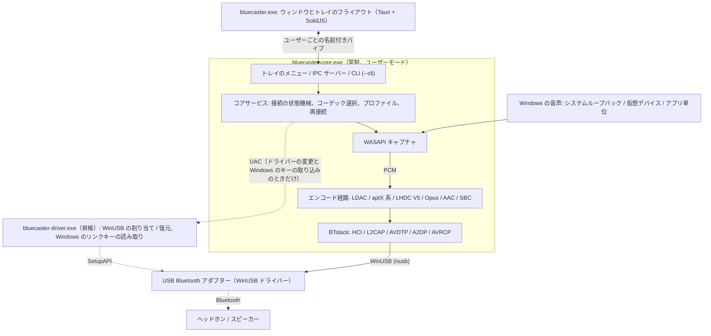
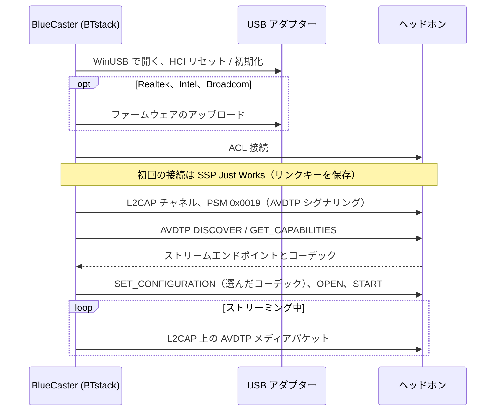
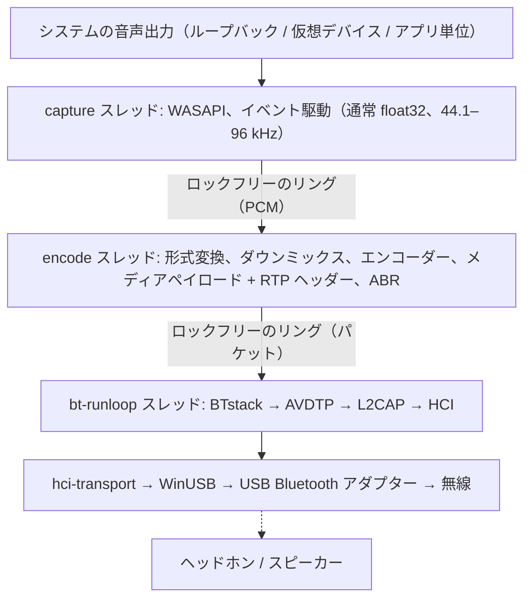
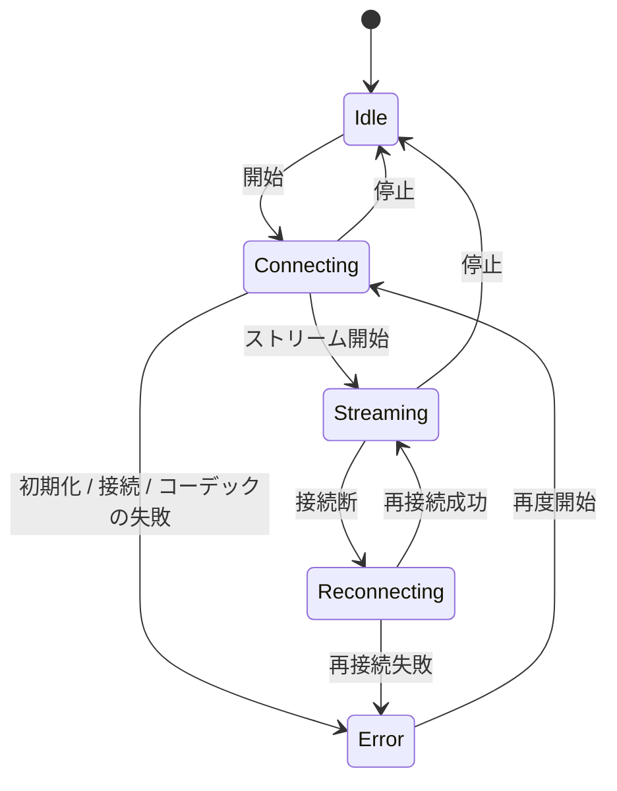

# アーキテクチャ
{: .no_toc }

## 目次
{: .no_toc .text-delta }

1. TOC
{:toc}

---

## 概要 {#overview}

BlueCaster は、Windows で LHDC V5、LDAC、aptX Adaptive、aptX HD、aptX Low Latency、aptX、Opus、AAC、SBC XQ、SBC の Bluetooth オーディオを使えるようにします（LE Audio の LC3 にも実験的に対応）。Windows 標準の Bluetooth スタックが A2DP で対応するのは SBC、クラシック aptX、AAC（Windows 11 のみ）だけですが、このツールはカーネルドライバーなしでそれ以外のコーデックを追加します。

**BTstack + WinUSB** を使います。完全にユーザーモードで動作し、ドライバー署名は不要です。

BlueCaster 2.0 は Rust で書かれています。置き換えの効かない C ライブラリ（BTstack と各コーデックのエンコーダー）はソースからビルドし、小さな FFI クレートを通して呼びます。それ以外は SBC エンコーダーも含めてすべて Rust です。

## プロセス {#processes}

BlueCaster は最大 3 つのプログラムで動きます。

| プログラム | 動いている間 | 役割 |
|:--------|:-----|:-----|
| `bluecaster-core.exe` | BlueCaster の実行中（ウィンドウ、スタートメニュー、**Windows 起動時に開始** から起動） | Bluetooth、音声の取り込みとエンコード、プロファイルと設定、トレイのアイコンとそのメニュー、IPC サーバー。`--cli` を付けると同じコアをコンソールで動かします |
| `bluecaster.exe` | ウィンドウを開いている間だけ（最後のウィンドウを閉じてから 3 分で終了） | メインウィンドウとトレイのフライアウト（Tauri 2、SolidJS + TypeScript）。自分では状態を持ちません |
| `bluecaster-driver.exe` | ドライバーの変更 1 回、またはキーの取り込み 1 回の間だけ、管理者権限（UAC）で | アダプターへの WinUSB の割り当てか元のドライバーへの復元、または Windows の Bluetooth がアダプターについて保持しているリンクキーの読み取り（`windows-keys`）をして終了します |

- **コアは Windows サービスではありません。** サインインしたユーザーの普通のプロセスとして動きます。WASAPI ループバックで取り込むのは、そのユーザーのセッションの音だからです。セッションごとの mutex で 1 つだけに保ち、もう一度起動するとウィンドウが開きます。
- **トレイはコア側にあります。** 右クリックのメニュー（開く、最初の 10 台のデバイス、切断、終了）は、ウィンドウを起動せずにすぐ開きます。左クリックでウィンドウのフライアウト（設定によってはメインウィンドウ）を起動します。
- **ウィンドウは表示だけを担当します。** コアの状態のスナップショットを受け取り、その後は変化だけを受け取ります。ウィンドウを閉じても、ウィンドウが落ちても音は止まりません。ウィンドウを閉じると隠れるだけなので、トレイからすぐに開き直せます。
- **コマンドラインも同じコアを使います。** `bluecaster-core.exe --cli` はトレイと IPC なしでコアサービスを動かします。エミュレーターテストもこの方法で動きます。

## トランスポート: BTstack + WinUSB {#transport-btstack--winusb}

WinUSB（Microsoft 署名済みの汎用 USB ドライバー）経由で USB Bluetooth アダプターと直接通信し、Windows の Bluetooth スタックを完全にバイパスします。ソース公開の Bluetooth スタック（非商用ライセンス）である BTstack が、HCI、L2CAP、AVDTP、A2DP をユーザーモードで実装します。

**利点**:
- ドライバー署名のコストが不要
- テスト署名モードが不要
- Secure Boot の無効化が不要
- すべてのコードがユーザーモードで動作（デバッグが容易）

**トレードオフ**:
- 専用の USB Bluetooth アダプターが必要（Windows の内蔵 Bluetooth とは別）
- WinUSB が使っている間、そのアダプターは通常の Windows の Bluetooth としては使えない
- デバイスのアドレスは手入力するか、USB アダプターでの検索（GAP inquiry）で見つける

**動作の流れ**:
1. USB Bluetooth アダプターに WinUSB を割り当てる。アプリで（**アダプタ > WinUSB ドライバに置き換える**、[ドライバーの割り当て](#driver-assignment)を参照）、または Zadig で
2. `hci-transport` クレートが `nusb` で WinUSB 経由でアダプターを開き、BTstack の HCI トランスポートとしてつなぐ
3. BTstack が HCI コマンドを送って Bluetooth コントローラーを初期化する
4. （Realtek、Intel、Broadcom のアダプター）必要ならファームウェアをアップロードする
5. BTstack が ACL 接続を確立し、L2CAP チャネル（PSM 0x0019）を開く
6. AVDTP シグナリングでリモートの SEP を検出し、コーデックをネゴシエーションする
7. エンコードした音声を、L2CAP 上の AVDTP メディアパケットとして送る

USB トランスポートには、v1 で実機のアダプターのために必要だった復旧処理がそのまま入っています。アダプターを開くときにイベントと ACL のパイプをリセットし、失敗したイベントの読み取りはやり直し、HCI コマンドにはタイムアウトを設け、アダプターを閉じるときは HCI Reset を送ります（ブートローダーのままのコントローラーには送りません）。こうして次のセッションは、アイドル状態のコントローラーから始められます。

## クレート構成 {#crate-structure}

ひとつの Cargo workspace（リポジトリ直下の `Cargo.toml`）を 5 つの層に分けています。各層は下の層にだけ依存します。ライブラリは `app/src/crates/`、プログラムは `app/src/core`、`app/src/ui`、`app/src/driver` にあります。取り込んだ `aptx-adaptive` は `codec` のパス依存で、workspace には入れていません。`unsafe` を書けるのは `*-sys` クレートと `win-sys` だけで、それ以外のクレートには `#![forbid(unsafe_code)]` が付いています。

| 層 | クレート | 役割 |
|:------|:------|:-----|
| 1. FFI | `btstack-sys` | BTstack を `cc`（MSVC）でビルドし、手書きの FFI 宣言と安全なラッパー、`btstack_config.h` を持つ。BTstack を呼べるのはランループのスレッドだけで、`!Send` の `Stack` トークンでこれを強制する |
| 1. FFI | `ldac-sys`、`openaptx-sys`、`fdkaac-sys`、`lhdcv5-sys`、`opus-sys`、`lc3-sys` | C のエンコーダーをビルドして提供する。ライブラリごとに 1 クレートにして、それぞれのライセンスを分けておく |
| 1. FFI | `win-sys` | Rust のライブラリがない Win32 API: MMCSS、既定のオーディオデバイス（IPolicyConfig）、WLAN API（AFH）、電源通知、Run キー、メディアキー、パイプの DACL、昇格、WinUSB ドライバーの割り当て（SetupAPI）、Windows 自身の Bluetooth（その無線、ペアリング済みのデバイス、リンクキー） |
| 2. 部品 | `hci-transport` | `nusb` による HCI over USB（"H2"）と、仮想コントローラー（`tools/emu`）への H4 over TCP |
| 2. 部品 | `aptx-adaptive` | Rust の aptX Adaptive エンコーダー（AKS-Logic/aptx-adaptive-linux から取り込み、MIT） |
| 2. 部品 | `codec` | `Encoder` トレイト、SBC エンコーダー（Bluedroid 版の Rust 移植）、C エンコーダーの安全なラッパー、Codec Information の解析とコーデックの選択 |
| 2. 部品 | `audio-capture` | `wasapi` クレートによる WASAPI キャプチャ: システムループバック、仮想デバイス、アプリ単位（プロセスループバック）。デバイスとアプリの一覧、テストトーン、アプリごとの音量（音量ミキサー） |
| 3. エンジン | `bt-host` | BTstack を専用スレッドで動かし、コマンドと型付きイベントで操作する: GAP、A2DP Source、AVRCP、SDP、パススルー用の RFCOMM チャネル（`rfcomm.*`）、リンクキー、デバイスの SDP サービス、AFH、ファームウェアの読み込みとチップのローダー（`bringup`）、チップのプローブとチップスクリプト、HCI キャプチャ（`.pklg`）、LE Audio（`le/`） |
| 2. 部品 | `le-audio` | LE Audio（実験的）: BTstack にも Windows にも依存しないロジック（Assigned Numbers、LTV、PACS / ASCS の PDU、プリセット、CSIP / VCP / MCP / CCP のモデル） |
| 3. エンジン | `pipeline` | PCM のリング、形式変換、ダウンミックス、エンコード、メディアペイロード、送信ペース、ABR |
| 4. コア | `bluecaster-core`（ディレクトリ `core`） | 状態機械、再接続、スリープと復帰、プロファイル、設定と v1 からの移行、音量の連動、出力のミュート、更新チェック、Realtek のファームウェアのダウンロード、受信機テストのクライアント、統計、ベンダーのプロトコル（`vendor/`） |
| 4. コア | `ipc` | コアとウィンドウで共有するプロトコルの型（serde。TypeScript の型は `ts-rs` で生成）とパイプのフレーム |
| 5. プログラム | `bluecaster-core-exe`（`app/src/core`） | `bluecaster-core.exe`: コア、トレイ（`tao` のイベントループ上の `tray-icon`）、IPC サーバー、`--cli` |
| 5. プログラム | `bluecaster-ui`（`app/src/ui`） | `bluecaster.exe`: Tauri 2。Rust 側は IPC クライアントで、ページは SolidJS + TypeScript + Vite |
| 5. プログラム | `bluecaster-driver`（`app/src/driver`） | `bluecaster-driver.exe`: 昇格ヘルパー |

## 音声の経路とスレッド {#audio-path-and-threads}

| スレッド | 優先度 | 仕事 |
|:-------|:---------|:-----|
| capture | MMCSS "Audio" | WASAPI を読む。無音の区間は無音で埋める |
| encode | MMCSS "Pro Audio" | エンコーダーの入力形式に変換し、エンコーダーのブロック単位でエンコードし（残りは次の回へ）、フレームをメディアペイロードに詰める。約 10 ms ずつ処理して、パケットを均等に送り出す |
| bt-runloop | -- | BTstack のランループ。L2CAP が送れる状態になるたびに、キューのパケットを送る。送信キュー（64 パケット）は、パケットを入れるたびに、350 ms 待ったパケットを古い順に捨てる |
| USB | -- | WinUSB の転送: 各 IN パイプ（イベント、ACL データ）で 3 本の読み取りを並行して待ち、書き込みはコマンド用と ACL データ用に 1 つずつ（同時に最大 8 本の転送） |
| core | 通常 | 状態機械、IPC（tokio。RFCOMM パススルーの接続ごとのキュー）、設定、統計（4 Hz）、更新チェック |

配信が始まった後の音声の経路では、メモリの確保もロックもしません。統計はアトミックなカウンターで、コアが 1 秒に 4 回読みます。BTstack はスレッド安全ではないので、ほかのスレッドはコマンドを送り、それを bt-runloop スレッドが実行します。

## コアと IPC {#core-and-ipc}

ウィンドウとコアは、ユーザーの名前付きパイプ `\\.\pipe\bluecaster-<user SID>` で通信します。パイプの DACL はそのユーザーだけを許可します。メッセージは長さ付きの JSON フレームです。

1. ウィンドウが `hello { protocol, client }` を送ります。プロトコルのバージョンが違うコアは `reject` で答え、ウィンドウは 2 つのプログラムのバージョンが違うと表示します。そうでなければ、コアは `welcome { protocol, server, features }` で答えます。`features` はプロトコルへの追加（`rfcomm`）を示します。
2. コアが `snapshot` を送ります。状態全体（アダプター、デバイス、ストリーム、プロファイル、設定、更新）とリビジョン番号です。
3. 以降、コアは変化を `event` で送ります。リビジョンを取りこぼしたら、ウィンドウはスナップショットを取り直します。
4. 操作は `request { id, method, params }` で、`response { id, result | error }` が返ります。メソッドのグループは `state.*`、`stream.*`、`device.*`、`profile.*`、`settings.*`、`adapter.*`、`audio.*`、`diag.*`、`receiver.*`、`rfcomm.*`、`app.*` です。

ほかのプログラムも同じパイプを使います。必要なことは [連携（IPC）](integration) にあります。3.0.0 より前のバージョンでは、パイプの名前は `\\.\pipe\a2dpwb-<user SID>` でした。コアは 3.0.0 の後も少なくとも 6 か月は、その名前でも待ち受けます。

エラーは文言ではなく、パラメーター付きのコード（例: `adapter.driver_missing`）です。ウィンドウがそれを翻訳し、メッセージの横に直し方を出します。高頻度のデータ（通信品質、ログ）は、画面が購読している間だけ送ります。

接続の状態機械:

失敗した接続は最大 3 回まで試します。切れたリンクは最大 3 回、スタックを再起動した後（スリープ、動かなくなったアダプター）は最大 10 回まで再接続します。PC がスリープに入るときは、切れたリンクを失敗として数えずに BTstack を止め、PC が復帰した後に再接続します。

## ドライバーの割り当て {#driver-assignment}

Windows 8 以降には、Microsoft 署名済みの WinUSB ドライバー（`winusb.inf`）が標準で入っています。`bluecaster-driver.exe` は、デバイス マネージャーの「ドライバーの更新 > 一覧から選択 > WinUsb デバイス」と同じことを SetupAPI で行います。

1. デバイスインスタンス ID でアダプターを開きます。
2. `Device Parameters` に `DeviceInterfaceGUIDs` の値を書き込み、WinUSB がデバイスインターフェースを登録するようにします。
3. `%SystemRoot%\INF\winusb.inf` の "WinUsb Device" のモデルを選び、`DiInstallDevice` でインストールします。標準の署名済みドライバーなので、証明書はインストールしません（Zadig / libwdi は、生成した INF を自作の証明書で署名します）。
4. **復元**: デバイスを削除（`DiUninstallDevice`）して再列挙すると、Windows が一番順位の高いドライバー（通常は `BthUSB` かメーカーのドライバー）を選び直します。割り当て前のドライバーは設定フォルダー（`driver\`）に記録しておき、復元の後に比べます。`restore --records <folder>` は、記録のあるアダプターをまとめて 1 回の昇格で復元します。アンインストーラーは確認のうえでこれを使います。

コアは管理者として動きません。割り当てと復元のときは、UAC の確認付きでヘルパーを起動し（`ShellExecuteEx` の "runas"）、その JSON の結果を読みます。アダプターとそのドライバーの一覧には昇格は不要です。

## 主要モジュール {#key-modules}

### コーデックの選択（`codec::caps`） {#codec-choice-codeccaps}

- リモートの能力を解析する: 標準の SBC と AAC の要素、ベンダーコーデック。aptX LL は両方の Vendor ID、aptX Adaptive は R1 と R2 のシンク（48 kHz ステレオでのみ使える）
- コーデックを選ぶ: 自動では、リモートが提示するうちで最も音質の高いコーデックを選ぶ。リモートが提示しないコーデックを求めた場合は、自動が選ぶのと同じコーデックに置き換え（プロファイルでは issue #86 以降は常に、コマンドラインでは `--fallback` のときだけ）、それ以外はエラーにする
- 実験的コーデック（aptX HD、aptX LL、Opus、Opus 05、FastStream）は、コマンドラインの `--no-experimental` で自動とフォールバックから外す。アプリでは常に使う（2.0.2-beta.7 のコーデック画面で入った `experimental_codecs` の設定は、issue #86 以降はオンとして読む）
- `auto_codec` の設定がオンの間（**コーデック > 対応するコーデックのうち最も音質の高いものを自動で選ぶ**。schema 5 以降はすべてのデバイスで 1 つの設定）、すべての A2DP プロファイルを自動の既定の設定で、自動として配信する。デバイスに選んだコーデックは、オフのときのためにプロファイルに残る
- 自動選択がオフのときは、ユーザーがカードをドラッグして決めたデバイスのコーデックの順番（プロファイルの `codec_order`。`codec::AutoOrder`。空なら音質の高い順）に従って、自動の選択と、選んだコーデックのフォールバックを決める。自動選択の間は既定の順番。FastStream と Opus 05 は、自動の選択にもフォールバックにもならない（2.0.2 のベータでは、すべてのデバイスに共通の 1 つの順番が settings.json の `auto_order` にあったが、今は無視する）
- aptX 系のサンプルレートを選ぶ（リモートが通知するレートから 44.1 / 48 kHz。キャプチャのリサンプリングは WASAPI が行う）。aptX Adaptive は 48 kHz。96 kHz を選び、音質が高音質で、シンクが R2 で 96 kHz を通知していれば 96 kHz。自動のレート（自動選択でも）は 48 kHz を求め、それがなければ各コーデックの選択がシンクの通知する中で最良のものを選ぶ（issue #86: シンクが通知する最高のレートでも、Windows のミックスのレートでもない）
- プロファイルの音質を、そのコーデックが持つ音質に対応させる（`Quality::for_codec`、issue #86）: LDAC と LHDC V5 は High / Medium（`sq`）/ Low（`mq`）、LHDC V5 には Medium-High（`mhq`）もある。aptX Adaptive は High / Low Latency。ほかのコーデックはすべて High（デバイスが受け付ける最高のビットレート）。そのコーデックにもうない音質（aptX Adaptive の Standard / Mobile、AAC の下の段階）は High として動く
- デバイスが提示した各コーデックが通知した内容（`KnownCodecs.caps`: サンプルレート、ビット深度、最大ビットレート。`RemoteCaps::listed_*`）を記録し、コーデックの設定ではそれだけを選べるようにする。SBC の bitpool の範囲は以前から記録している

### Bluetooth ホスト（`bt-host`） {#bluetooth-host-bt-host}

**責務**:
- USB（または TCP）の HCI トランスポートで、BTstack を専用スレッドで動かす
- ストリームエンドポイントの登録: ベンダーコーデック（LDAC、aptX HD、aptX、aptX LL、LHDC V5、FastStream、Opus、Opus 05、aptX Adaptive）と SBC（SBC XQ も使う）、AAC。合わせて 11 個（BTstack の `MAX_NR_AVDTP_STREAM_ENDPOINTS`）
- SDP レコードの登録（A2DP Source、AVRCP Controller、AVRCP Target。その実験的な設定がオンの間は、バッテリー残量のためだけに HFP Audio Gateway も）
- SSP ペアリングの管理（Just Works、General Bonding。リンクキーを永続化）
- 接続タイムアウトの後は半開きの接続を切断し、再試行できるようにする
- 失敗した接続を再試行し（最大 3 回）、原因（応答なし、無通信のリンク、相手からの切断、認証）を区別する。デバイスがもう知らないリンクキーは削除して、ペアリングし直す
- デバイス検索のための GAP inquiry
- AVRCP の絶対音量とヘッドホンのボタン
- AFH のホストチャネル分類と、通信品質の表示のための RSSI / AFH の読み取り
- ファームウェアの読み込み: Realtek と Broadcom は BTstack のチップセットドライバーで、Intel（レガシーと TLV のブートローダー）は共通のチップローダーのインターフェース（`bringup`）の上の Rust で行い、その進み具合はアダプターの起動中にアダプタ画面に表示する
- 開発者モード: チップのプローブ（アダプターが標準の読み取りコマンドに何を答えるか。`logs\probe\` に JSON のレポート）、チップスクリプト（テキストで書いた要求を WinUSB のアダプターで実行）、接続中のデバイスが公開する SDP サービス
- HCI キャプチャ（`.pklg`）。接続中に始めた場合も接続時のやり取りを含める

**使用している主な BTstack API**:
- `a2dp_source_create_stream_endpoint()` — コーデックのエンドポイントを登録
- `a2dp_source_establish_stream()` — A2DP シンクに接続
- `a2dp_source_set_config_other()` — ベンダー固有のコーデックを設定
- `a2dp_source_stream_send_media_payload_rtp()` — エンコードした音声を RTP ヘッダー付きで送信（LDAC、aptX HD、AAC、SBC、SBC XQ、LHDC V5、Opus）
- `a2dp_source_stream_send_media_packet()` — RTP ヘッダーなしの生のメディアパケット（aptX、aptX LL、FastStream）、または BlueCaster 自身の RTP ヘッダー付きのメディアパケット（aptX Adaptive）を送信

### 音声の取り込み（`audio-capture`） {#audio-capture-audio-capture}

Windows Audio Session API で音声をリアルタイムに取り込みます。
- 既定の出力デバイスのシステムループバック、選んだ（仮想）デバイスのループバック、またはアプリとその子プロセスのプロセスループバック（Windows 10 build 19041 以降）
- デバイスの共有モードのミックスフォーマット（通常 float32）で渡す。エンコーダー向けの変換は pipeline が行う
- アプリケーションのモードでは、アプリの起動を待ち、アプリを再起動しても取り込み直す
- Windows の音量ミキサーと同じように、既定の出力でのアプリの音量とミュートを設定する（`mixer`）。セッションの音量はループバックのキャプチャに反映され、システムループバックの配信中にコアがその出力をミュートしている間（`bluecaster-core::mute_output`）も同じ

### ベンダーのプロトコル（`bluecaster-core::vendor`） {#vendor-protocols-bluecaster-corevendor}

イヤホンによっては、純正アプリがイヤホン独自の RFCOMM サービスでモードを切り替えてからでないと、あるコーデックやビットレートを提示しません。ベンダーごとに 1 つのモジュールが、BlueCaster が持っているリンクでそれを行います。対象のイヤホンは、そのイヤホンが名乗る名前で見分けます。

- **Huawei / Honor**: LDAC を通知しないイヤホンに LDAC を求めるプロファイルは、イヤホンの「音質優先」モードを設定してから接続し直す。もともとモードがオフだったイヤホンは、それで LDAC にならなければオフに戻す。自動では行わない
- **OPPO**: LHDC V5 で配信するとき（自分で選んだときも自動のときも）、イヤホンに一度だけ Hi-Res を求め、その後に通知する内容を読むために一度だけ接続し直す。そうしたことの記録は、デバイスのコーデックの情報（`device_codecs.json`）と一緒に、`device.forget_codecs` で消すまで残る

開発者モードの **ベンダー** タブで、それぞれをいつ使うか（名前で自動、常に、使わない）を上書きでき、ベンダーごとのオプションもあります。

### ペアリング（`link_keys`、`win-sys::bt_keys`） {#pairings-link_keys-win-sysbt_keys}

リンクキーは `link_keys.txt` に保存します。デバイスを追加する画面で、コアは BlueCaster が今使っているアダプターについて Windows の Bluetooth が保持していたキーを引き継げます。`bluecaster-driver.exe windows-keys` がそれを読み（UAC の確認が 1 回）、BlueCaster がすでに持っているキーはそのまま残し、その中のオーディオデバイスを Windows での名前で保存します。開発者モードでは、デバイスのリンクキーと、デバイスが公開する SDP サービスを表示します。

### オーディオエンコーダー {#audio-encoders}

| エンコーダー | ライブラリ | ビットレート | 特徴 |
|---------|---------|---------|----------|
| LHDC V5 | lhdcv5-enc（AOSP エンコーダーの C 移植） | 400/500/900/1000 kbps（Low/Medium/Medium-High/High）、シンクが通知する最大以下、ABR 160–400 kbps | 16/24 bit、5 ms フレーム、2 バイトのメディアペイロードヘッダー、RTP ヘッダー |
| LDAC | libldac (AOSP) | 330/660/990 kbps | High/Medium/Low（HQ/SQ/MQ）モード、ABR |
| aptX Adaptive | aptx-adaptive（AKS-Logic/aptx-adaptive-linux の純 Rust のエンコーダー、MIT） | High 427 kbps、Low Latency 265 kbps（R2 のシンク: 270）。ABR で 364/318 に下がる（R2: 270/204） | 48 kHz ステレオ（選んだときは、96 kHz を通知する R2 のシンクへ High で 96 kHz: 646/340/255 kbps）、24 bit。メディアパケット 1 つにコーデックのパケット 1 つ、BlueCaster 自身の RTP ヘッダー付き。High で ABR。自動では LHDC V5 と LDAC の次に選ぶ |
| Opus | libopus 1.5.2 | 256 kbps（ステレオ。モノラルは半分） | 実験的。Android の A2DP Opus: 48 kHz、20 ms フレーム（シンクが 10 ms だけならそれ）、メディアペイロードに収まる上限付きの制約付き VBR、1 パケットに 1 フレーム、1 バイトのメディアペイロードヘッダー、RTP ヘッダー |
| aptX HD | libopenaptx | 576 kbps | 24 bit 入力、固定レート、RTP ヘッダー |
| aptX | libopenaptx | 352/384 kbps（44.1/48 kHz） | 16 bit ステレオ、RTP ヘッダーなし |
| aptX LL | libopenaptx | 352 kbps | 約 32 ms の遅延、RTP ヘッダーなし、パケットは約 7.5 ms 以下 |
| AAC | fdk-aac | 最大 256 kbps（シンクが通知するビットレート以下） | AAC-LC、LATM トランスポート |
| SBC XQ | 同じ SBC エンコーダー | 約 385/505/552 kbps | デュアルチャネル、bitpool 47 / 43（44.1 / 48 kHz、High）。シンクの SBC がデュアルチャネルと 29 以上の bitpool を許すときだけ（bitpool は PipeWire と同じくシンクの最大で抑える）。SBC のストリームエンドポイント、メディアペイロードヘッダー、RTP ヘッダーを共用 |
| SBC | Bluedroid エンコーダーの Rust 移植 | 最大約 345 kbps | A2DP の必須のベースライン。C 版とビット単位で一致（すべての設定でテスト） |
| FastStream | 同じ SBC エンコーダー | 198/216 kbps（44.1/48 kHz） | CSR のベンダーコーデック、音楽の方向のみ（音声の戻りのチャネルなし）: SBC ジョイントステレオ bitpool 29、フレームを 72 バイトに埋め、1 パケットに 3 フレーム、メディアペイロードヘッダーも RTP ヘッダーもなし（PipeWire と同じ）。自動では選ばない |

すべてのエンコーダーは `codec::Encoder` トレイトを実装しています。入力の PCM 形式と 1 回の呼び出しで使うフレーム数を示し、コーデックのフレームを返します。

libopenaptx は、4 ステレオサンプル単位のパック済み 24 bit リトルエンディアン PCM を受け取ります。aptX のラッパーが 16 bit または 32 bit のサンプルをこの形式に変換し、モノラルの入力は両チャネルに複製します。

## ベンダーコーデックの情報要素 {#vendor-codec-information-elements}

標準ではないコーデックは、AVDTP で Vendor Specific として登録します。

| コーデック | Vendor ID | Codec ID |
|-------|-----------|----------|
| LHDC V5 | Savitech (0x0000053A) | 0x4C35 |
| LDAC | Sony (0x0000012D) | 0x00AA |
| aptX Adaptive | Qualcomm (0x000000D7) | 0x00AD |
| Opus | Google (0x000000E0) | 0x0001 |
| aptX HD | Qualcomm (0x000000D7) | 0x0024 |
| aptX | APT (0x0000004F) | 0x0001 |
| aptX Low Latency | CSR (0x0000000A) または Qualcomm (0x000000D7) | 0x0002 |
| FastStream | CSR (0x0000000A) | 0x0001 |
| Opus 05 | The Linux Foundation（0x000005F1、PipeWire） | 0x1005 |

AAC と SBC は、A2DP の仕様で定義された標準のコーデック ID を使います。

コーデック情報要素のサイズ（6 バイトの Vendor ID / Codec ID を含む）:

- **aptX**: 7 バイト（バイト 6 = サンプルレート / チャネルモード）
- **aptX HD**: 11 バイト（バイト 6 は aptX と同じ、加えて予約の 4 バイト）。ステレオが必須
- **aptX LL**: 8 バイト。シンクが拡張（"new caps"）フラグを立てていれば 17 バイト。BlueCaster は aptX LL のエンドポイントを 1 つ登録し、シンクが使った Vendor ID でストリームを設定します
- **LHDC V5**: 11 バイト（Android `a2dp_vendor_lhdcv5_constants.h`）。バイト 6 がサンプルレート（0x20 44.1k、0x10 48k、0x04 96k、0x01 192k）、バイト 7 がビット深度（0x04 16 bit、0x02 24 bit）とシンクの最小 / 最大ビットレートの制限、バイト 8 がコーデックのサブバージョン（0x01 = V5 ver.1）と 0x10 = 5 ms フレーム、バイト 9-10 がオプションの機能（低遅延、ロスレス、JAS、AR、META。BlueCaster はどれも提示しません）。ステレオのみ。シンクのビットレートの制限は、Android と同じく設定にそのまま返し、エンコーダーにも適用します。メディアパケットには 2 バイトのペイロードヘッダー（フレーム数 << 2（遅延のビットは 0）とシーケンス番号）が付きます
- **FastStream**: 8 バイト（PipeWire `a2dp_faststream_t`）。バイト 6 が方向（0x01 シンク = 音楽、0x02 ソース = 音声）、バイト 7 の下位 4 ビットがシンクのレート（0x2 44.1k、0x1 48k）、上位 4 ビットがソースのレート（0x2 16k）。BlueCaster は音楽の方向だけを提示し、設定します
- **Opus**: 7 バイト（Android `a2dp_vendor_opus_constants.h`）。バイト 6 のビット 2..0 がチャネルモード（0x01 モノラル、0x02 ステレオ、0x04 デュアルモノラル）、ビット 4..3 がフレーム長（0x08 10 ms、0x10 20 ms）、ビット 7 が 48 kHz。BlueCaster はモノラルとステレオ、10 ms と 20 ms を提示し、20 ms ステレオで設定します（モノラルは、モノラルの入力をそれに対応するシンクへ送るときだけ）。メディアパケットには、1 バイトのペイロードヘッダー（下位 4 ビットがフレーム数 1）に続けて Opus のパケットを 1 つ入れます
- **aptX Adaptive**: 40 バイト。BTstack の能力のイベントではシンクのコーデック情報が 30 バイトに切られますが、BlueCaster が使う値はすべてその中にあります。SET_CONFIGURATION: 48 kHz でソースタイプ 2（ホストのエンコーダー: 再生のタイミングはシンク自身が決める）、ステレオ。R1 のシンクにはシンク自身の目標遅延のバイトを返し、LL0 は少なくとも 80 ms に上げ、HQ の遅延が 0 なら 200 ms にします。R2 のシンクにはソース自身の R2 ブロックを送ります

**RTP ヘッダーの有無**: LDAC、aptX HD、AAC、SBC、SBC XQ、LHDC V5、Opus のメディアパケットには 12 バイトの RTP ヘッダーが付きます。aptX、aptX LL、FastStream は（Android や PipeWire と同じく）RTP ヘッダー **なし** で送るので、L2CAP MTU 全体を aptX のフレームに使えます。

**aptX Adaptive** は、メディアパケット 1 つにコーデックのパケットを 1 つ入れ、BlueCaster 自身の 12 バイトの RTP ヘッダーを付けて送ります（BTstack は付けません）。ペイロードタイプ 96、シーケンス番号はパケットごとに +1、タイムスタンプはパケットのチャネルあたりのサンプル数（時刻ではありません）、SSRC はシンクの遅延モード（HQ 0x000000A3、LL 0x000000A1）です。ペイロードは 16 ビット単位でバイトを入れ替えます。HQ のパケットは 656 バイト（12 ms）、LL のパケットは 348 バイト（10 ms）です。自動は、クラシック aptX、Opus、AAC よりもこれを優先し（issue #86 の順番）、LHDC V5 と LDAC の次に選びます。

## 設定とファイル {#settings-and-files}

すべて設定フォルダー `%APPDATA%\BlueCaster`（または環境変数 `BLUECASTER_CONFIG_DIR` で指定したフォルダー）に保存します。v1 と 2.0.x にあったファイルはその形式のままです（2.0.x は `%APPDATA%\A2DPWB` を使っていました。3.0.0 は初回起動時にそのフォルダーの名前を変え、ファイルを下のフォルダーに振り分けます）。

| パス | 内容 |
|:-----|:---------|
| `settings.json` | アプリの設定。`schema_version` 付き。知らないキーも消さずに残す |
| `profiles.json` | プロファイル |
| `devices\devices.txt` | 既知のデバイス |
| `devices\le_audio_devices.txt` | LE Audio（実験的）: デバイス一覧の LE Audio の項目 |
| `devices\device_codecs.json` | クラシックの各デバイスが前回の接続で提示した内容（と、OPPO のイヤホンに Hi-Res を求めたかどうか） |
| `pairing\link_keys.txt` | リンクキー。v1 や 2.0.x でペアリングしたヘッドホンは、ペアリングし直さずに再接続する |
| `pairing\le_audio_bonds.tlv`、`pairing\le_audio_csip.txt` | LE Audio（実験的）: LE のボンディング情報（GATT サーバーが保持する CCC の値を含む）とコーディネートセット |
| `adapters\adapter_caps.json` | スタックが各アダプターについて知ったこと（LE Audio への対応、アドレス、HCI のバージョン、Windows でのアダプターの名前） |
| `adapters\driver\<instance id>.json` | WinUSB を割り当てた各アダプターの、元のドライバー |
| `firmware\` | ファームウェアのファイル（`*.bin`、`*.hcd`、`ibt-*`。Intel のものは linux-firmware と同じ配置で `firmware\intel\` にも）。以前のバージョンが設定フォルダーに直接置いていたファイルはここに移す |
| `logs\<YYYY-MM-DD>\core.log`、`ui.log`、`driver.log` | コア、ウィンドウ、ドライバーのヘルパーのログ。1 日 1 フォルダー（UTC）。マスクはしない |
| `logs\hci\*.pklg` | HCI キャプチャ: ストリームが失敗したときや接続が切れたときに書き出すフライトレコーダーのもの（最新の 10 個）と、自分で開始したもの（`hci_<date>_<time>.pklg`） |
| `logs\probe\` | チップのプローブとチップスクリプトのレポート（最新の 10 個） |
| `logs\crash\` | クラッシュレポート: クラッシュごとにミニダンプ（`*.dmp`）とテキストファイル（プログラムごとに最新の 5 個） |
| `logs\bundles\*.zip` | 診断パッケージ（最新の 3 個） |
| `backup\v1\` | v2 の初回起動時に一度だけ作る、v1 の設定のコピー |
| `backup\v2\` | 3.0.0 の初回起動時に一度だけ作る、2.0.x の設定とペアリングのコピー |
| `backup\profiles-before-codecs.json` | コーデック画面が 1 台のデバイスの複数のプロファイルを 1 つにまとめる前の `profiles.json`（一度だけ書き出す） |

プログラムのフォルダーは `%LOCALAPPDATA%\BlueCaster\` です。3 つのプログラム、アンインストーラー、`licenses\`（`licenses\README.txt`、`licenses\bluecaster\LICENSE...`、`licenses\third-party\...`）が入ります。ファームウェアのダウンロードのキャッシュは `%TEMP%\bluecaster-cache` です。

## ビルドシステム {#build-system}

- プログラムは **Cargo** でビルドし、CMake は要りません。各 `-sys` クレートが `build.rs` で `extern/` の git サブモジュールの C ライブラリを MSVC でコンパイルします。CMake でビルドするのは開発者向けツールの `tools/a2dp_decode` だけです
- ウィンドウのページは **Vite** でビルドし（`app/src/ui` で `pnpm build`）、Tauri が `bluecaster.exe` に埋め込みます
- IPC プロトコルの TypeScript の型は、Rust の型から生成します（`cargo test -p ipc export_bindings`）
- 言語ファイル（`app/lang/*.json`）は、ウィンドウとコアのトレイメニューが使います
- `installer/build-release.ps1` がインストーラー（Inno Setup、`installer/BlueCaster.iss`）、ポータブル zip、更新用のマニフェストを作ります。[ビルド](building)を参照してください

## 重要な注意事項 {#important-considerations}

- **アダプターの互換性**: Realtek（最も検証済み）と CSR の USB アダプター。Intel と Broadcom は試験的。Realtek のアダプターは起動時にファームウェアのアップロードが必要で、ブートローダーモードの Intel のアダプターも同じ
- **ペアリング**: SSP Just Works と General Bonding を使う。リンクキーはローカルのファイルに永続化するか、そのアダプターについて Windows の Bluetooth から引き継ぐ
- **2 つ目のアダプターを推奨**: Windows には内蔵の Bluetooth を残し、BlueCaster には専用の USB アダプターを使う
- 一部の Bluetooth アダプターは、ファームウェアが出せるビットレートを制限する
- USB Bluetooth 5.0 以上のアダプターは、一般に LDAC でよく動く
- 自動のコーデック選択の優先順位（音質順、issue #86）: LHDC V5 > LDAC > aptX Adaptive > Opus > aptX HD > aptX > aptX LL > AAC > SBC XQ > SBC（FastStream と Opus 05 は選んだときだけ）。デバイスが提示しないコーデックを選んでいる場合は、デバイスの順番で、デバイスが提示する最初のコーデックにフォールバックする
