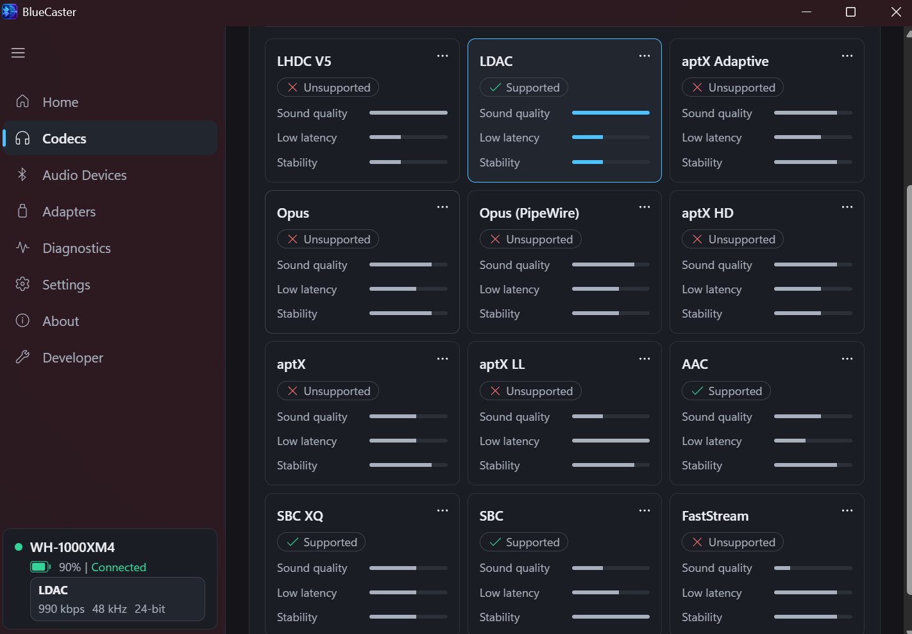
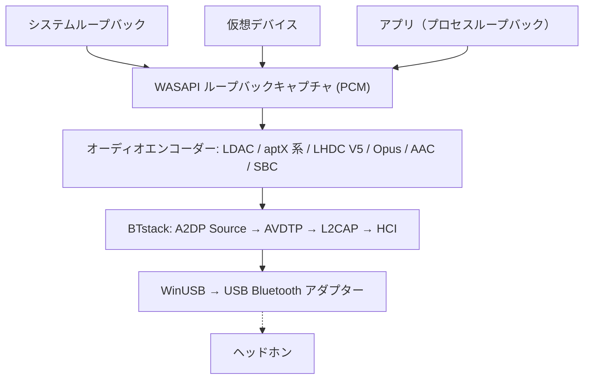

# A2DP Windows Bridge (A2DPWB)

Windows 向け Bluetooth A2DP オーディオストリーミングツール（全コーデック対応）
{: .fs-6 .fw-300 }

USB Bluetooth アダプターを WinUSB モードで使用し、**LDAC、aptX HD、aptX Low Latency、aptX、AAC、SBC、LHDC V5**（および試験的に **Opus** と PipeWire の **Opus 05**）でシステム音声をストリーミングします。カーネルドライバーやテスト署名は不要です。

[セットアップ](setup){: .btn .btn-primary .fs-5 .mb-4 .mb-md-0 .mr-2 }
[GitHub](https://github.com/SeiyaFunaokaJP/A2DP-Windows-Bridge){: .btn .fs-5 .mb-4 .mb-md-0 }

---

## 対応コーデック

| コーデック | ビットレート | サンプルレート | ビット深度 | レイテンシー |
|:-----------|:-------------|:---------------|:-----------|:-------------|
| LDAC | 330/660/990 kbps | 44.1--96 kHz | 16/24/32 bit | 約 200 ms |
| aptX HD 🧪 | 576 kbps | 44.1/48 kHz | 24 bit | 約 150 ms |
| aptX Low Latency 🧪 | 352 kbps | 44.1/48 kHz | 16 bit | 約 32 ms |
| aptX | 352/384 kbps | 44.1/48 kHz | 16 bit | -- |
| AAC | 128/192/256 kbps | 44.1/48 kHz | 16 bit | 約 150 ms |
| SBC XQ | 約 385/505/552 kbps | 44.1/48 kHz | 16 bit | 約 150 ms |
| SBC | 最大約 345 kbps | 44.1/48 kHz | 16 bit | 約 150 ms |
| FastStream 🧪 | 198/216 kbps | 44.1/48 kHz | 16 bit | -- |
| LHDC V5 | 400/500/900/1000 kbps、ABR 160--400 kbps | 44.1/48/96/192 kHz | 16/24 bit | -- |
| Opus 🧪 | 128/192/256 kbps | 48 kHz | 16 bit | -- |
| Opus 05 🧪 | 128/192/256 kbps | 48 kHz | 16 bit | -- |

### プラットフォーム別のコーデック対応（ヘッドホンへの送信）

| コーデック | Windows 10 標準 | Windows 11 標準 | Ubuntu 標準（PipeWire） | **A2DPWB**（Windows 10 / 11） |
|:-----------|:---------------:|:---------------:|:-----------------------:|:-----------------------------:|
| LDAC | ❌ | ❌ | ✅ | ✅ |
| aptX HD | ❌ | ❌ | ✅ | 🧪 実験的 |
| aptX Low Latency | ❌ | ❌ | ✅ | 🧪 実験的 |
| aptX | ✅ | ✅ | ✅ | ✅ |
| AAC | ❌ | ✅ | ❌ Ubuntu のパッケージに含まれない | ✅ |
| SBC XQ | ❌ | ❌ | ✅ | ✅（SBC でデュアルチャネルと bitpool 43 以上を許すシンク） |
| SBC | ✅ | ✅ | ✅ | ✅ |
| FastStream | ❌ | ❌ | ✅ | 🧪 実験的（音楽のみ、明示的に選んだとき） |
| LHDC V5 | ❌ | ❌ | ❌ | ✅ |
| Opus（Android の A2DP Opus） | ❌ | ❌ | ✅ PipeWire 1.2 以降（`opus_g`）。Ubuntu 24.04（PipeWire 1.0.5）にはない | 🧪 実験的 |
| Opus 05（PipeWire 独自の Opus） | ❌ | ❌ | ✅ PipeWire 0.3.57 以降（`opus_05`、相手も PipeWire のときだけ） | 🧪 実験的（明示的に選んだとき） |
| aptX Adaptive | ❌ | ❌ | ❌ | ❌ |

✅ 対応 · 🧪 実験的 · ❌ 非対応。どの列も送信側（PC → ヘッドホン）です。「標準」は A2DPWB を使わない OS 自身の Bluetooth オーディオで、Ubuntu の列は Ubuntu 26.04 の PipeWire（`libspa-0.2-bluetooth`）が持つコーデックです。

{: .warning }
**aptX HD・aptX Low Latency は実験的な対応です。** Android / PipeWire の実装に合わせ、エンコード→デコードの往復テストは通っていますが、実機のヘッドホンでの検証はまだです。表のレイテンシーは一般的な目安で、A2DPWB で測定した値ではありません。

{: .warning }
**LHDC V5 について。** Google が Android 17（AOSP、Apache-2.0）に追加した LHDC V5 エンコーダーの C 移植版を使用しています。移植版は AOSP の Rust 版エンコーダーとビット単位で一致することを確認済みで、A2DP のシグナリングは Android の `a2dp_vendor_lhdcv5` に合わせています。実機の LHDC V5 ヘッドホンでも、ユーザーにより v1.1.1-beta.1 で 1000 kbps / 192 kHz での動作が確認されています（[#50](https://github.com/SeiyaFunaokaJP/A2DP-Windows-Bridge/issues/50)）。v2 も同じエンコーダーを使います。対応するのはロッシーの LHDC V5 のみで、LHDC V2/V3（従来機）とロスレスの「LHDC-RAW」にはオープンソースのエンコーダーがありません。自動選択では LHDC V5 は LDAC・aptX 系より下、AAC・SBC より上に位置します。

{: .warning }
**Opus は実験的な対応です。** Android の A2DP Opus ベンダーコーデック（Android 13 以降、ベンダー ID 0x000000E0 Google）で、48 kHz・20 ms フレーム・ステレオ 256 kbps（Android が要求する値。標準 192、モバイル 128 kbps）を libopus 1.5.2 でエンコードします。仮想シンクとのエンドツーエンドテストには合格していますが、実際の Opus 対応ヘッドホンでは未確認です。自動選択では LHDC V5 の下、AAC / SBC の上です。

{: .warning }
**Opus 05 は実験的な対応で、実機では未確認です。** PipeWire 独自の A2DP Opus ベンダーコーデック（ベンダー ID 0x000005F1、コーデック ID 0x1005、PipeWire の `opus_05`）で、実装しているのは PipeWire だけなので、受け手は A2DP シンクとして動く PipeWire の PC に限られます。A2DPWB が送るのはステレオの音楽の方向だけ（5.1 / 7.1 や戻りの音声はなし）で、48 kHz・10 ms フレーム（シンクが 20 ms だけならそれ）、エンコーダーとビットレートは Opus と同じで、シンクの上限で頭打ちにします。自動選択では選ばないので、プロファイルか `-c opus05` で選んでください。PipeWire と同じ能力を出す仮想シンクとのエンドツーエンドテストには合格していますが、実際の PipeWire では試していません。A2DP シンクとしての PipeWire は、Opus 05 を 0.3.57 から、Android の Opus（`opus_g`）を 1.2.0 から受けられます。Ubuntu 24.04 LTS の PipeWire 1.0.5 は Opus 05 だけ、Ubuntu 25.10（1.4.7）と 26.04 LTS（1.6.2）は両方です。どちらも A2DPWB ではまだ確かめていません。

{: .warning }
**SBC XQ** は Sony WH-1000XM4 で確認済みです（デュアルチャネル、48 kHz で bitpool 43、552 kbps）。この設定を拒否するシンクには、通常の SBC でつなぎ直します。**FastStream は実験的な対応です。** 仮想シンクとのエンドツーエンドテストには合格していますが、実際の FastStream 対応ヘッドホンでは試していません。音楽の方向のみで、自動選択では選びません。

{: .note }
**クラシック aptX だけが目的なら**、Windows 10 標準の Bluetooth スタックがクラシック aptX に対応しています（aptX HD・aptX LL・aptX Adaptive は非対応）。その場合 A2DPWB は不要です。A2DPWB が主に役立つのは LDAC・aptX HD・aptX Low Latency です。

{: .note }
**aptX Adaptive には対応していません**（オープンソースのエンコーダーが存在しないため）。ヘッドホンがクラシック aptX も通知していれば A2DPWB は aptX を直接使用し、そうでなければ Auto は AAC か SBC を選びます。詳しくは [aptX ファミリーと aptX Adaptive の互換性](usage#aptx-compatibility)を参照してください。

## 対応プラットフォーム {#platform-support}

| コンポーネント | Windows 10 (x64 / ARM64) | Windows 11 (x64 / ARM64) | Linux (Ubuntu) |
|:---------------|:----------------:|:----------------:|:--------------:|
| **A2DPWB**（ウィンドウ / トレイ / CLI） | ✅（実機では未確認） | ✅ | ❌ |
| [ソースからのビルド](building)（Rust、Visual Studio 2022 以降、Node.js） | ✅ | ✅ | ❌ |
| `a2dpwb_decode`（ストリーム検査ツール） | ✅ | ✅ | ❌ |
| エンドツーエンドテスト `tools/emu/run_test.py` | ✅ | ✅ | ❌ |
| 仮想アダプター `tools/emu/emu_vhci.py` | ❌ | ❌ | ✅ |
| [測定用受信機](usage#receiver) `tools/linux_sink` | ❌ | ❌ | ✅ |

A2DPWB 本体は Windows 専用（Windows 10 22H2 または Windows 11）で、x64 と ARM64 向けにビルドされます。Linux 側のツールには Python 3.11 以降が必要です（Ubuntu 26.04 で確認済み）。`setup.sh` は Ubuntu / Debian 向けで、他のディストリビューションではパッケージを手動でインストールしてください。

## 検証済みの機器 {#verified-hardware}

| 対象 | 構成 | コーデック | 結果 |
|:-----|:-----|:-----------|:-----|
| Sony WH-1000XM4（ヘッドホン） | Windows 11 + TP-Link UB500 | LDAC、AAC、SBC、SBC XQ | ✅ 再生できる（XM4 は aptX 非対応） |
| TP-Link UB500（Realtek RTL8761BU、アダプター） | Windows 11、WinUSB、linux-firmware の `rtl8761bu` | – | ✅ |
| 測定用受信機 `tools/linux_sink` | Windows 11 + UB500 → Ubuntu 26.04（実際の無線） | SBC、AAC、aptX、aptX HD、aptX LL、LDAC | ✅ 受信・測定できる |
| 仮想リンク `tools/emu`（Bumble） | Windows 11、無線なし | SBC、SBC XQ、AAC、aptX、aptX HD、aptX LL、LDAC、LHDC V5、FastStream、Opus、Opus 05 | ✅ エンドツーエンドテストに合格 |

Windows 10 の実機ではまだ試していません。その他のアダプターは[推奨アダプター](setup#adapters)を参照してください。

## 音切れと接続の問題

音切れと接続の報告が結局何だったのか、報告する前に行う確認、通信品質の読み方: **[音切れと接続の問題](wireless)**。

## オーディオキャプチャモード

A2DPWB は WASAPI でオーディオをキャプチャし、3 つのモードを提供します。

| モード | 説明 | 用途 |
|:-------|:-----|:-----|
| **システムループバック** | WASAPI ループバックで既定の再生デバイスから全システム音声をキャプチャ | シンプルな構成 -- すべての音声がストリーミングされる |
| **仮想デバイス** | ユーザーが選択した仮想オーディオデバイス（VB-CABLE、VoiceMeeter 等）からキャプチャ | 特定のアプリだけ Bluetooth に送り、他の音声はスピーカーに出力 |
| **アプリ** | 1 つのアプリが再生する音だけを、アプリ自身の処理の後でキャプチャ（Windows 11 / Windows 10 2004 以降） | 1 つのアプリだけを送る、システム全体のエフェクトアプリ（イコライザー、音質補正など）の出力を送る |

**仮想デバイス**モードでは、Windows の既定の再生デバイスを選択した仮想デバイスに切り替えて（**既定デバイスを自動切替**）、そのループバック出力をキャプチャします。仮想デバイスに出力するアプリの音声が Bluetooth でストリーミングされます。ストリーミングを止めると、元の既定デバイスに戻します。

システムループバックは既定の再生デバイスから音声を奪わないため、音声は Bluetooth とそのデバイスの両方から出ます。詳しくは[キャプチャモード](usage#capture-modes)を参照してください。

## 動作の仕組み

A2DPWB は Windows の Bluetooth スタックを完全にバイパスします。[BTstack](https://github.com/bluekitchen/btstack) を使用して WinUSB 経由で USB Bluetooth アダプターと直接通信し、Bluetooth プロトコルスタック全体をユーザーモードで実装します。音を送るのは小さな常駐プログラム（`a2dpwb-core.exe`、トレイのアイコン付き）で、ウィンドウはその状態を表示するだけなので、閉じても音は止まりません（[アーキテクチャ](architecture)を参照）。

## 主な機能

- **マルチコーデック**: LDAC、aptX HD、aptX Low Latency、aptX、AAC、SBC、LHDC V5、Opus / Opus 05（試験的）（自動ネゴシエーション対応）
- **LE Audio（実験的）**: LE Audio のヘッドホン・イヤホンへ LC3 で送信（BAP ユニキャスト、左右一組のイヤホン、ヘッドセットの音量、メディアボタン、GMAP の低遅延）。Bluetooth 5.2 のアイソクロナスチャネルに対応したアダプターが必要です。確かめたのは Bluetooth のエミュレータだけで、実機の LE Audio ヘッドホンではまだ試していません（[使い方](usage#le-audio)を参照）
- **3 つのキャプチャモード**: システムループバック、仮想オーディオデバイスルーティング、または 1 つのアプリの出力
- **ウィンドウ・トレイ・CLI**: セットアップと診断はウィンドウ、毎日の接続はトレイのフライアウトとメニュー、ほかにコマンドライン（[使い方](usage)を参照）
- **アプリ内で WinUSB を割り当て**: アダプターへの WinUSB ドライバーの割り当てと元のドライバーへの復元。Zadig は不要です（[セットアップ](setup#winusb)を参照）
- **初回セットアップ**: アダプター、ドライバーとファームウェア、ヘッドホン、最初の接続
- **ABR**: 不安定な接続時のアダプティブビットレート（LDAC と LHDC V5）
- **自動再接続**: 切断時に自動再接続（最大 10 回）。PC のスリープからの復帰後も再接続
- **通信品質と AFH**: 送信内容・RSSI・使用中のチャネルを表示し、避けるべき Wi-Fi チャネルをアダプターに伝えます（[使い方](usage#link-quality)を参照）
- **ヘッドホン操作（AVRCP）**: ヘッドホンや Windows の音量と連動する音量スライダー、ヘッドホンの再生/一時停止・曲送り・曲戻しで PC の再生を操作（[使い方](usage#headphone-buttons) を参照）
- **プロファイル管理**: デバイス + コーデック + キャプチャの設定。トレイからも接続できます
- **更新**: インストール版は配信を止めたときに自分で更新します（[使い方](usage#updates)を参照）
- **多言語対応**: 英語、日本語、中国語（簡体字 / 繁体字）、韓国語、ドイツ語、フランス語、スペイン語
- **Realtek ファームウェア**: Realtek アダプター向けガイド付きファームウェアダウンロード
- **診断**: 接続フロー、ログ、HCI キャプチャ、不具合報告用の診断情報、Linux PC を使った対向受信テスト（[使い方](usage#receiver)を参照）
