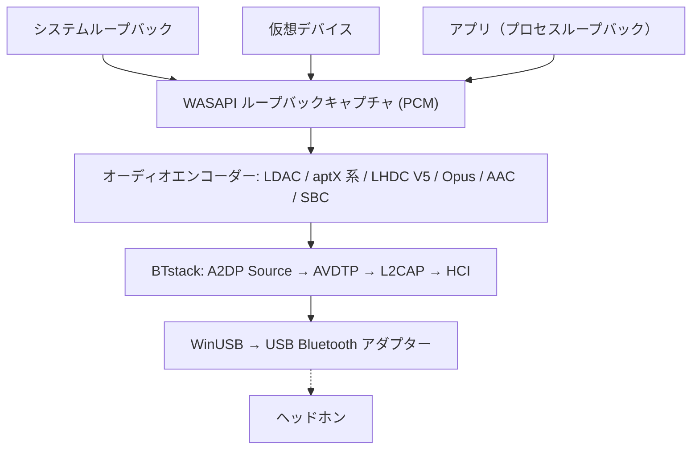

# A2DP Windows Bridge (A2DPWB)

Windows 向け Bluetooth A2DP オーディオストリーミングツール（全コーデック対応）
{: .fs-6 .fw-300 }

USB Bluetooth アダプターを WinUSB モードで使用し、**LHDC V5、LDAC、aptX Adaptive、aptX HD、aptX、aptX Low Latency、AAC、SBC**（および試験的に **Opus**、PipeWire の **Opus 05**）でシステム音声をストリーミングします。カーネルドライバーやテスト署名は不要です。

[セットアップ](setup){: .btn .btn-primary .fs-5 .mb-4 .mb-md-0 .mr-2 }
[GitHub](https://github.com/SeiyaFunaokaJP/A2DP-Windows-Bridge){: .btn .fs-5 .mb-4 .mb-md-0 }

---

## 対応コーデック

| コーデック | ビットレート | サンプルレート | ビット深度 | レイテンシー |
|:-----------|:-------------|:---------------|:-----------|:-------------|
| LHDC V5 | 400/500/900/1000 kbps、ABR 160--400 kbps | 44.1/48/96/192 kHz | 16/24 bit | -- |
| LDAC | 330/660/990 kbps | 44.1--96 kHz | 16/24/32 bit | 約 200 ms |
| aptX Adaptive | 265/427 kbps（96 kHz: 646） | 48/96 kHz | 24 bit | -- |
| Opus 🧪 | 256 kbps | 48 kHz | 16 bit | -- |
| aptX HD 🧪 | 576 kbps | 44.1/48 kHz | 24 bit | 約 150 ms |
| aptX | 352/384 kbps | 44.1/48 kHz | 16 bit | -- |
| aptX Low Latency 🧪 | 352 kbps | 44.1/48 kHz | 16 bit | 約 32 ms |
| AAC | 最大 256 kbps | 44.1/48 kHz | 16 bit | 約 150 ms |
| SBC XQ | 約 385/505/552 kbps | 44.1/48 kHz | 16 bit | 約 150 ms |
| SBC | 最大約 345 kbps | 44.1/48 kHz | 16 bit | 約 150 ms |
| FastStream 🧪 | 198/216 kbps | 44.1/48 kHz | 16 bit | -- |
| Opus 05 🧪 | 256 kbps | 48 kHz | 16 bit | -- |
| LC3（LE Audio） 🧪 | 1 チャネルあたり 32--124 kbps | 16/24/32/48 kHz | 16 bit | 約 140 ms |
| LC3 低遅延（LE Audio GMAP） 🧪 | 1 チャネルあたり 64--96 kbps | 32/48 kHz | 16 bit | 約 30 ms |

### プラットフォーム別のコーデック対応（ヘッドホンへの送信）

| コーデック | Windows 10 標準 | Windows 11 標準 | Ubuntu 標準（PipeWire） | **A2DPWB**（Windows 10 / 11） |
|:-----------|:---------------:|:---------------:|:-----------------------:|:-----------------------------:|
| LHDC V5 | ❌ | ❌ | ❌ | ✅ |
| LDAC | ❌ | ❌ | ✅ | ✅ |
| aptX Adaptive | ❌ | ❌ | ❌ | ✅ |
| Opus（Android の A2DP Opus） | ❌ | ❌ | ✅ PipeWire 1.2 以降（`opus_g`）。Ubuntu 24.04（PipeWire 1.0.5）にはない | 🧪 実験的 |
| aptX HD | ❌ | ❌ | ✅ | 🧪 実験的 |
| aptX | ✅ | ✅ | ✅ | ✅ |
| aptX Low Latency | ❌ | ❌ | ✅ | 🧪 実験的 |
| AAC | ❌ | ✅ | ❌ Ubuntu のパッケージに含まれない | ✅ |
| SBC XQ | ❌ | ❌ | ✅ | ✅（SBC でデュアルチャネルと bitpool 29 以上を許すシンク） |
| SBC | ✅ | ✅ | ✅ | ✅ |
| FastStream | ❌ | ❌ | ✅ | 🧪 実験的（音楽のみ、明示的に選んだとき） |
| Opus 05（PipeWire 独自の Opus） | ❌ | ❌ | ✅ PipeWire 0.3.57 以降（`opus_05`、相手も PipeWire のときだけ） | 🧪 実験的（明示的に選んだとき） |
| LC3（LE Audio、BAP ユニキャスト） | ❌ | ✅ Bluetooth のハードウェアとドライバーが LE Audio に対応した PC のみ | ✅ PipeWire の BAP `lc3`（BlueZ の LE Audio） | 🧪 実験的（デバイスの LE Audio の項目、ゲーミングヘッドセットでは GMAP の低遅延、ISO 対応の Bluetooth 5.2 アダプターが必要、[使い方](usage#le-audio)） |

✅ 対応 · 🧪 実験的 · ❌ 非対応。どの列も送信側（PC → ヘッドホン）です。「標準」は A2DPWB を使わない OS 自身の Bluetooth オーディオで、Ubuntu の列は Ubuntu 26.04 の PipeWire（`libspa-0.2-bluetooth`）が持つコーデックです。

{: .warning }
**aptX HD・aptX Low Latency は実験的な対応です。** Android / PipeWire の実装に合わせ、エンコード→デコードの往復テストは通っていますが、実機のヘッドホンでの検証はまだです。表のレイテンシーは一般的な目安で、A2DPWB で測定した値ではありません。

{: .warning }
**LHDC V5 について。** Google が Android 17（AOSP、Apache-2.0）に追加した LHDC V5 エンコーダーの C 移植版を使用しています。移植版は AOSP の Rust 版エンコーダーとビット単位で一致することを確認済みで、A2DP のシグナリングは Android の `a2dp_vendor_lhdcv5` に合わせています。実機の LHDC V5 ヘッドホンでも、ユーザーにより v1.1.1-beta.1 で 1000 kbps / 192 kHz での動作が確認されています（[#50](https://github.com/SeiyaFunaokaJP/A2DP-Windows-Bridge/issues/50)）。v2 も同じエンコーダーを使います。対応するのはロッシーの LHDC V5 のみで、LHDC V2/V3（従来機）とロスレスの「LHDC-RAW」にはオープンソースのエンコーダーがありません。自動選択では LHDC V5 は LDAC・aptX 系より下、AAC・SBC より上に位置します。

{: .warning }
**Opus は実験的な対応です。** Android の A2DP Opus ベンダーコーデック（Android 13 以降、ベンダー ID 0x000000E0 Google）で、48 kHz・20 ms フレーム・ステレオ 256 kbps（Android が要求する値。標準 192、モバイル 128 kbps）を libopus 1.5.2 でエンコードします。仮想シンクとのエンドツーエンドテストには合格していますが、実際の Opus 対応ヘッドホンでは未確認です。自動選択では LHDC V5 の下、AAC / SBC の上です。

{: .warning }
**Opus 05 は実験的な対応で、実機では未確認です。** PipeWire 独自の A2DP Opus ベンダーコーデック（ベンダー ID 0x000005F1、コーデック ID 0x1005、PipeWire の `opus_05`）で、実装しているのは PipeWire だけなので、受け手は A2DP シンクとして動く PipeWire の PC に限られます。A2DPWB が送るのはステレオの音楽の方向だけ（5.1 / 7.1 や戻りの音声はなし）で、48 kHz・10 ms フレーム（シンクが 20 ms だけならそれ）、エンコーダーとビットレートは Opus と同じで、シンクの上限で頭打ちにします。自動選択では選ばないので、**コーデック** 画面か `-c opus05` で選んでください。PipeWire と同じ能力を出す仮想シンクとのエンドツーエンドテストには合格していますが、実際の PipeWire では試していません。A2DP シンクとしての PipeWire は、Opus 05 を 0.3.57 から、Android の Opus（`opus_g`）を 1.2.0 から受けられます。Ubuntu 24.04 LTS の PipeWire 1.0.5 は Opus 05 だけ、Ubuntu 25.10（1.4.7）と 26.04 LTS（1.6.2）は両方です。どちらも A2DPWB ではまだ確かめていません。

{: .warning }
**SBC XQ** は Sony WH-1000XM4 で確認済みです（デュアルチャネル、48 kHz で bitpool 43、552 kbps）。この設定を拒否するシンクには、通常の SBC でつなぎ直します。**FastStream は実験的な対応です。** 仮想シンクとのエンドツーエンドテストには合格していますが、実際の FastStream 対応ヘッドホンでは試していません。音楽の方向のみで、自動選択では選びません。

{: .note }
**クラシック aptX だけが目的なら**、Windows 10 標準の Bluetooth スタックがクラシック aptX に対応しています（aptX HD・aptX LL・aptX Adaptive は非対応）。その場合 A2DPWB は不要です。A2DPWB が主に役立つのは LDAC・aptX HD・aptX Low Latency です。

{: .note }
**aptX Adaptive について。** [AKS-Logic/aptx-adaptive-linux](https://github.com/AKS-Logic/aptx-adaptive-linux) の MIT ライセンスの Rust 製エンコーダーでエンコードします。そのテーブルは、作者が Qualcomm の出荷済みバイナリと無線のキャプチャから再構成したものです。48 kHz ステレオ（44.1 kHz を指定しても 48 kHz で取り込みます）、24 bit で、高音質 427 kbps か低遅延 265 kbps（R2 のシンクは 270）、高音質では ABR が使えます。96 kHz（高音質 646 kbps）は、コーデックの設定で 96 kHz を選んだときに、ヘッドホンが 96 kHz を通知する R2 のシンクであれば使います。低遅延では使いません。自動では 48 kHz です。自動選択では LHDC V5、LDAC の次に選ばれます。**コーデック** 画面か `-c aptxad` で選ぶこともできます。2.0.2-beta.6 で EarFun Air Pro 4+ を使った 48 kHz での動作が利用者から報告されており、クラシック aptX と同じくらい安定しています。96 kHz もその後、実際のヘッドホンで確認されました（[#86](https://github.com/SeiyaFunaokaJP/A2DP-Windows-Bridge/issues/86)）。上流は Linux で Bose QuietComfort Ultra（第 1 世代）と B&W Px7 S2e での動作を報告しています。詳しくは [aptX ファミリーと aptX Adaptive](usage#aptx-compatibility)を参照してください。

## 対応プラットフォーム {#platform-support}

| コンポーネント | Windows 10 (x64 / ARM64) | Windows 11 (x64 / ARM64) | Linux (Ubuntu) |
|:---------------|:----------------:|:----------------:|:--------------:|
| **A2DPWB**（ウィンドウ / トレイ / CLI） | ✅（実機では未確認） | ✅ | ❌ |
| [ソースからのビルド](building)（Rust、Visual Studio 2022 以降、Node.js） | ✅ | ✅ | ❌ |
| `a2dpwb_decode`（ストリーム検査ツール） | ✅ | ✅ | ❌ |
| エンドツーエンドテスト `tools/emu/run_test.py` | ✅ | ✅ | ❌ |
| 仮想アダプター `tools/emu/emu_vhci.py` | ❌ | ❌ | ✅ |
| [測定用受信機](usage#receiver) `tools/linux_sink` | ❌ | ❌ | ✅ |

A2DPWB 本体は Windows 専用（Windows 10 22H2 または Windows 11）で、x64 と ARM64 向けにビルドされます。Linux 側のツールには Python 3.11 以降が必要です（Ubuntu 26.04 で確認済み）。`setup.sh` は Ubuntu / Debian 向けで、他のディストリビューションではパッケージを手動でインストールしてください。

## 検証済みの機器 {#verified-hardware}

Sony WH-1000XM4・WH-1000XM6、EarFun Air Pro 4+、Grado GW100x などを、TP-Link UB500、汎用 RTL8761B、ノート PC 内蔵の RTL8852BE、ASUS BT400、CSR8510 のアダプターで確認しています。コーデック、バージョン、元になった報告まで含めた一覧は **[検証済みの機器](../hardware)**（英語） にあります。

## オーディオキャプチャモード

A2DPWB は WASAPI でオーディオをキャプチャし、3 つのモードを提供します。

| モード | 説明 | 用途 |
|:-------|:-----|:-----|
| **システムループバック** | WASAPI ループバックで既定の再生デバイスから全システム音声をキャプチャ | シンプルな構成 -- すべての音声がストリーミングされる |
| **仮想デバイス** | ユーザーが選択した仮想オーディオデバイス（VB-CABLE、VoiceMeeter 等）からキャプチャ | 特定のアプリだけ Bluetooth に送り、他の音声はスピーカーに出力 |
| **アプリ** | 1 つのアプリが再生する音だけを、アプリ自身の処理の後でキャプチャ（Windows 11 / Windows 10 2004 以降） | 1 つのアプリだけを送る、システム全体のエフェクトアプリ（イコライザー、音質補正など）の出力を送る |

**仮想デバイス**モードでは、Windows の既定の再生デバイスを選択した仮想デバイスに切り替えて（**既定デバイスを自動切替**）、そのループバック出力をキャプチャします。仮想デバイスに出力するアプリの音声が Bluetooth でストリーミングされます。ストリーミングを止めると、元の既定デバイスに戻します。

システムループバックは既定の再生デバイスから音声を奪わないため、音声は Bluetooth とそのデバイスの両方から出ます。詳しくは[キャプチャモード](usage#capture-modes)を参照してください。

## 動作の仕組み

A2DPWB は Windows の Bluetooth スタックを完全にバイパスします。[BTstack](https://github.com/bluekitchen/btstack) を使用して WinUSB 経由で USB Bluetooth アダプターと直接通信し、Bluetooth プロトコルスタック全体をユーザーモードで実装します。音を送るのは小さな常駐プログラム（`a2dpwb-core.exe`、トレイのアイコン付き）で、ウィンドウはその状態を表示するだけなので、閉じても音は止まりません（[アーキテクチャ](architecture)を参照）。

## 主な機能

- **マルチコーデック**: LHDC V5、LDAC、aptX Adaptive、aptX HD、aptX、aptX Low Latency、AAC、SBC、Opus / Opus 05（試験的）（自動ネゴシエーション対応）
- **LE Audio（実験的）**: LE Audio のヘッドホン・イヤホンへ LC3 で送信（BAP ユニキャスト、左右一組のイヤホン、ヘッドセットの音量、メディアボタン、GMAP の低遅延）。Bluetooth 5.2 のアイソクロナスチャネルに対応したアダプターが必要です。確かめたのは Bluetooth のエミュレータだけで、実機の LE Audio ヘッドホンではまだ試していません（[使い方](usage#le-audio)を参照）
- **3 つのキャプチャモード**: システムループバック、仮想オーディオデバイスルーティング、または 1 つのアプリの出力
- **ウィンドウ・トレイ・CLI**: セットアップと診断はウィンドウ、毎日の接続はトレイのフライアウトとメニュー、ほかにコマンドライン（[使い方](usage)を参照）
- **アプリ内で WinUSB を割り当て**: アダプターへの WinUSB ドライバーの割り当てと元のドライバーへの復元。Zadig は不要です（[セットアップ](setup#winusb)を参照）
- **初回セットアップ**: アダプター、ドライバーとファームウェア、ヘッドホン、最初の接続
- **ABR**: 不安定な接続時のアダプティブビットレート（LDAC、LHDC V5、aptX Adaptive）
- **自動再接続**: 切断時に自動再接続（最大 10 回）。PC のスリープからの復帰後も再接続
- **通信品質と AFH**: 送信内容・RSSI・使用中のチャネルを表示し、避けるべき Wi-Fi チャネルをアダプターに伝えます（[使い方](usage#link-quality)を参照）
- **ヘッドホン操作（AVRCP）**: ヘッドホンや Windows の音量と連動する音量スライダー、ヘッドホンの再生/一時停止・曲送り・曲戻しで PC の再生を操作（[使い方](usage#headphone-buttons) を参照）
- **デバイスごとの設定**: オーディオデバイスごとにコーデック（その設定つき）と出力ソースを持ち、ホームに並んで表示され、トレイからも接続できます
- **更新**: インストール版はオーディオデバイスを切断したときに自分で更新します（[使い方](usage#updates)を参照）
- **多言語対応**: 英語、日本語、中国語（簡体字 / 繁体字）、韓国語、ドイツ語、フランス語、スペイン語
- **Realtek ファームウェア**: Realtek アダプター向けガイド付きファームウェアダウンロード
- **診断**: 接続フロー、ログ、HCI キャプチャ、不具合報告用の診断情報、Linux PC を使った対向受信テスト（[使い方](usage#receiver)を参照）
