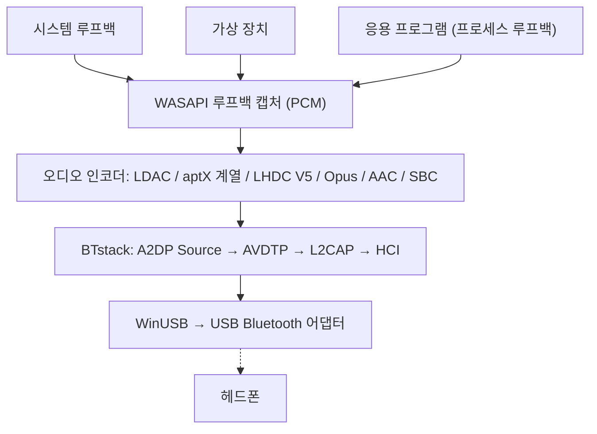

# A2DP Windows Bridge (A2DPWB)

모든 코덱을 지원하는 Windows용 Bluetooth A2DP 오디오 스트리밍 도구
{: .fs-6 .fw-300 }

WinUSB 모드의 USB Bluetooth 어댑터를 사용하여 시스템 오디오를 **LHDC V5, LDAC, aptX Adaptive, aptX HD, aptX, aptX Low Latency, AAC, SBC** 및 (실험적) **Opus**, PipeWire의 **Opus 05**로 스트리밍합니다. 커널 드라이버나 테스트 서명이 필요 없습니다.

[시작하기](setup){: .btn .btn-primary .fs-5 .mb-4 .mb-md-0 .mr-2 }
[GitHub](https://github.com/SeiyaFunaokaJP/A2DP-Windows-Bridge){: .btn .fs-5 .mb-4 .mb-md-0 }

---

## 지원 코덱

| 코덱 | 비트레이트 | 샘플링 속도 | 비트 심도 | 지연 시간 |
|:-----|:-----------|:------------|:----------|:----------|
| LHDC V5 | 400/500/900/1000 kbps, ABR 160--400 kbps | 44.1/48/96/192 kHz | 16/24 bit | -- |
| LDAC | 330/660/990 kbps | 44.1--96 kHz | 16/24/32 bit | 약 200 ms |
| aptX Adaptive | 265--427 kbps (96 kHz: 255--646) | 48/96 kHz | 24 bit | -- |
| Opus 🧪 | 128/192/256 kbps | 48 kHz | 16 bit | -- |
| aptX HD 🧪 | 576 kbps | 44.1/48 kHz | 24 bit | 약 150 ms |
| aptX | 352/384 kbps | 44.1/48 kHz | 16 bit | -- |
| aptX Low Latency 🧪 | 352 kbps | 44.1/48 kHz | 16 bit | 약 32 ms |
| AAC | 128/192/256 kbps | 44.1/48 kHz | 16 bit | 약 150 ms |
| SBC XQ | 약 385/505/552 kbps | 44.1/48 kHz | 16 bit | 약 150 ms |
| SBC | 최대 약 345 kbps | 44.1/48 kHz | 16 bit | 약 150 ms |
| FastStream 🧪 | 198/216 kbps | 44.1/48 kHz | 16 bit | -- |
| Opus 05 🧪 | 128/192/256 kbps | 48 kHz | 16 bit | -- |
| LC3 (LE 오디오) 🧪 | 채널당 32--124 kbps | 16/24/32/48 kHz | 16 bit | 약 140 ms |
| LC3 저지연 (LE 오디오 GMAP) 🧪 | 채널당 64--96 kbps | 32/48 kHz | 16 bit | 약 30 ms |

### 플랫폼별 코덱 지원 (헤드폰으로 전송)

| 코덱 | Windows 10 기본 | Windows 11 기본 | Ubuntu 기본 (PipeWire) | **A2DPWB** (Windows 10 / 11) |
|:-----|:---------------:|:---------------:|:----------------------:|:----------------------------:|
| LHDC V5 | ❌ | ❌ | ❌ | ✅ |
| LDAC | ❌ | ❌ | ✅ | ✅ |
| aptX Adaptive | ❌ | ❌ | ❌ | ✅ |
| Opus (Android의 A2DP Opus) | ❌ | ❌ | ✅ PipeWire 1.2 이상 (`opus_g`); Ubuntu 24.04(PipeWire 1.0.5)에는 없음 | 🧪 실험적 |
| aptX HD | ❌ | ❌ | ✅ | 🧪 실험적 |
| aptX | ✅ | ✅ | ✅ | ✅ |
| aptX Low Latency | ❌ | ❌ | ✅ | 🧪 실험적 |
| AAC | ❌ | ✅ | ❌ Ubuntu 패키지에 포함되지 않음 | ✅ |
| SBC XQ | ❌ | ❌ | ✅ | ✅ (SBC에서 듀얼 채널과 bitpool 43 이상을 허용하는 수신 장치) |
| SBC | ✅ | ✅ | ✅ | ✅ |
| FastStream | ❌ | ❌ | ✅ | 🧪 실험적 (음악 전용, 직접 선택한 경우) |
| Opus 05 (PipeWire 자체 Opus) | ❌ | ❌ | ✅ PipeWire 0.3.57 이상 (`opus_05`, PipeWire 기기로만) | 🧪 실험적 (직접 선택한 경우) |
| LC3 (LE 오디오, BAP 유니캐스트) | ❌ | ✅ Bluetooth 하드웨어와 드라이버가 LE 오디오를 지원하는 PC에서만 | ✅ PipeWire BAP `lc3` (BlueZ LE 오디오) | 🧪 실험적 (장치의 LE 오디오 항목, 게이밍 헤드셋에서는 GMAP 저지연, ISO를 지원하는 Bluetooth 5.2 어댑터 필요, [사용법](usage#le-audio)) |

✅ 지원 · 🧪 실험적 · ❌ 미지원. 모든 열은 전송 측(PC → 헤드폰) 기준입니다. "기본"은 A2DPWB 없이 OS 자체 Bluetooth 오디오를 사용하는 경우이며, Ubuntu 열은 Ubuntu 26.04의 PipeWire 코덱 구성(`libspa-0.2-bluetooth`)입니다.

{: .warning }
**aptX HD와 aptX Low Latency는 실험적 기능입니다.** Android / PipeWire 구현을 따르며 인코딩/디코딩 왕복 테스트를 통과했지만, 실제 헤드폰에서는 아직 검증되지 않았습니다. 표의 지연 시간은 일반적인 수치이며 A2DPWB로 측정한 값이 아닙니다.

{: .warning }
**LHDC V5 정보.** Google이 Android 17(AOSP, Apache-2.0)에 추가한 LHDC V5 인코더의 C 포팅 버전을 사용합니다. 이 포팅 버전은 AOSP Rust 인코더와 비트 단위로 일치함을 확인했으며, A2DP 시그널링은 Android의 `a2dp_vendor_lhdcv5`를 따릅니다. 한 사용자가 v1.1.1-beta.1에서 실제 LHDC V5 헤드폰으로 1000 kbps / 192 kHz 작동을 확인했으며([#50](https://github.com/SeiyaFunaokaJP/A2DP-Windows-Bridge/issues/50)), v2도 같은 인코더를 사용합니다. 손실 압축 LHDC V5만 지원합니다. LHDC V2/V3(구형 헤드폰)와 무손실 "LHDC-RAW" 모드는 오픈 소스 인코더가 없습니다. 자동 모드에서 LHDC V5의 우선순위는 LDAC 및 aptX 계열보다 낮고 AAC / SBC보다 높습니다.

{: .warning }
**Opus는 실험적 기능입니다.** Android의 A2DP Opus 벤더 코덱(Android 13 이상, 벤더 ID 0x000000E0 Google)으로, 48 kHz, 20 ms 프레임이며 Android가 요청하는 대로 256 kbps 스테레오(표준 192, 모바일 128 kbps)로 libopus 1.5.2를 사용해 인코딩합니다. 가상 싱크를 상대로 한 엔드투엔드 테스트는 통과했지만, 실제 Opus 헤드폰에서는 아직 검증되지 않았습니다. 자동 모드에서 Opus의 우선순위는 LHDC V5보다 낮고 AAC / SBC보다 높습니다.

{: .warning }
**Opus 05는 실험적 기능이며 실제 기기에서는 확인하지 않았습니다.** PipeWire 고유의 A2DP Opus 벤더 코덱(벤더 ID 0x000005F1, 코덱 0x1005, PipeWire의 `opus_05`)으로, 구현한 곳이 PipeWire뿐이므로 수신 장치는 A2DP 싱크로 동작하는 PipeWire PC여야 합니다. A2DPWB는 스테레오 음악 방향만 보냅니다(5.1 / 7.1과 복귀 채널 없음). 48 kHz, 10 ms 프레임(싱크가 20 ms만 지원하면 20 ms), 인코더와 비트레이트는 Opus와 같으며 싱크의 상한으로 제한합니다. 자동 선택은 이를 고르지 않으므로 **코덱** 화면에서 또는 `-c opus05`로 선택하십시오. PipeWire와 같은 기능을 제공하는 가상 싱크를 상대로 한 엔드투엔드 테스트는 통과했지만, 실제 PipeWire 수신 장치로는 시험하지 않았습니다. A2DP 싱크로서의 PipeWire는 Opus 05를 0.3.57부터, Android의 Opus(`opus_g`)를 1.2.0부터 디코딩합니다. Ubuntu 24.04 LTS는 PipeWire 1.0.5(Opus 05만), Ubuntu 25.10(1.4.7)과 26.04 LTS(1.6.2)는 둘 다 제공합니다. 어느 쪽도 A2DPWB로는 아직 확인하지 않았습니다.

{: .warning }
**SBC XQ**는 Sony WH-1000XM4로 검증되었습니다(듀얼 채널, 48 kHz에서 bitpool 43, 552 kbps). 이 구성을 거부하는 싱크에는 일반 SBC로 다시 연결합니다. **FastStream은 실험적 기능입니다.** 가상 싱크를 상대로 한 엔드투엔드 테스트는 통과했지만 실제 FastStream 헤드폰으로는 시험하지 않았습니다. 음악 방향만 지원하며, 자동 선택은 이를 고르지 않습니다.

{: .note }
**기본 aptX만 필요하십니까?** Windows 10의 기본 Bluetooth 스택은 이미 기본 aptX를 지원하므로(aptX HD, aptX LL, aptX Adaptive는 미지원) 이 경우 A2DPWB가 필요하지 않습니다. A2DPWB는 주로 LDAC, aptX HD, aptX Low Latency에 유용합니다.

{: .note }
**aptX Adaptive 정보.** [AKS-Logic/aptx-adaptive-linux](https://github.com/AKS-Logic/aptx-adaptive-linux)의 MIT 라이선스 순수 Rust 인코더로 인코딩하며, 이 인코더의 테이블은 개발자들이 출시된 Qualcomm 바이너리와 무선 캡처로부터 재구성한 것입니다. 48 kHz 스테레오(44.1 kHz를 요청하면 48 kHz로 캡처), 24비트입니다. R1 싱크에서는 높음 427 kbps, 표준 364, 모바일 318, 저지연 265 kbps이며(R2 싱크는 별도의 표), 높음에서는 ABR을 사용합니다. 설정에서 96 kHz를 선택하고 헤드폰이 96 kHz를 알리는 R2 싱크이면 96 kHz(높음 646 kbps, 표준 340, 모바일 255)를 사용하며, 저지연에서는 사용하지 않고 그 밖의 경우에는 48 kHz입니다. 96 kHz도 실제 헤드폰으로 확인되었습니다([#86](https://github.com/SeiyaFunaokaJP/A2DP-Windows-Bridge/issues/86)). 자동은 48 kHz입니다. 자동 선택은 LHDC V5, LDAC 다음으로 이를 고르며, **코덱** 화면에서 또는 `-c aptxad`로 직접 선택할 수도 있습니다. 한 사용자가 2.0.2-beta.6에서 EarFun Air Pro 4+로 48 kHz 동작을 확인했으며, 기본 aptX만큼 안정적이었습니다([#86](https://github.com/SeiyaFunaokaJP/A2DP-Windows-Bridge/issues/86)). 업스트림은 Linux에서 Bose QuietComfort Ultra(1세대)와 B&W Px7 S2e로 동작한다고 보고합니다. [aptX 계열과 aptX Adaptive](usage#aptx-compatibility)를 참조하십시오.

## 지원 플랫폼 {#platform-support}

| 구성 요소 | Windows 10 (x64 / ARM64) | Windows 11 (x64 / ARM64) | Linux (Ubuntu) |
|:----------|:----------------:|:----------------:|:--------------:|
| **A2DPWB** (창, 트레이, CLI) | ✅ (실제 하드웨어에서는 아직 미확인) | ✅ | ❌ |
| [소스에서 빌드](building) (Rust, Visual Studio 2022 이상, Node.js) | ✅ | ✅ | ❌ |
| `a2dpwb_decode` (스트림 검사 도구) | ✅ | ✅ | ❌ |
| 엔드투엔드 테스트 `tools/emu/run_test.py` | ✅ | ✅ | ❌ |
| 가상 어댑터 `tools/emu/emu_vhci.py` | ❌ | ❌ | ✅ |
| [측정용 수신기](usage#receiver) `tools/linux_sink` | ❌ | ❌ | ✅ |

A2DPWB 자체는 Windows(Windows 10 22H2 또는 Windows 11) 전용이며 x64와 ARM64용으로 빌드됩니다. Linux 도구에는 Python 3.11 이상이 필요합니다(Ubuntu 26.04에서 확인). `setup.sh`는 Ubuntu / Debian용이며, 다른 배포판에서는 패키지를 직접 설치해야 합니다.

## 검증된 하드웨어 {#verified-hardware}

Sony WH-1000XM4·WH-1000XM6, EarFun Air Pro 4+, Grado GW100x 등을 TP-Link UB500, 범용 RTL8761B, 노트북 내장 RTL8852BE, ASUS BT400, CSR8510 어댑터에서 확인했습니다. 코덱, 버전, 근거가 된 보고까지 담은 전체 목록은 **[검증된 하드웨어](../hardware)** (영어)에 있습니다.

## 오디오 캡처 모드

A2DPWB는 WASAPI로 오디오를 캡처하며 세 가지 모드를 제공합니다.

| 모드 | 설명 | 용도 |
|:-----|:-----|:-----|
| **시스템 루프백** | WASAPI 루프백으로 기본 재생 장치의 모든 시스템 오디오 출력을 캡처 | 간단한 구성 -- 모든 소리가 스트리밍됨 |
| **가상 장치** | 사용자가 선택한 가상 오디오 장치(예: VB-CABLE, VoiceMeeter)에서 캡처 | 특정 앱만 Bluetooth로 보내고 나머지 소리는 스피커로 출력 |
| **응용 프로그램** | 한 앱이 재생하는 소리만 앱 자체 처리 후에 캡처 (Windows 11 / Windows 10 2004 이상) | 한 앱만 보내거나, 시스템 전체 효과 앱(이퀄라이저, 음질 향상 앱)의 출력을 보낼 때 |

**가상 장치** 모드에서 A2DPWB는 Windows 기본 재생 장치를 선택한 가상 장치로 전환한 다음(**기본 장치 자동 전환**), 그 루프백 출력을 캡처합니다. 가상 장치로 출력하는 앱의 소리가 Bluetooth로 스트리밍됩니다. 스트리밍을 중지하면 이전 기본 장치로 복원됩니다.

시스템 루프백은 기본 재생 장치에서 소리를 빼앗지 않습니다. 소리는 Bluetooth와 함께 그 장치에서도 재생됩니다. [캡처 모드](usage#capture-modes)를 참조하십시오.

## 작동 방식

A2DPWB는 Windows Bluetooth 스택을 완전히 우회합니다. [BTstack](https://github.com/bluekitchen/btstack)을 사용해 WinUSB를 통해 USB Bluetooth 어댑터와 직접 통신하며, Bluetooth 프로토콜 스택 전체를 사용자 모드에서 구현합니다. 오디오는 작은 상주 프로그램(`a2dpwb-core.exe`, 트레이 아이콘 포함)이 스트리밍하고, 창은 그 상태를 표시할 뿐이므로 창을 닫아도 오디오는 멈추지 않습니다([아키텍처](architecture) 참조).

## 주요 기능

- **다중 코덱**: LHDC V5, LDAC, aptX Adaptive, aptX HD, aptX, aptX Low Latency, AAC, SBC 및 (실험적) Opus / Opus 05, 자동 협상
- **LE 오디오 (실험적)**: LE 오디오 헤드폰과 이어폰으로 LC3 전송(BAP 유니캐스트, 한 쌍의 양쪽 이어폰, 헤드셋 음량, 미디어 버튼, GMAP 저지연). Bluetooth 5.2의 등시성 채널을 지원하는 어댑터가 필요합니다. Bluetooth 에뮬레이터로만 시험했고 실제 LE 오디오 헤드폰으로는 아직 확인하지 않았습니다([사용법](usage#le-audio) 참조)
- **세 가지 캡처 모드**: 시스템 루프백, 가상 오디오 장치 라우팅, 또는 한 응용 프로그램의 출력
- **창, 트레이, CLI**: 설정과 진단을 위한 창, 평소 연결에 쓰는 트레이 플라이아웃과 메뉴, 그리고 명령줄 ([사용법](usage) 참조)
- **앱 내 WinUSB 할당**: 어댑터에 WinUSB 드라이버를 할당하고 원래 드라이버를 복원하며, Zadig가 필요 없습니다 ([설정](setup#winusb) 참조)
- **첫 실행 설정**: 어댑터, 드라이버와 펌웨어, 헤드폰, 첫 연결
- **ABR**: 불안정한 연결을 위한 적응형 비트레이트 (LDAC, LHDC V5, aptX Adaptive)
- **자동 다시 연결**: 연결이 끊기면 다시 연결 (최대 10회), PC가 절전 모드에서 복귀한 후에도 다시 연결
- **연결 품질과 AFH**: 전송 내용, RSSI, 사용 중인 채널을 표시하고, 피해야 할 Wi-Fi 채널을 어댑터에 알립니다 ([사용법](usage#link-quality) 참조)
- **헤드폰 제어 (AVRCP)**: 헤드폰 및 Windows 볼륨과 연동되는 볼륨 슬라이더, 헤드폰의 재생/일시 정지, 다음 곡, 이전 곡 버튼으로 PC 재생 제어 ([사용법](usage#headphone-buttons) 참조)
- **장치별 설정**: 오디오 장치마다 코덱(고유 설정 포함)과 출력 소스를 두며, 홈에 나란히 표시되고 트레이에서 바로 연결
- **업데이트**: 설치된 버전은 오디오 장치의 연결이 끊긴 후 스스로 업데이트됩니다 ([사용법](usage#updates) 참조)
- **다국어 지원**: 영어, 일본어, 중국어 간체, 중국어 번체, 한국어, 독일어, 프랑스어, 스페인어
- **Realtek 펌웨어**: Realtek 어댑터용 안내형 펌웨어 다운로드
- **진단**: 연결 흐름, 로그, HCI 캡처, 버그 보고용 진단 정보, Linux PC를 이용한 피어 수신기 테스트 ([사용법](usage#receiver) 참조)
