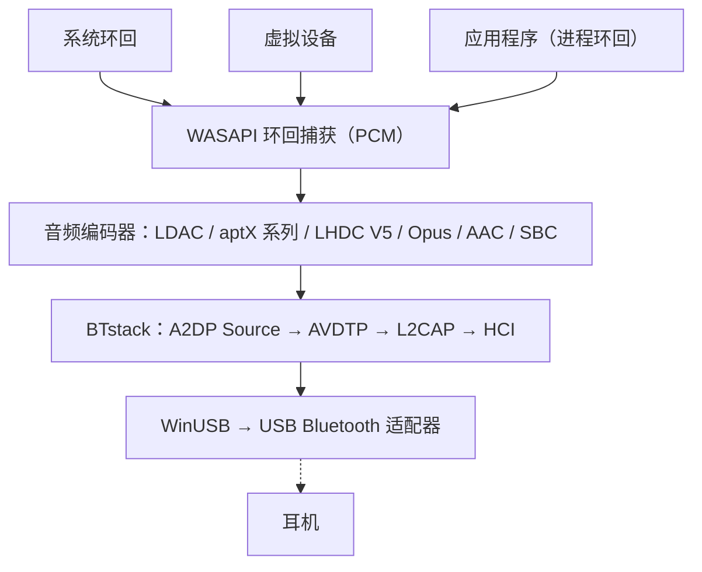

# BlueCaster

适用于 Windows 的 Bluetooth A2DP 音频串流工具，支持全部主流编解码器。
{: .fs-6 .fw-300 }

使用处于 WinUSB 模式的 USB Bluetooth 适配器，以 **LHDC V5、LDAC、aptX Adaptive、aptX HD、aptX、aptX Low Latency、AAC、SBC** 以及（实验性的）**Opus** 和 PipeWire 的 **Opus 05** 串流系统音频——无需内核驱动，也无需测试签名。

[开始使用](setup){: .btn .btn-primary .fs-5 .mb-4 .mb-md-0 .mr-2 }
[GitHub](https://github.com/SeiyaFunaokaJP/BlueCaster){: .btn .fs-5 .mb-4 .mb-md-0 }

---

## 支持的编解码器

| 编解码器 | 比特率 | 采样率 | 位深度 | 延迟 |
|:------|:--------|:------------|:----------|:--------|
| LHDC V5 | 400/500/900/1000 kbps，ABR 160--400 kbps | 44.1/48/96/192 kHz | 16/24 bit | -- |
| LDAC | 330/660/990 kbps | 44.1--96 kHz | 16/24/32 bit | 约 200 ms |
| aptX Adaptive | 265--427 kbps（96 kHz：255--646） | 48/96 kHz | 24 bit | -- |
| Opus 🧪 | 128/192/256 kbps | 48 kHz | 16 bit | -- |
| aptX HD 🧪 | 576 kbps | 44.1/48 kHz | 24 bit | 约 150 ms |
| aptX | 352/384 kbps | 44.1/48 kHz | 16 bit | -- |
| aptX Low Latency 🧪 | 352 kbps | 44.1/48 kHz | 16 bit | 约 32 ms |
| AAC | 128/192/256 kbps | 44.1/48 kHz | 16 bit | 约 150 ms |
| SBC XQ | 约 385/505/552 kbps | 44.1/48 kHz | 16 bit | 约 150 ms |
| SBC | 最高约 345 kbps | 44.1/48 kHz | 16 bit | 约 150 ms |
| FastStream 🧪 | 198/216 kbps | 44.1/48 kHz | 16 bit | -- |
| Opus 05 🧪 | 128/192/256 kbps | 48 kHz | 16 bit | -- |
| LC3（LE Audio） 🧪 | 每声道 32--124 kbps | 16/24/32/48 kHz | 16 bit | 约 140 ms |
| LC3 低延迟（LE Audio GMAP） 🧪 | 每声道 64--96 kbps | 32/48 kHz | 16 bit | 约 30 ms |

### 各平台的编解码器支持情况（向耳机发送）

| 编解码器 | Windows 10 内置 | Windows 11 内置 | Ubuntu 内置（PipeWire） | **BlueCaster**（Windows 10 / 11） |
|:------|:-------------------:|:-------------------:|:--------------------------:|:----------------------------:|
| LHDC V5 | ❌ | ❌ | ❌ | ✅ |
| LDAC | ❌ | ❌ | ✅ | ✅ |
| aptX Adaptive | ❌ | ❌ | ❌ | ✅ |
| Opus（Android 的 A2DP Opus） | ❌ | ❌ | ✅ PipeWire 1.2+（`opus_g`）；Ubuntu 24.04（PipeWire 1.0.5）中没有 | 🧪 实验性 |
| aptX HD | ❌ | ❌ | ✅ | 🧪 实验性 |
| aptX | ✅ | ✅ | ✅ | ✅ |
| aptX Low Latency | ❌ | ❌ | ✅ | 🧪 实验性 |
| AAC | ❌ | ✅ | ❌ Ubuntu 软件包中未包含 | ✅ |
| SBC XQ | ❌ | ❌ | ✅ | ✅（SBC 允许双声道且 bitpool ≥ 29 的接收端） |
| SBC | ✅ | ✅ | ✅ | ✅ |
| FastStream | ❌ | ❌ | ✅ | 🧪 实验性（仅音乐，需明确选择） |
| Opus 05（PipeWire 自有的 Opus） | ❌ | ❌ | ✅ PipeWire 0.3.57+（`opus_05`，仅限 PipeWire 设备） | 🧪 实验性（需明确选择） |
| LC3（LE Audio，BAP 单播） | ❌ | ✅ 仅限 Bluetooth 硬件和驱动支持 LE Audio 的 PC | ✅ PipeWire BAP `lc3`（BlueZ LE Audio） | 🧪 实验性（设备的 LE Audio 条目；游戏耳机使用 GMAP 低延迟；需要支持 ISO 的 Bluetooth 5.2 适配器，[使用方法](usage#le-audio)） |

✅ 支持 · 🧪 实验性 · ❌ 不支持。所有列均指发送端（PC → 耳机）。“内置”指不使用 BlueCaster 时操作系统自带的 Bluetooth 音频；Ubuntu 一列为 Ubuntu 26.04 的 PipeWire 编解码器集（`libspa-0.2-bluetooth`）。

{: .warning }
**aptX HD 和 aptX Low Latency 为实验性功能。** 它们参照 Android / PipeWire 的实现，并通过了编码/解码往返测试，但尚未在真实耳机上验证。表中的延迟为典型值，并非使用 BlueCaster 实测。

{: .warning }
**关于 LHDC V5。** 它使用 Google 在 Android 17 中加入的 LHDC V5 编码器（AOSP，Apache-2.0）的 C 语言移植版；该移植版已与 AOSP 的 Rust 编码器做过逐位一致性验证，A2DP 信令则参照 Android 的 `a2dp_vendor_lhdcv5`。已有用户在 v1.1.1-beta.1 上用真实的 LHDC V5 耳机验证了 1000 kbps / 192 kHz（[#50](https://github.com/SeiyaFunaokaJP/BlueCaster/issues/50)）；v2 使用相同的编码器。仅支持有损的 LHDC V5：LHDC V2/V3（较旧的耳机）和无损的“LHDC-RAW”模式没有开源编码器。在“自动”模式下，LHDC V5 的优先级低于 LDAC 和 aptX 系列，高于 AAC / SBC。

{: .warning }
**Opus 为实验性功能。** 它是 Android 的 A2DP Opus 厂商编解码器（Android 13+，Vendor ID 0x000000E0 Google）：48 kHz、20 ms 帧，按 Android 的请求以 256 kbps 立体声编码（标准 192 kbps，移动 128 kbps），编码器为 libopus 1.5.2。它已通过针对虚拟接收端的端到端测试，但尚未在真实的 Opus 耳机上验证。在“自动”模式下，它的优先级低于 LHDC V5，高于 AAC / SBC。

{: .warning }
**Opus 05 为实验性功能，尚未在真实设备上验证。** 它是 PipeWire 自有的 A2DP Opus 厂商编解码器（Vendor ID 0x000005F1，编解码器 0x1005；PipeWire 的 `opus_05`），只有 PipeWire 实现了它，因此接收端必须是以 PipeWire 作为 A2DP 接收端的 PC。BlueCaster 只发送立体声音乐方向（没有 5.1 / 7.1，也没有回传通道）：48 kHz、10 ms 帧（接收端只支持 20 ms 时用 20 ms），编码器和码率与 Opus 相同，并限制在接收端的上限以内。“自动”从不选择它；请在**编解码器**页面或用 `-c opus05` 选择。它已通过针对提供 PipeWire 能力的虚拟接收端的端到端测试，但尚未在真实的 PipeWire 接收端上试过。作为 A2DP 接收端的 PipeWire 自 0.3.57 起可解码 Opus 05，自 1.2.0 起可解码 Android 的 Opus（`opus_g`）：Ubuntu 24.04 LTS 自带 PipeWire 1.0.5（仅 Opus 05），Ubuntu 25.10（1.4.7）和 26.04 LTS（1.6.2）两者都有；两者都尚未用 BlueCaster 验证。

{: .warning }
**SBC XQ** 已用 Sony WH-1000XM4 验证（双声道，48 kHz 下 bitpool 43，552 kbps）。拒绝该配置的接收端会改用普通 SBC 重新连接。**FastStream 为实验性功能：**它已通过针对虚拟接收端的端到端测试，但尚未用真实的 FastStream 耳机试过。仅支持音乐方向；“自动”从不选择它。

{: .note }
**只需要经典 aptX？** Windows 10 的内置 Bluetooth 堆栈已经支持经典 aptX（不含 aptX HD、aptX LL 和 aptX Adaptive），因此无需 BlueCaster。BlueCaster 主要用于 LDAC、aptX HD 和 aptX Low Latency。

{: .note }
**关于 aptX Adaptive。** 它使用 [AKS-Logic/aptx-adaptive-linux](https://github.com/AKS-Logic/aptx-adaptive-linux) 的纯 Rust 编码器（MIT 许可）编码，其中的表由该项目作者根据 Qualcomm 已出货的二进制文件和空中抓包重建。48 kHz 立体声（请求 44.1 kHz 时以 48 kHz 捕获），24-bit：对 R1 接收端为高 427 kbps、标准 364、移动 318、低延迟 265 kbps（R2 接收端有各自的表），高音质下支持 ABR。在其设置中选择 96 kHz 且耳机是列出 96 kHz 的 R2 接收端时使用 96 kHz（高 646 kbps、标准 340、移动 255）；低延迟下不使用，其他情况为 48 kHz。96 kHz 也已用真实耳机确认（[#86](https://github.com/SeiyaFunaokaJP/BlueCaster/issues/86)）；“自动”为 48 kHz。“自动”在 LHDC V5 和 LDAC 之后选择它；也可以在**编解码器**页面或用 `-c aptxad` 选择。有用户在 2.0.2-beta.6 上用 EarFun Air Pro 4+ 确认了 48 kHz 下的工作，与经典 aptX 一样稳定（[#86](https://github.com/SeiyaFunaokaJP/BlueCaster/issues/86)）；上游报告它在 Linux 上可用于 Bose QuietComfort Ultra（第 1 代）和 B&W Px7 S2e。请参阅 [aptX 系列与 aptX Adaptive](usage#aptx-compatibility)。

## 平台支持 {#platform-support}

| 组件 | Windows 10 (x64 / ARM64) | Windows 11 (x64 / ARM64) | Linux (Ubuntu) |
|:----------|:----------------:|:----------------:|:--------------:|
| **BlueCaster**（窗口、托盘、CLI） | ✅（尚未在实机上试用） | ✅ | ❌ |
| [从源代码构建](../building)（Rust、Visual Studio 2022+、Node.js） | ✅ | ✅ | ❌ |
| `bluecaster_decode`（流检查工具） | ✅ | ✅ | ❌ |
| 端到端测试 `tools/emu/run_test.py` | ✅ | ✅ | ❌ |
| 虚拟适配器 `tools/emu/emu_vhci.py` | ❌ | ❌ | ✅ |
| [测量用接收器](usage#receiver) `tools/linux_sink` | ❌ | ❌ | ✅ |

BlueCaster 本身仅在 Windows 上运行（Windows 10 22H2 或 Windows 11），提供 x64 和 ARM64 版本。Linux 工具需要 Python 3.11 或更高版本（已在 Ubuntu 26.04 上验证）；`setup.sh` 面向 Ubuntu / Debian，其他发行版需要手动安装所需软件包。

## 已验证的硬件 {#verified-hardware}

已在 TP-Link UB500、通用 RTL8761B、笔记本电脑内置的 RTL8852BE、ASUS BT400 和 CSR8510 适配器上，用 Sony WH-1000XM4 和 WH-1000XM6、EarFun Air Pro 4+、Grado GW100x 等确认。包含编解码器、版本及相关报告的完整列表：**[已验证的硬件](../hardware)**（英文）。

## 配合使用的工具

在 issue 中报告可与 BlueCaster 配合使用的第三方应用，例如耳机控制应用（并非 BlueCaster 制作或支持）：**[Works With](../works-with)**（英文）。

## 音频捕获模式

BlueCaster 通过 WASAPI 捕获音频，提供三种模式：

| 模式 | 说明 | 用途 |
|:-----|:------------|:---------|
| **系统环回** | 通过 WASAPI 环回捕获默认播放设备输出的全部系统音频 | 设置简单——所有声音都会被串流 |
| **虚拟设备** | 从用户选择的虚拟音频设备（如 VB-CABLE、VoiceMeeter）捕获 | 将特定应用的声音送到 Bluetooth，其他声音仍从扬声器播放 |
| **应用程序** | 仅捕获某一个应用播放的声音，且是经过该应用自身处理之后的声音（Windows 11 / Windows 10 2004+） | 发送单个应用，或系统级音效应用（均衡器、音效增强）的输出 |

在**虚拟设备**模式下，BlueCaster 可以将 Windows 默认播放设备切换为所选虚拟设备（**自动切换默认设备**），然后捕获其环回输出。输出到该虚拟设备的应用将通过 Bluetooth 串流。停止串流时，会恢复之前的默认设备。

系统环回不会把声音从默认播放设备上“拿走”：声音会同时在该设备和 Bluetooth 上播放。请参阅[捕获模式](usage#capture-modes)。

## 工作原理

BlueCaster 完全绕过 Windows 的 Bluetooth 堆栈。它通过 WinUSB 直接与 USB Bluetooth 适配器通信，并使用 [BTstack](https://github.com/bluekitchen/btstack) 在用户模式下实现完整的 Bluetooth 协议栈。由一个小型常驻程序（`bluecaster-core.exe`，带有托盘图标）负责串流音频；窗口只显示其状态，因此关闭窗口不会停止音频（请参阅[架构](../architecture)）。

## 功能

- **多编解码器**：LHDC V5、LDAC、aptX Adaptive、aptX HD、aptX、aptX Low Latency、AAC、SBC 以及（实验性的）Opus / Opus 05，自动协商
- **LE Audio（实验性）**：通过 LC3 向 LE Audio 耳机传输（BAP 单播、一对耳机的左右两只、耳机音量、媒体按键、GMAP 低延迟）。需要支持 Bluetooth 5.2 等时通道的适配器；只在 Bluetooth 模拟器上测试过，尚未在真实的 LE Audio 耳机上验证（请参阅[使用方法](usage#le-audio)）
- **三种捕获模式**：系统环回、虚拟音频设备路由，或单个应用的输出
- **窗口、托盘和 CLI**：用于设置和诊断的窗口、用于日常连接的托盘浮出窗口和菜单，以及命令行（请参阅[使用方法](usage)）
- **在应用内分配 WinUSB**：为适配器分配 WinUSB 驱动程序，并可恢复原来的驱动程序，无需 Zadig（请参阅[安装与设置](setup#winusb)）
- **首次运行设置**：适配器、驱动程序和固件、耳机、首次连接
- **ABR**：针对不稳定连接的自适应比特率（LDAC、LHDC V5 和 aptX Adaptive）
- **自动重新连接**：断开后自动重新连接（最多 10 次），PC 从睡眠中恢复后也会重新连接
- **链路质量与 AFH**：显示发送内容、RSSI 和正在使用的信道；告知适配器应避开哪些 Wi-Fi 信道（请参阅[使用方法](usage#link-quality)）
- **耳机控制（AVRCP）**：音量滑块与耳机及 Windows 音量同步；耳机的播放/暂停、下一曲和上一曲按键可控制 PC 上的播放（请参阅[使用方法](usage#headphone-buttons)）
- **按设备设置**：每个音频设备各有编解码器（含其自身设置）和输出源，在主页并排显示，可从托盘直接连接
- **更新**：安装版会在音频设备断开连接后自动更新（请参阅[使用方法](usage#updates)）
- **本地化**：英语、日语、简体中文、繁体中文、韩语、德语、法语、西班牙语
- **Realtek 固件**：为 Realtek 适配器提供固件下载引导
- **诊断**：连接流程、日志、HCI 捕获、用于错误报告的诊断信息、与 Linux PC 进行的对端接收器测试（请参阅[使用方法](usage#receiver)）
