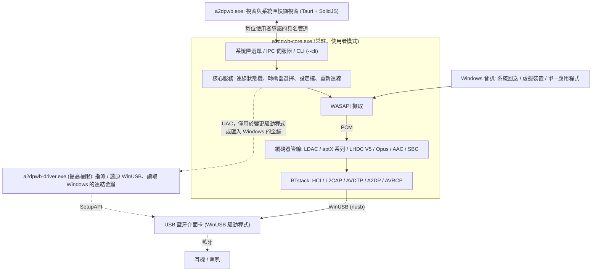
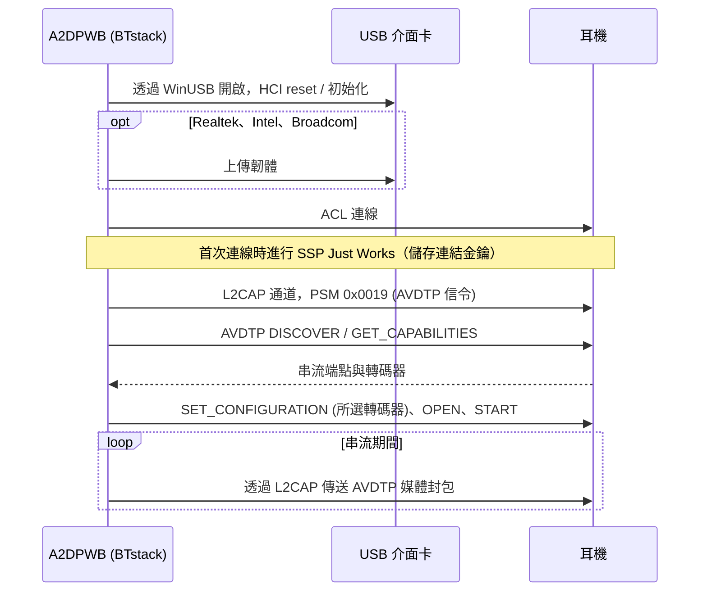
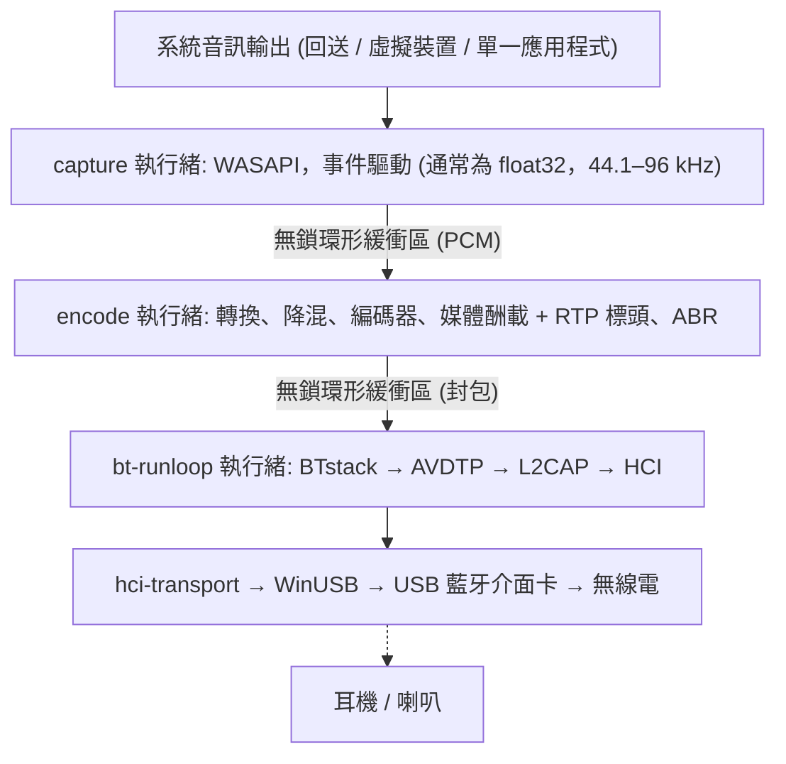
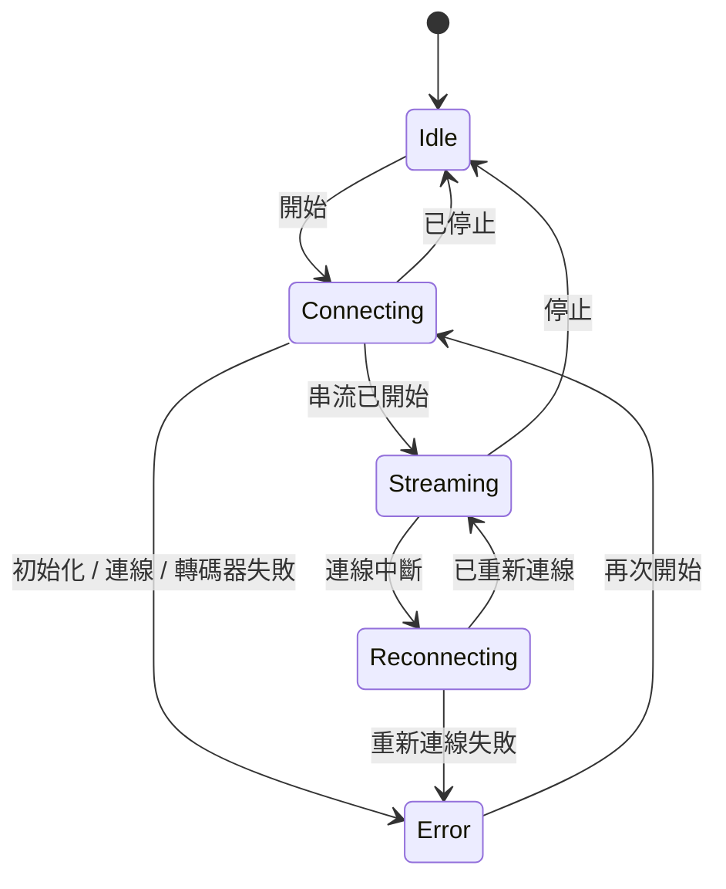

# 架構
{: .no_toc }

## 目錄
{: .no_toc .text-delta }

1. TOC
{:toc}

---

## 概觀 {#overview}

A2DP Windows Bridge (A2DPWB) 讓 Windows 能使用 LHDC V5、LDAC、aptX Adaptive、aptX HD、
aptX Low Latency、aptX、Opus、AAC、SBC XQ 與 SBC 藍牙音訊
（以及透過 LE Audio 的 LC3，實驗性）。Windows 本身的藍牙堆疊在 A2DP 上
只支援 SBC、傳統 aptX 與（僅限 Windows 11）AAC — 本工具不需核心驅動程式
即可加入其他轉碼器。

使用 **BTstack + WinUSB** — 完全在使用者模式下運作，不需要驅動程式簽章。

A2DPWB 2.0 以 Rust 撰寫。無法替換的 C 程式庫（BTstack 與各轉碼器的編碼器）
從原始碼編譯，並透過小型 FFI crate 呼叫；其餘一切（包括 SBC 編碼器）都是 Rust。

## 處理程序 {#processes}

A2DPWB 最多以三個程式執行：

| 程式 | 執行時機 | 工作內容 |
|:--------|:-----|:-----|
| `a2dpwb-core.exe` | A2DPWB 執行期間（由視窗、「開始」功能表或 **隨 Windows 啟動** 啟動） | 藍牙、音訊擷取與編碼、設定檔與設定、系統匣圖示及其選單、IPC 伺服器。`--cli` 則改從主控台執行相同的核心 |
| `a2dpwb.exe` | 只在視窗開啟期間（最後一個視窗關閉 3 分鐘後結束） | 主視窗與系統匣快顯視窗（Tauri 2、SolidJS + TypeScript）。本身不保存任何狀態 |
| `a2dpwb-driver.exe` | 每次變更驅動程式或匯入金鑰時，以系統管理員權限（UAC）執行 | 為介面卡指派 WinUSB 或還原其先前的驅動程式，或讀取 Windows 藍牙為某個介面卡保存的連結金鑰（`windows-keys`），然後結束 |

- **核心不是 Windows 服務。** 它是已登入使用者的一般處理程序，因為 WASAPI
  回送擷取的是該使用者工作階段的音訊。每個工作階段的 mutex 讓它只執行一個
  執行個體；再次啟動它會開啟視窗。
- **系統匣屬於核心。** 其右鍵選單（開啟、前 10 個裝置、中斷連線、結束）
  會立即開啟，不需要啟動視窗。按左鍵則會啟動視窗的快顯視窗（或依設定
  啟動主視窗）。
- **視窗只負責顯示。** 它會收到核心狀態的快照，之後再收到變更；關閉視窗或
  視窗當機都不會停止音訊。關閉視窗只會將它隱藏，因此從系統匣重新開啟時
  會立即出現。
- **命令列使用相同的核心。** `a2dpwb-core.exe --cli` 會在沒有系統匣與 IPC 的
  情況下執行核心服務；模擬器測試就是以這種方式執行。

## 傳輸：BTstack + WinUSB {#transport-btstack--winusb}

透過 WinUSB（Microsoft 簽署的通用 USB 驅動程式）直接與 USB 藍牙介面卡通訊，
完全繞過 Windows 藍牙堆疊。BTstack 是一個公開原始碼的藍牙堆疊（非商業授權），
在使用者模式下實作 HCI、L2CAP、AVDTP 與 A2DP。

**優點**：
- 不需要驅動程式簽章費用
- 不需要測試簽章模式
- 不需要停用安全開機
- 所有程式碼都在使用者模式下執行（較容易偵錯）

**取捨**：
- 需要專用的 USB 藍牙介面卡（與 Windows 內建藍牙分開）
- 由 WinUSB 佔用期間，該介面卡無法用於一般的 Windows 藍牙
- 裝置位址需手動輸入，或以 USB 介面卡掃描（GAP inquiry）找到

**運作方式**：
1. 在應用程式中（**介面卡 > 替換為 WinUSB 驅動程式**，請參閱 [驅動程式指派](#driver-assignment)）
   或透過 Zadig，為 USB 藍牙介面卡指派 WinUSB
2. `hci-transport` crate 以 `nusb` 透過 WinUSB 開啟介面卡，並將它作為 HCI 傳輸
   連接到 BTstack
3. BTstack 傳送 HCI 命令以初始化藍牙控制器
4. （Realtek、Intel 與 Broadcom 介面卡）視需要上傳韌體
5. BTstack 建立 ACL 連線並開啟 L2CAP 通道（PSM 0x0019）
6. AVDTP 信令探索遠端 SEP 並協商轉碼器
7. 編碼後的音訊以 AVDTP 媒體封包透過 L2CAP 傳送

USB 傳輸保留了 v1 中實際介面卡所需的復原步驟：開啟介面卡時會重設事件與
ACL 管道，事件讀取失敗時會重試，HCI 命令有逾時，關閉介面卡時會傳送
HCI Reset（仍處於 bootloader 的控制器除外），讓下一個工作階段面對的是
閒置的控制器。

## Crate 結構 {#crate-structure}

一個 Cargo 工作區（儲存庫根目錄的 `Cargo.toml`），分為五層；每一層只依賴
其下方的層。程式庫位於 `app/src/crates/`，程式位於 `app/src/core`、`app/src/ui`
與 `app/src/driver`；內含於專案的 `aptx-adaptive` 是 `codec` 的路徑相依項目，
不屬於工作區。只有 `*-sys` crate 與 `win-sys` 可以包含 `unsafe` 程式碼；
其他所有 crate 都標有 `#![forbid(unsafe_code)]`。

| 層 | Crate | 工作內容 |
|:------|:------|:-----|
| 1. FFI | `btstack-sys` | 以 `cc`（MSVC）建置 BTstack、手寫的 FFI 宣告與安全包裝函式、`btstack_config.h`。BTstack 只能在其 run loop 執行緒上呼叫：由 `!Send` 的 `Stack` token 強制保證 |
| 1. FFI | `ldac-sys`、`openaptx-sys`、`fdkaac-sys`、`lhdcv5-sys`、`opus-sys`、`lc3-sys` | 建置 C 編碼器並對外提供；每個程式庫一個 crate，讓各自的授權保持分離 |
| 1. FFI | `win-sys` | 沒有 Rust 程式庫的 Win32 API：MMCSS、預設音訊裝置（IPolicyConfig）、WLAN API（AFH）、電源通知、Run 機碼、媒體鍵、管道的 DACL、提高權限、WinUSB 驅動程式指派（SetupAPI），以及 Windows 本身的藍牙（其無線電、已配對的裝置與連結金鑰） |
| 2. 元件 | `hci-transport` | 以 `nusb` 實作 HCI over USB（「H2」），以及透過 TCP 以 H4 連線到虛擬控制器（`tools/emu`） |
| 2. 元件 | `aptx-adaptive` | 以 Rust 撰寫的 aptX Adaptive 編碼器（內含自 AKS-Logic/aptx-adaptive-linux，MIT） |
| 2. 元件 | `codec` | `Encoder` trait、SBC 編碼器（Bluedroid 編碼器的 Rust 移植版）、C 編碼器的安全包裝函式、Codec Information 解析與轉碼器選擇 |
| 2. 元件 | `audio-capture` | WASAPI 擷取（`wasapi` crate）：系統回送、虛擬裝置、單一應用程式（處理程序回送）；裝置與應用程式清單、測試音、各應用程式的音量（音量混音程式） |
| 3. 引擎 | `bt-host` | 在專用執行緒上執行 BTstack，由命令與具型別的事件驅動：GAP、A2DP Source、AVRCP、SDP、供轉送使用的 RFCOMM 通道（`rfcomm.*`）、連結金鑰、裝置的 SDP 服務、AFH、韌體載入與晶片載入程式（`bringup`）、晶片探測與晶片指令碼、HCI 擷取（`.pklg`）、LE Audio（`le/`） |
| 2. 元件 | `le-audio` | LE Audio（實驗性）：不依賴 BTstack 或 Windows 的邏輯（assigned numbers、LTV、PACS / ASCS PDU、預設組合、CSIP / VCP / MCP / CCP 模型） |
| 3. 引擎 | `pipeline` | PCM 環形緩衝區、格式轉換、降混、編碼、媒體酬載、送出節奏控制、ABR |
| 4. 核心 | `a2dpwb-core`（目錄 `core`） | 狀態機、重新連線、睡眠 / 恢復、設定檔、設定與 v1 移轉、音量同步、輸出靜音、更新檢查、Realtek 韌體下載、接收器測試用戶端、統計資料、廠商協定（`vendor/`） |
| 4. 核心 | `ipc` | 核心與視窗共用的通訊協定型別（serde；TypeScript 型別以 `ts-rs` 產生）與管道的訊框處理 |
| 5. 程式 | `a2dpwb-core-exe`（`app/src/core`） | `a2dpwb-core.exe`：核心、系統匣（在 `tao` 事件迴圈上使用 `tray-icon`）、IPC 伺服器、`--cli` |
| 5. 程式 | `a2dpwb-ui`（`app/src/ui`） | `a2dpwb.exe`：Tauri 2；Rust 端是 IPC 用戶端，頁面為 SolidJS + TypeScript + Vite |
| 5. 程式 | `a2dpwb-driver`（`app/src/driver`） | `a2dpwb-driver.exe`：提高權限的輔助程式 |

## 音訊路徑與執行緒 {#audio-path-and-threads}

| 執行緒 | 優先順序 | 工作 |
|:-------|:---------|:-----|
| capture | MMCSS "Audio" | 讀取 WASAPI；無聲的區段以靜音填補 |
| encode | MMCSS "Pro Audio" | 轉換為編碼器接受的格式，以完整的編碼器區塊為單位編碼（剩餘部分等待下一輪），將訊框打包成媒體酬載；每輪約 10 ms，讓封包平均送出 |
| bt-runloop | -- | BTstack 的 run loop；每當 L2CAP 可以傳送時，就送出佇列中的封包。每有封包加入佇列時，傳送佇列（64 個封包）會從最舊的開始捨棄已等待 350 ms 的封包 |
| USB | -- | WinUSB 傳輸：每個 IN 管道（事件、ACL 資料）上同時有三個讀取在進行，另有一個負責命令的寫入者與一個負責 ACL 資料的寫入者（同時最多 8 個傳輸） |
| core | Normal | 狀態機、IPC（tokio；RFCOMM 轉送的各連線佇列）、設定、統計資料（4 Hz）、更新檢查 |

串流開始後，音訊路徑不會配置記憶體，也不會取得任何鎖。統計資料是原子計數器，
由核心每秒讀取四次。BTstack 並非執行緒安全：其他執行緒會向它傳送命令，
這些命令在 bt-runloop 執行緒上執行。

## 核心與 IPC {#core-and-ipc}

視窗透過使用者的具名管道 `\\.\pipe\a2dpwb-<user SID>` 與核心通訊，其 DACL
只允許該使用者存取。訊息為附長度前置碼的 JSON 訊框：

1. 視窗傳送 `hello { protocol, client }`。通訊協定版本不同的核心會回應
   `reject`，視窗則會顯示兩個程式來自不同版本。否則核心會回應
   `welcome { protocol, server, features }`；`features` 列出通訊協定的
   新增功能（`rfcomm`）。
2. 核心傳送 `snapshot`：其完整狀態（介面卡、裝置、串流、設定檔、設定、
   更新）以及修訂編號。
3. 之後核心會以 `event` 傳送變更。若遺漏了某個修訂，視窗會重新取得快照。
4. 操作為 `request { id, method, params }`，並以 `response { id,
   result | error }` 回應。方法群組有 `state.*`、`stream.*`、
   `device.*`、`profile.*`、`settings.*`、`adapter.*`、`audio.*`、`diag.*`、
   `receiver.*`、`rfcomm.*` 與 `app.*`。

其他程式也使用同一個管道；它們所需的資訊請參閱
[整合 (IPC)](integration)。

錯誤是附參數的代碼（例如 `adapter.driver_missing`），而不是文字；視窗會將其
翻譯，並在訊息旁提供解決方法。高頻率的資料（連線品質、記錄）只會在某個畫面
訂閱時傳送。

連線狀態機：

連線失敗時最多嘗試 3 次。連結中斷時最多重新連線 3 次；若堆疊曾重新啟動
（睡眠、停止運作的介面卡），則最多 10 次。PC 進入睡眠時，核心會停止 BTstack，
且不將中斷的連結計為失敗，並在 PC 恢復後重新連線。

## 驅動程式指派 {#driver-assignment}

Windows 8 以上內建由 Microsoft 簽署的 WinUSB 驅動程式（`winusb.inf`）。
`a2dpwb-driver.exe` 透過 SetupAPI，執行與裝置管理員「更新驅動程式 >
讓我挑選 > WinUsb Device」相同的動作：

1. 以裝置執行個體 ID 開啟介面卡。
2. 在其 `Device Parameters` 中寫入 `DeviceInterfaceGUIDs` 值，讓 WinUSB
   為它註冊裝置介面。
3. 選取 `%SystemRoot%\INF\winusb.inf` 的「WinUsb Device」型號，並以
   `DiInstallDevice` 安裝。內建驅動程式已經簽署，因此不會安裝任何憑證
   （不同於 Zadig / libwdi，它們會以自製憑證簽署產生的 INF）。
4. **還原**：移除裝置（`DiUninstallDevice`）並重新列舉；Windows 接著會再次
   選擇排名最高的驅動程式（通常是 `BthUSB` 或廠商的驅動程式）。介面卡先前
   使用的驅動程式會記錄在設定資料夾中（`driver\`），並在還原後進行比對。
   `restore --records <folder>` 會在一次提高權限的執行中還原所有記錄的
   介面卡；解除安裝程式在詢問後會使用它。

核心絕不會以系統管理員身分執行：進行指派或還原時，它會以 UAC 提示
（`ShellExecuteEx` "runas"）啟動輔助程式，並讀取其 JSON 結果。列出介面卡及其
驅動程式不需要提高權限。

## 主要模組 {#key-modules}

### 轉碼器選擇 (`codec::caps`) {#codec-choice-codeccaps}

- 解析遠端的功能：標準的 SBC 與 AAC 元素以及廠商轉碼器，包括兩種 Vendor ID
  下的 aptX LL，以及 aptX Adaptive（R1 與 R2 接收端；僅在支援 48 kHz 立體聲時可用）
- 選擇轉碼器：「自動」會選用遠端提供的音質最高的轉碼器；若要求的轉碼器不在
  遠端提供的清單中，會改用「自動」會選擇的同一個轉碼器（設定檔自 issue #86 起
  一律如此；命令列只在加上 `--fallback` 時），否則視為錯誤
- 命令列加上 `--no-experimental` 時，「自動」與替代選擇不會使用實驗性轉碼器
  （aptX HD、aptX LL、Opus、Opus 05、FastStream）；應用程式一律會使用它們
  （自 issue #86 起，2.0.2-beta.7 的「編解碼器」頁面帶來的 `experimental_codecs`
  設定一律視為開啟）
- `auto_codec` 設定開啟時（**編解碼器 > 自動選擇支援的音質最高的編解碼器**，
  自 schema 5 起是適用於所有裝置的單一設定），每個 A2DP 設定檔都以「自動」
  及其預設設定串流；為裝置選擇的轉碼器會保留在其設定檔中，供關閉時使用
- 自動選擇關閉時，依使用者拖曳卡片排出的裝置轉碼器順序（設定檔的
  `codec_order`；`codec::AutoOrder`，空白表示音質由高到低），決定「自動」的
  選擇與所選轉碼器的替代選擇；自動選擇開啟時使用預設順序。FastStream 與
  Opus 05 永遠不會成為「自動」的選擇或替代選擇。（2.0.2 的搶先版對所有裝置
  使用同一個順序，即 settings.json 的 `auto_order`，現已忽略。）
- 選擇 aptX 系列的取樣率（從遠端公布的取樣率中選擇 44.1 / 48 kHz；
  由 WASAPI 對擷取的音訊重新取樣）；aptX Adaptive 使用 48 kHz，在選擇了 96 kHz、
  品質為高，且接收端為 R2 並列出 96 kHz 時使用 96 kHz。取樣率設為「自動」
  （自動選擇時也是如此）時要求 48 kHz，接收端未列出時，由各轉碼器的選擇邏輯
  從接收端列出的取樣率中選出最佳者（issue #86：不是它列出的最高取樣率，
  也不是 Windows 的混音取樣率）
- 將設定檔的品質對應到轉碼器提供的品質（`Quality::for_codec`，issue #86）：
  LDAC 與 LHDC V5 為高 / 中（`sq`）/ 低（`mq`），LHDC V5 另有中高（`mhq`），
  aptX Adaptive 為高 / 低延遲，其他所有轉碼器為高（裝置接受的最高位元率）；
  轉碼器已不再提供的品質（aptX Adaptive 的標準 / 行動、AAC 的較低等級）以高執行
- 記錄裝置所提供的每種轉碼器列出的內容（`KnownCodecs.caps`：取樣率、
  位元深度、最大位元率；`RemoteCaps::listed_*`），讓轉碼器設定只提供這些選項；
  SBC 的 bitpool 範圍原本就已記錄

### 藍牙主機 (`bt-host`) {#bluetooth-host-bt-host}

**職責**：
- 在專用執行緒上，以 USB（或 TCP）HCI 傳輸執行 BTstack
- 註冊串流端點：廠商轉碼器（LDAC、aptX HD、aptX、aptX LL、
  LHDC V5、FastStream、Opus、Opus 05、aptX Adaptive）以及 SBC（SBC XQ 也使用）
  與 AAC：共 11 個（BTstack 的 `MAX_NR_AVDTP_STREAM_ENDPOINTS`）
- 註冊 SDP 記錄（A2DP Source、AVRCP Controller、AVRCP Target；在該實驗性
  設定開啟時，另有僅用於電量的 HFP Audio Gateway）
- 管理 SSP 配對（Just Works、General Bonding；保存連結金鑰）
- 連線逾時後拆除半開的連線，讓重試能正常運作
- 重試失敗的連線（最多 3 次）並區分原因（沒有回應、連結無資料、
  遠端結束連結、驗證）；捨棄裝置已不認得的連結金鑰並重新配對
- 用於裝置掃描的 GAP inquiry
- AVRCP 絕對音量與耳機按鈕
- AFH 主機通道分類，以及供連線品質畫面使用的 RSSI / AFH 讀數
- 韌體載入：Realtek 與 Broadcom 透過 BTstack 的晶片組驅動程式，Intel
  （傳統與 TLV bootloader）則以 Rust 實作於共用的晶片載入程式介面
  （`bringup`）上，介面卡啟動期間，**介面卡** 畫面會顯示其進度
- 開發人員模式：晶片探測（介面卡對標準讀取命令的回應，以 JSON 報告存於
  `logs\probe\`）、晶片指令碼（以文字撰寫、在使用 WinUSB 的介面卡上執行的
  請求），以及已連線裝置列出的 SDP 服務
- HCI 擷取（`.pklg`），在連線期間開始時也包含連線建立過程

**使用的主要 BTstack API**：
- `a2dp_source_create_stream_endpoint()` — 註冊轉碼器端點
- `a2dp_source_establish_stream()` — 連線到 A2DP 接收端
- `a2dp_source_set_config_other()` — 設定廠商專屬轉碼器
- `a2dp_source_stream_send_media_payload_rtp()` — 傳送附 RTP 標頭的
  編碼音訊（LDAC、aptX HD、AAC、SBC、SBC XQ、LHDC V5、Opus）
- `a2dp_source_stream_send_media_packet()` — 傳送不含 RTP 標頭的
  原始媒體封包（aptX、aptX LL、FastStream），或帶有 A2DPWB 自己的 RTP 標頭
  的媒體封包（aptX Adaptive）

### 音訊擷取 (`audio-capture`) {#audio-capture-audio-capture}

使用 Windows Audio Session API 即時擷取音訊。
- 預設輸出裝置的系統回送、所選（虛擬）裝置的回送，或單一應用程式及其子
  處理程序的處理程序回送（Windows 10 組建 19041 以上）
- 提供裝置共用模式的混音格式（通常為 float32；由管線為編碼器轉換）
- 在應用程式模式下，會等待應用程式啟動，並在應用程式重新啟動時再次擷取
- 與 Windows 的音量混音程式一樣，設定預設輸出上各應用程式的音量與靜音
  （`mixer`）：工作階段的音量會影響回送擷取，即使核心在 System Loopback
  串流期間將該輸出靜音也是如此（`a2dpwb-core::mute_output`）

### 廠商協定 (`a2dpwb-core::vendor`) {#vendor-protocols-a2dpwb-corevendor}

有些耳塞式耳機要在其專屬 App 透過自己的 RFCOMM 服務切換模式後，才會提供
某種轉碼器或位元率。每個廠商各有一個模組，透過 A2DPWB 既有的連結執行此操作，
並以耳機提供的名稱來辨識：

- **華為 / 榮耀**：要求 LDAC、但耳機未列出 LDAC 的設定檔，會將耳機設為
  「音質優先」模式，然後重新連線；原本關閉此模式的耳機，若因此仍未得到 LDAC，
  會把模式還原。「自動」時永不執行
- **OPPO**：LHDC V5 串流時（手動選擇或由「自動」選擇），會向耳機要求一次
  Hi-Res，並以一次新的連線讀取耳機之後列出的內容；此紀錄會與裝置的轉碼器
  一起保存（`device_codecs.json`），直到 `device.forget_codecs` 將其清除

開發人員模式的 **廠商** 分頁可覆寫各協定的使用時機（依名稱自動、一律、
不使用），並提供該廠商自己的選項。

### 配對 (`link_keys`、`win-sys::bt_keys`) {#pairings-link_keys-win-sysbt_keys}

連結金鑰保存於 `link_keys.txt`。在新增裝置的地方，核心可以接手 Windows 藍牙為
A2DPWB 現在使用的介面卡所保存的金鑰：`a2dpwb-driver.exe windows-keys` 會讀取
這些金鑰（一次 UAC 提示），A2DPWB 已有的金鑰會保留，其中的音訊裝置會以
Windows 中的名稱儲存。開發人員模式會顯示裝置的連結金鑰與其列出的 SDP 服務。

### 音訊編碼器 {#audio-encoders}

| 編碼器 | 程式庫 | 位元率 | 特色 |
|---------|---------|---------|----------|
| LHDC V5 | lhdcv5-enc（AOSP 編碼器的 C 語言移植版） | 400/500/900/1000 kbps（低/中/中高/高），不超過接收端列出的最大值，ABR 160–400 kbps | 16/24 位元、5 ms 訊框、2 位元組媒體酬載標頭、RTP 標頭 |
| LDAC | libldac (AOSP) | 330/660/990 kbps | 高/中/低（HQ/SQ/MQ）模式、ABR |
| aptX Adaptive | aptx-adaptive（AKS-Logic/aptx-adaptive-linux 的純 Rust 編碼器，MIT） | 高 427 kbps、低延遲 265 kbps（R2 接收端：270）；ABR 降至 364/318（R2：270/204） | 48 kHz 立體聲（選擇時，對列出 96 kHz 的 R2 接收端於高品質使用 96 kHz：646/340/255 kbps）、24 位元；每個媒體封包一個轉碼器封包，前面為 A2DPWB 自己的 RTP 標頭；高品質時 ABR；「自動」排在 LHDC V5 與 LDAC 之後選用 |
| Opus | libopus 1.5.2 | 256 kbps（立體聲；單聲道為一半） | 實驗性；Android 的 A2DP Opus：48 kHz、20 ms 訊框（接收端只支援 10 ms 時為 10 ms）、上限為媒體酬載大小的受限 VBR、每個封包一個訊框、1 位元組媒體酬載標頭、RTP 標頭 |
| aptX HD | libopenaptx | 576 kbps | 24 位元輸入、固定位元率、RTP 標頭 |
| aptX | libopenaptx | 352/384 kbps (44.1/48 kHz) | 16 位元立體聲、無 RTP 標頭 |
| aptX LL | libopenaptx | 352 kbps | 約 32 ms 延遲、無 RTP 標頭、封包 ≤ 約 7.5 ms |
| AAC | fdk-aac | 最高 256 kbps（不超過接收端列出的位元率） | AAC-LC、LATM 傳輸 |
| SBC XQ | 同一個 SBC 編碼器 | 約 385/505/552 kbps | 雙聲道（dual channel），44.1 / 48 kHz 時 bitpool 47 / 43（高）；僅在接收端的 SBC 允許雙聲道且 bitpool 至少為 29 時使用（bitpool 隨後與 PipeWire 一樣限制在接收端的最大值）；與 SBC 共用串流端點、媒體酬載標頭與 RTP 標頭 |
| SBC | Bluedroid 編碼器的 Rust 移植版 | 最高約 345 kbps | A2DP 必備的基本轉碼器；與 C 編碼器位元完全一致（已以所有設定組合測試） |
| FastStream | 同一個 SBC 編碼器 | 198/216 kbps (44.1/48 kHz) | CSR 廠商轉碼器，僅音樂方向（無語音回傳通道）：SBC joint stereo、bitpool 29，訊框補齊至 72 位元組，每個封包 3 個訊框，無媒體酬載標頭也無 RTP 標頭（與 PipeWire 相同）；「自動」永遠不會選用 |

所有編碼器都實作 `codec::Encoder` trait：它們會說明 PCM 格式與每次呼叫
消耗的訊框數，並回傳轉碼器訊框。

libopenaptx 預期的輸入是以 4 個立體聲取樣為一組的 packed 24-bit little-endian
PCM；aptX 包裝函式會將 16 位元或 32 位元取樣轉換為該格式，單聲道輸入會複製到
兩個聲道。

## 廠商轉碼器資訊元素 {#vendor-codec-information-elements}

非標準轉碼器在 AVDTP 中以 Vendor Specific 註冊：

| 轉碼器 | Vendor ID | Codec ID |
|-------|-----------|----------|
| LHDC V5 | Savitech (0x0000053A) | 0x4C35 |
| LDAC | Sony (0x0000012D) | 0x00AA |
| aptX Adaptive | Qualcomm (0x000000D7) | 0x00AD |
| Opus | Google (0x000000E0) | 0x0001 |
| aptX HD | Qualcomm (0x000000D7) | 0x0024 |
| aptX | APT (0x0000004F) | 0x0001 |
| aptX Low Latency | CSR (0x0000000A) 或 Qualcomm (0x000000D7) | 0x0002 |
| FastStream | CSR (0x0000000A) | 0x0001 |
| Opus 05 | The Linux Foundation (0x000005F1，PipeWire) | 0x1005 |

AAC 與 SBC 使用 A2DP 規格中定義的標準 A2DP Codec ID。

轉碼器資訊元素的大小（含 6 位元組的 vendor/codec ID）：

- **aptX**：7 位元組（第 6 位元組 = 取樣率 / 聲道模式）
- **aptX HD**：11 位元組（第 6 位元組同 aptX，另加 4 個保留位元組）；
  必須為立體聲
- **aptX LL**：8 位元組，接收端設定延伸（「new caps」）旗標時為 17 位元組。
  A2DPWB 註冊一個 aptX LL 端點，並以接收端使用的 Vendor ID 設定串流
- **LHDC V5**：11 位元組（Android `a2dp_vendor_lhdcv5_constants.h`）：第 6 位元組
  為取樣率（0x20 44.1k、0x10 48k、0x04 96k、0x01 192k），第 7 位元組為位元深度
  （0x04 16-bit、0x02 24-bit）及接收端的最小/最大位元率限制，第 8 位元組為
  轉碼器子版本（0x01 = V5 ver.1）與 0x10 = 5 ms 訊框，第 9-10 位元組為
  選用功能（low latency、lossless、JAS、AR、META），A2DPWB 均不提供。
  僅支援立體聲。接收端的位元率限制會回傳於設定中並套用到編碼器，
  與 Android 的做法相同。媒體封包帶有 2 位元組的酬載標頭：
  訊框數 << 2（延遲位元為 0）與序號
- **FastStream**：8 位元組（PipeWire `a2dp_faststream_t`）：第 6 位元組為方向
  （0x01 sink = 音樂、0x02 source = 語音），第 7 位元組的低 4 位元為接收端取樣率
  （0x2 44.1k、0x1 48k），高 4 位元為來源端取樣率（0x2 16k）。A2DPWB 只提供
  並設定音樂方向
- **Opus**：7 位元組（Android `a2dp_vendor_opus_constants.h`）：第 6 位元組的
  位元 2..0 為聲道模式（0x01 單聲道、0x02 立體聲、0x04 雙單聲道），位元 4..3
  為訊框長度（0x08 10 ms、0x10 20 ms），位元 7 為 48 kHz。A2DPWB 提供單聲道
  與立體聲、10 與 20 ms，並設定為 20 ms 立體聲（只有在單聲道輸入且接收端支援
  單聲道時才使用單聲道）。媒體封包在 1 位元組的酬載標頭（低 4 位元為訊框數 1）
  之後帶有一個 Opus 封包
- **aptX Adaptive**：40 位元組。BTstack 的能力事件會將接收端的轉碼器資訊截斷為
  30 位元組，但其中仍包含 A2DPWB 使用的所有內容。SET_CONFIGURATION：48 kHz、
  來源類型 2（主機編碼器：由接收端自行控制播放時序）、立體聲；R1 接收端會收到
  它自己的目標延遲位元組，其中 LL0 提高至至少 80 ms，HQ 延遲為 0 時改為 200 ms；
  R2 接收端則收到來源端自己的 R2 區塊

**RTP 與無 RTP**：LDAC、aptX HD、AAC、SBC、SBC XQ、LHDC V5 與 Opus 的媒體封包帶有
12 位元組的 RTP 標頭。aptX、aptX LL 與 FastStream 則 **不帶** RTP 標頭傳送（與 Android 及
PipeWire 相同），因此整個 L2CAP MTU 都可用於 aptX 訊框。

**aptX Adaptive** 在每個媒體封包中傳送一個轉碼器封包，前面為
A2DPWB 自己的 12 位元組 RTP 標頭（BTstack 不另加）：酬載類型 96，序號每個封包
+1，時間戳記為封包中每聲道的取樣數（不是時鐘），SSRC 為接收端的延遲模式
（HQ 0x000000A3、LL 0x000000A1）。酬載以 16 位元字組為單位交換位元組。HQ 封包
為 656 位元組（12 ms），LL 封包為 348 位元組（10 ms）。「自動」會優先選用它，
而非傳統 aptX、Opus 與 AAC（issue #86 的順序），但排在 LHDC V5 與 LDAC 之後。

## 設定與檔案 {#settings-and-files}

所有內容都保存在設定資料夾 `%APPDATA%\A2DPWB`（或環境變數
`A2DPWB_CONFIG_DIR` 指定的資料夾）中；v1 就有的檔案沿用 v1 的格式：

| 檔案 | 內容 |
|:-----|:---------|
| `settings.json` | 應用程式設定，附 `schema_version`；未知的鍵會保留 |
| `profiles.json` | 設定檔 |
| `devices.txt`、`link_keys.txt` | 已知裝置及其連結金鑰：與 v1 配對過的耳機不需重新配對即可重新連線 |
| `le_audio_devices.txt`、`le_audio_bonds.tlv`、`le_audio_csip.txt` | LE Audio（實驗性）：裝置清單中的 LE Audio 項目、LE 綁定資訊（含 GATT 伺服器持久保存的 CCC 值）以及協調集 |
| `device_codecs.json` | 每個傳統藍牙裝置上次連線時提供的內容（以及是否曾向 OPPO 耳機要求 Hi-Res） |
| `adapter_caps.json` | 堆疊對每個介面卡得知的資訊（是否支援 LE Audio、位址、HCI 版本、Windows 中的名稱） |
| `firmware\` | 韌體檔案（`*.bin`、`*.hcd`、`ibt-*`；Intel 的也放在 `firmware\intel\`，與 linux-firmware 的配置相同）；舊版直接放在設定資料夾中的檔案會移到這裡 |
| `profiles-before-codecs.json` | 「編解碼器」畫面將同一裝置的多個設定檔併為一個之前的 `profiles.json`（只寫入一次） |
| `hci_<date>_<time>.pklg` | HCI 擷取檔 |
| `logs\a2dpwb-core.<date>.log`、`logs\a2dpwb-ui.<date>.log`、`logs\a2dpwb-driver.log` | 核心與視窗的記錄，每天一個檔案（UTC），保留最近 7 個，以及驅動程式輔助程式的記錄；未經遮蔽 |
| `logs\hci\` | HCI 飛行記錄器的擷取檔，在串流失敗或連線中斷時寫入（最新的 10 個） |
| `logs\probe\` | 晶片探測與晶片指令碼的報告（最新的 10 個） |
| `logs\crash\` | 當機報告：每次當機一個 minidump 與一個文字檔（每個程式最新的 5 個） |
| `logs\bundles\` | 診斷套件（最新的 3 個） |
| `driver\` | 每個曾指派 WinUSB 的介面卡先前使用的驅動程式 |
| `backup-v1\` | v1 設定的複本，在 v2 首次啟動時建立一次 |

## 建置系統 {#build-system}

- 程式由 **Cargo** 建置，不需要 CMake。每個 `-sys` crate 會在 `build.rs` 中
  以 MSVC 編譯 `extern/` 內 git 子模組的 C 程式庫。只有開發者工具
  `tools/a2dp_decode` 以 CMake 建置
- 視窗的頁面以 **Vite** 建置（在 `app/src/ui` 中執行 `pnpm build`），並由 Tauri
  內嵌到 `a2dpwb.exe` 中
- IPC 通訊協定的 TypeScript 型別由 Rust 型別產生
  （`cargo test -p ipc export_bindings`）
- 語言檔（`app/lang/*.json`）由視窗與核心的系統匣選單共同使用
- `installer/build-release.ps1` 會產生安裝程式（Inno Setup，`installer/A2DPWB.iss`）、
  免安裝版 zip 與更新程式資訊清單。請參閱 [建置](building)

## 重要注意事項 {#important-considerations}

- **介面卡相容性**：Realtek（測試最完整）與 CSR USB 介面卡；Intel 與
  Broadcom 為實驗性。Realtek 介面卡在啟動時需要上傳韌體，
  處於 bootloader 模式的 Intel 介面卡亦同
- **配對**：使用 SSP Just Works 搭配 General Bonding。連結金鑰保存於
  本機檔案，或從該介面卡的 Windows 藍牙接手
- **建議使用第二個介面卡**：內建藍牙保留給 Windows 使用，
  A2DPWB 使用專用的 USB 介面卡
- 部分藍牙介面卡的韌體會限制可達到的位元率
- USB 藍牙 5.0 以上的介面卡通常很適合 LDAC
- 自動轉碼器選擇的優先順序（依音質，issue #86）：LHDC V5 > LDAC > aptX Adaptive > Opus > aptX HD > aptX > aptX LL > AAC > SBC XQ > SBC（FastStream 與 Opus 05 僅在明確選擇時使用）；所選轉碼器不受裝置支援時，改用裝置順序中第一個受支援的轉碼器
