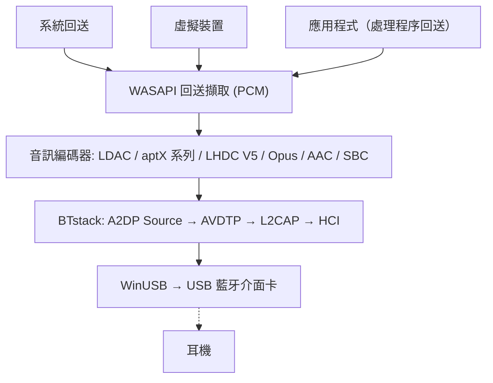

# BlueCaster

適用於 Windows、支援所有轉碼器的藍牙 A2DP 音訊串流工具。
{: .fs-6 .fw-300 }

使用處於 WinUSB 模式的 USB 藍牙介面卡，以 **LHDC V5、LDAC、aptX Adaptive、aptX HD、aptX、aptX Low Latency、AAC、SBC** 及（實驗性的）**Opus** 與 PipeWire 的 **Opus 05** 串流系統音訊 -- 不需要核心驅動程式，也不需要測試簽章。

[開始使用](setup){: .btn .btn-primary .fs-5 .mb-4 .mb-md-0 .mr-2 }
[GitHub](https://github.com/SeiyaFunaokaJP/BlueCaster){: .btn .fs-5 .mb-4 .mb-md-0 }

---

## 支援的轉碼器

| 轉碼器 | 位元率 | 取樣率 | 位元深度 | 延遲 |
|:------|:--------|:------------|:----------|:--------|
| LHDC V5 | 400/500/900/1000 kbps，ABR 160--400 kbps | 44.1/48/96/192 kHz | 16/24 bit | -- |
| LDAC | 330/660/990 kbps | 44.1--96 kHz | 16/24/32 bit | 約 200 ms |
| aptX Adaptive | 265--427 kbps（96 kHz：255--646） | 48/96 kHz | 24 bit | -- |
| Opus 🧪 | 128/192/256 kbps | 48 kHz | 16 bit | -- |
| aptX HD 🧪 | 576 kbps | 44.1/48 kHz | 24 bit | 約 150 ms |
| aptX | 352/384 kbps | 44.1/48 kHz | 16 bit | -- |
| aptX Low Latency 🧪 | 352 kbps | 44.1/48 kHz | 16 bit | 約 32 ms |
| AAC | 128/192/256 kbps | 44.1/48 kHz | 16 bit | 約 150 ms |
| SBC XQ | 約 385/505/552 kbps | 44.1/48 kHz | 16 bit | 約 150 ms |
| SBC | 最高約 345 kbps | 44.1/48 kHz | 16 bit | 約 150 ms |
| FastStream 🧪 | 198/216 kbps | 44.1/48 kHz | 16 bit | -- |
| Opus 05 🧪 | 128/192/256 kbps | 48 kHz | 16 bit | -- |
| LC3（LE Audio） 🧪 | 每聲道 32--124 kbps | 16/24/32/48 kHz | 16 bit | 約 140 ms |
| LC3 低延遲（LE Audio GMAP） 🧪 | 每聲道 64--96 kbps | 32/48 kHz | 16 bit | 約 30 ms |

### 各平台的轉碼器支援（傳送到耳機）

| 轉碼器 | Windows 10 內建 | Windows 11 內建 | Ubuntu 內建 (PipeWire) | **BlueCaster** (Windows 10 / 11) |
|:------|:-------------------:|:-------------------:|:--------------------------:|:----------------------------:|
| LHDC V5 | ❌ | ❌ | ❌ | ✅ |
| LDAC | ❌ | ❌ | ✅ | ✅ |
| aptX Adaptive | ❌ | ❌ | ❌ | ✅ |
| Opus（Android 的 A2DP Opus） | ❌ | ❌ | ✅ PipeWire 1.2+（`opus_g`）；Ubuntu 24.04（PipeWire 1.0.5）中沒有 | 🧪 實驗性 |
| aptX HD | ❌ | ❌ | ✅ | 🧪 實驗性 |
| aptX | ✅ | ✅ | ✅ | ✅ |
| aptX Low Latency | ❌ | ❌ | ✅ | 🧪 實驗性 |
| AAC | ❌ | ✅ | ❌ 不在 Ubuntu 的套件中 | ✅ |
| SBC XQ | ❌ | ❌ | ✅ | ✅（SBC 允許雙聲道且 bitpool ≥ 29 的接收端） |
| SBC | ✅ | ✅ | ✅ | ✅ |
| FastStream | ❌ | ❌ | ✅ | 🧪 實驗性（僅限音樂，需明確選擇） |
| Opus 05（PipeWire 自有的 Opus） | ❌ | ❌ | ✅ PipeWire 0.3.57+（`opus_05`，僅限 PipeWire 裝置） | 🧪 實驗性（需明確選擇） |
| LC3（LE Audio，BAP 單播） | ❌ | ✅ 僅限藍牙硬體與驅動程式支援 LE Audio 的 PC | ✅ PipeWire BAP `lc3`（BlueZ LE Audio） | 🧪 實驗性（裝置的 LE Audio 項目；電競耳機使用 GMAP 低延遲；需要支援 ISO 的 Bluetooth 5.2 介面卡，[使用方式](usage#le-audio)） |

✅ 支援 · 🧪 實驗性 · ❌ 不支援。所有欄位皆為傳送端（PC → 耳機）。「內建」指不使用 BlueCaster 時作業系統本身的藍牙音訊；Ubuntu 欄位為 Ubuntu 26.04 的 PipeWire 轉碼器組合（`libspa-0.2-bluetooth`）。

{: .warning }
**aptX HD 與 aptX Low Latency 為實驗性功能。** 兩者依照 Android / PipeWire 的實作，並通過編碼/解碼往返測試，但尚未在實際耳機上驗證。此表中的延遲值為典型數值，並非以 BlueCaster 實測。

{: .warning }
**關於 LHDC V5。** 它使用 Google 加入 Android 17 的 LHDC V5 編碼器（AOSP，Apache-2.0）的 C 語言移植版；此移植版已與 AOSP 的 Rust 編碼器比對驗證為位元完全一致，A2DP 訊號則依照 Android 的 `a2dp_vendor_lhdcv5`。已有使用者在 v1.1.1-beta.1 上以實際的 LHDC V5 耳機驗證，可在 1000 kbps / 192 kHz 下運作（[#50](https://github.com/SeiyaFunaokaJP/BlueCaster/issues/50)）；v2 使用相同的編碼器。僅支援有損的 LHDC V5：LHDC V2/V3（較舊的耳機）與無損的「LHDC-RAW」模式沒有開放原始碼的編碼器。在「自動」模式下，LHDC V5 的優先順序低於 LDAC 與 aptX 系列，高於 AAC / SBC。

{: .warning }
**Opus 為實驗性功能。** 這是 Android 的 A2DP Opus 廠商轉碼器（Android 13 以上，廠商 ID 0x000000E0 Google）：48 kHz、20 ms 訊框，依 Android 的要求以 256 kbps 立體聲傳送（標準 192 kbps、行動 128 kbps），使用 libopus 1.5.2 編碼。它通過了針對虛擬接收端的端對端測試，但尚未在實際的 Opus 耳機上驗證。在「自動」模式下，其優先順序低於 LHDC V5，高於 AAC / SBC。

{: .warning }
**Opus 05 為實驗性功能，尚未在實際裝置上驗證。** 這是 PipeWire 自有的 A2DP Opus 廠商轉碼器（廠商 ID 0x000005F1，轉碼器 0x1005；PipeWire 的 `opus_05`），只有 PipeWire 實作了它，因此接收端必須是以 PipeWire 作為 A2DP 接收端的 PC。BlueCaster 只傳送立體聲音樂方向（沒有 5.1 / 7.1，也沒有回傳通道）：48 kHz、10 ms 訊框（接收端只支援 20 ms 時用 20 ms），編碼器與位元率和 Opus 相同，並限制在接收端的上限以內。「自動」不會選擇它；請在 **編解碼器** 畫面或用 `-c opus05` 選擇。它已通過針對提供 PipeWire 能力的虛擬接收端的端對端測試，但尚未在實際的 PipeWire 接收端上試過。作為 A2DP 接收端的 PipeWire 自 0.3.57 起可解碼 Opus 05，自 1.2.0 起可解碼 Android 的 Opus（`opus_g`）：Ubuntu 24.04 LTS 內附 PipeWire 1.0.5（僅 Opus 05），Ubuntu 25.10（1.4.7）與 26.04 LTS（1.6.2）兩者皆有；兩者都尚未用 BlueCaster 驗證。

{: .warning }
**SBC XQ** 已用 Sony WH-1000XM4 驗證（雙聲道，48 kHz 下 bitpool 43，552 kbps）。拒絕該設定的接收端會改用一般 SBC 重新連線。**FastStream 為實驗性功能：**它已通過針對虛擬接收端的端對端測試，但尚未用實際的 FastStream 耳機試過。僅支援音樂方向；「自動」不會選擇它。

{: .note }
**只需要傳統 aptX？** Windows 10 的內建藍牙堆疊已支援傳統 aptX（不含 aptX HD、aptX LL 或 aptX Adaptive），因此不需要 BlueCaster。BlueCaster 主要適用於 LDAC、aptX HD 與 aptX Low Latency。

{: .note }
**關於 aptX Adaptive。** 它使用 [AKS-Logic/aptx-adaptive-linux](https://github.com/AKS-Logic/aptx-adaptive-linux) 以純 Rust 撰寫、採用 MIT 授權的編碼器編碼，其表格由作者從 Qualcomm 的出貨二進位檔與空中擷取資料重建而來。48 kHz 立體聲（要求 44.1 kHz 時會以 48 kHz 擷取）、24 位元：搭配 R1 接收端時為高 427 kbps、標準 364、行動 318 與低延遲 265 kbps（R2 接收端有各自的表格），高品質時可使用 ABR。在其設定中選擇 96 kHz 且耳機為列出 96 kHz 的 R2 接收端時使用 96 kHz（高 646 kbps、標準 340、行動 255）；低延遲時不使用，其他情況為 48 kHz。96 kHz 也已以實際耳機確認（[#86](https://github.com/SeiyaFunaokaJP/BlueCaster/issues/86)）；「自動」為 48 kHz。「自動」會在 LHDC V5 與 LDAC 之後選擇它；也可以在 **編解碼器** 畫面或用 `-c aptxad` 選擇。有使用者在 2.0.2-beta.6 上以 EarFun Air Pro 4+ 確認 48 kHz 可正常運作，與傳統 aptX 一樣穩定（[#86](https://github.com/SeiyaFunaokaJP/BlueCaster/issues/86)）；上游回報在 Linux 上搭配 Bose QuietComfort Ultra（第 1 代）與 B&W Px7 S2e 可正常運作。請參閱 [aptX 系列與 aptX Adaptive](usage#aptx-compatibility)。

## 平台支援 {#platform-support}

| 元件 | Windows 10 (x64 / ARM64) | Windows 11 (x64 / ARM64) | Linux (Ubuntu) |
|:----------|:----------------:|:----------------:|:--------------:|
| **BlueCaster**（視窗、系統匣、CLI） | ✅（尚未在實機上試過） | ✅ | ❌ |
| [從原始碼建置](../building)（Rust、Visual Studio 2022 以上、Node.js） | ✅ | ✅ | ❌ |
| `bluecaster_decode`（串流檢查工具） | ✅ | ✅ | ❌ |
| 端對端測試 `tools/emu/run_test.py` | ✅ | ✅ | ❌ |
| 虛擬介面卡 `tools/emu/emu_vhci.py` | ❌ | ❌ | ✅ |
| [測量用接收器](usage#receiver) `tools/linux_sink` | ❌ | ❌ | ✅ |

BlueCaster 本身僅能在 Windows（Windows 10 22H2 或 Windows 11）上以 x64 與 ARM64 版本執行。Linux 工具需要 Python 3.11 以上（已在 Ubuntu 26.04 驗證）；`setup.sh` 以 Ubuntu / Debian 為對象，其他發行版需手動安裝套件。

## 已驗證的硬體 {#verified-hardware}

已在 TP-Link UB500、通用 RTL8761B、筆電內建的 RTL8852BE、ASUS BT400 與 CSR8510 介面卡上，以 Sony WH-1000XM4 與 WH-1000XM6、EarFun Air Pro 4+、Grado GW100x 等確認。包含編解碼器、版本與相關回報的完整清單：**[已驗證的硬體](../hardware)**（英文）。

## 搭配使用的工具

在 issue 中回報可與 BlueCaster 搭配使用的第三方應用程式，例如耳機控制 App（並非 BlueCaster 製作或支援）：**[Works With](../works-with)**（英文）。

## 音訊擷取模式

BlueCaster 透過 WASAPI 擷取音訊，提供三種模式：

| 模式 | 說明 | 使用情境 |
|:-----|:------------|:---------|
| **系統回送** | 透過 WASAPI 回送，擷取預設播放裝置的所有系統音訊輸出 | 設定簡單 -- 串流所有聲音 |
| **虛擬裝置** | 從使用者選取的虛擬音訊裝置（例如 VB-CABLE、VoiceMeeter）擷取 | 將特定應用程式導向藍牙，其他音訊仍從喇叭播放 |
| **應用程式** | 僅擷取單一應用程式播放的內容（經該應用程式本身處理後）（Windows 11 / Windows 10 2004 以上） | 傳送單一應用程式，或系統層級效果應用程式（等化器、音效增強器）的輸出 |

在 **虛擬裝置** 模式下，BlueCaster 可以將 Windows 預設播放裝置切換為所選的虛擬裝置（**連線時設為 Windows 預設輸出**），再擷取其回送輸出。輸出到該虛擬裝置的應用程式會透過藍牙串流。停止串流時，會還原先前的預設裝置。

系統回送不會把音訊從預設播放裝置上移走：音訊會同時在該裝置與藍牙上播放。請參閱 [擷取模式](usage#capture-modes)。

## 運作方式

BlueCaster 完全繞過 Windows 藍牙堆疊。它透過 WinUSB 直接與 USB 藍牙介面卡通訊，並使用 [BTstack](https://github.com/bluekitchen/btstack) 在使用者模式下實作完整的藍牙通訊協定堆疊。音訊由一個常駐的小程式（`bluecaster-core.exe`，附系統匣圖示）負責串流；視窗只顯示其狀態，因此關閉視窗並不會停止音訊（請參閱 [架構](../architecture)）。

## 功能

- **多轉碼器**：LHDC V5、LDAC、aptX Adaptive、aptX HD、aptX、aptX Low Latency、AAC、SBC 及（實驗性的）Opus / Opus 05，自動協商
- **LE Audio（實驗性）**：以 LC3 傳送到 LE Audio 耳機（BAP 單播、一對耳機的左右兩耳、耳機音量、媒體按鍵、GMAP 低延遲）。需要支援 Bluetooth 5.2 等時通道的介面卡；只在藍牙模擬器上測試過，尚未在實際的 LE Audio 耳機上確認（請參閱[使用方式](usage#le-audio)）
- **三種擷取模式**：系統回送、虛擬音訊裝置路由，或單一應用程式的輸出
- **視窗、系統匣與 CLI**：用於設定與診斷的視窗、日常連線用的系統匣快顯視窗與選單，以及命令列（請參閱 [使用方式](usage)）
- **應用程式內的 WinUSB 設定**：為介面卡指派 WinUSB 驅動程式，並可還原原本的驅動程式，不需要 Zadig（請參閱 [安裝設定](setup#winusb)）
- **首次執行設定**：介面卡、驅動程式與韌體、耳機、首次連線
- **ABR**：針對不穩定連線的自適應位元率（LDAC、LHDC V5 與 aptX Adaptive）
- **自動重新連線**：斷線時重新連線（最多 10 次），PC 從睡眠中恢復後也會重新連線
- **連線品質與 AFH**：顯示傳送的內容、RSSI 與使用中的通道；告知介面卡應避開哪些 Wi-Fi 通道（請參閱 [使用方式](usage#link-quality)）
- **耳機控制 (AVRCP)**：與耳機及 Windows 音量同步的音量滑桿；耳機的播放/暫停、下一首與上一首按鈕可控制 PC 上的播放（請參閱 [使用方式](usage#headphone-buttons)）
- **依裝置設定**：每個音訊裝置各有轉碼器（含其自身設定）與輸出來源，在首頁並排顯示，可從系統匣連線
- **更新**：已安裝的版本會在音訊裝置中斷連線後自行更新（請參閱 [使用方式](usage#updates)）
- **多語系**：英文、日文、簡體中文、繁體中文、韓文、德文、法文、西班牙文
- **Realtek 韌體**：Realtek 介面卡的韌體下載引導
- **診斷**：連線流程、記錄、HCI 擷取、用於錯誤回報的診斷資訊、與 Linux PC 進行對端接收器測試（請參閱 [使用方式](usage#receiver)）
